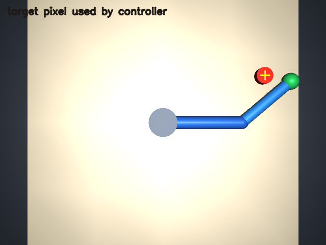
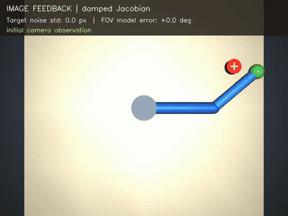
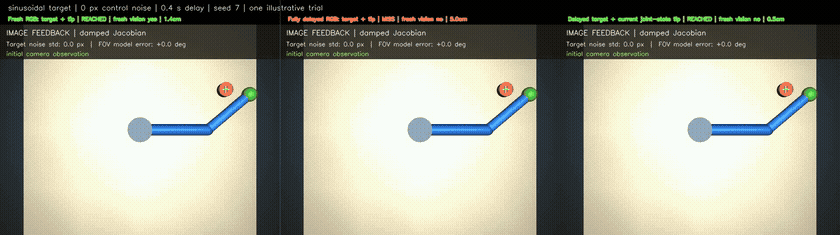
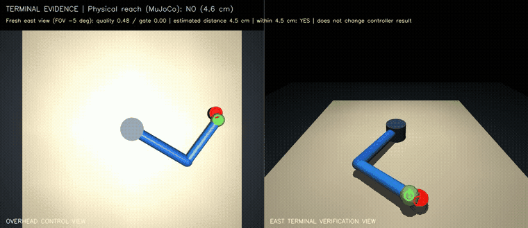
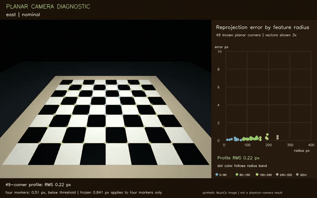
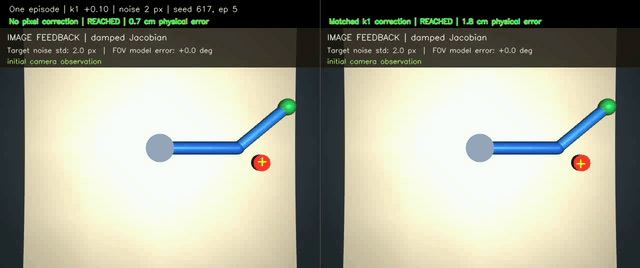
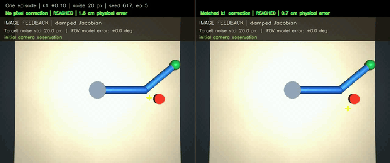
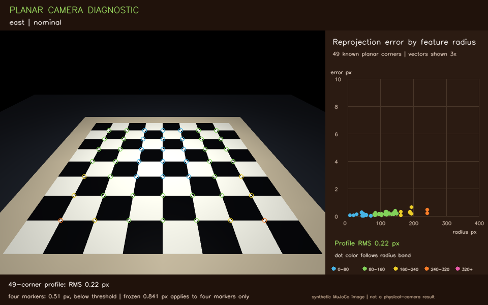
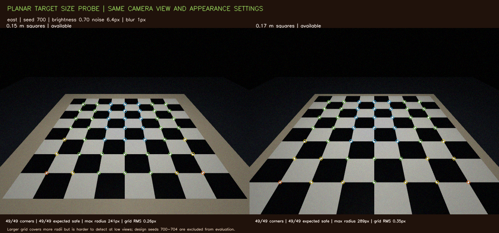
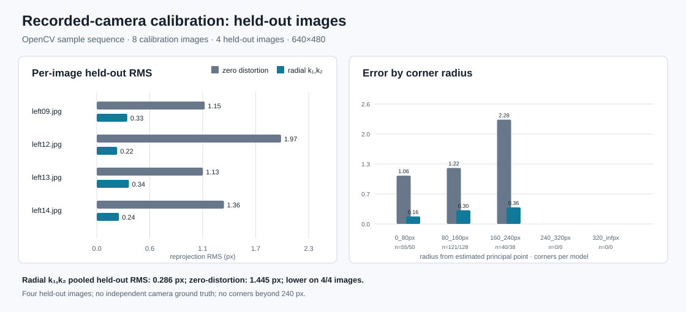

# Camera-based reaching in MuJoCo

A small robotics demo with a clear perception-to-action loop:

1. MuJoCo renders an overhead RGB camera view of a tabletop and a red target.
2. OpenCV detects the target centroid from pixels.
3. A pinhole camera model projects that pixel onto the table.
4. Two-link inverse kinematics turns the estimated point into joint targets.
5. MuJoCo runs the arm, and ground truth is used only to score the final error.



[Watch the clean open-loop baseline](assets/reaching_demo.mp4)

[Read the illustrated project explainer PDF](output/pdf/visual-servo-mujoco-project-explainer.pdf)

## GitHub demo previews

These compact GIFs animate directly in the README. Click one to open its full
MP4 file. The detailed gallery below links the remaining examples and the
reproduction commands.

| Closed-loop reaching | Delayed vision and current arm state |
| --- | --- |
| [](assets/demos/feedback_clean.mp4) | [](assets/demos/sensor_timing_sinusoidal_noise-0px_delay-1.mp4) |
| Held-out terminal visual estimate | Dense planar camera calibration |
| [](assets/demos/terminal_verification_quality_heldout_false_success.mp4) | [](assets/demos/camera_calibration_planar.mp4) |
| Radial correction at 2 px noise | Noise and distortion sweep |
| [](assets/demos/radial_distortion_correction.mp4) | [](assets/demos/radial_distortion_noise_benchmark.svg) |
| High-noise correction example | Aggregate scorecard |
| [](assets/demos/radial_distortion_correction_20px.mp4) | [](assets/demos/radial_distortion_noise_benchmark.svg) |

## Trial results at a glance

The robotics trial results below come from controlled MuJoCo/OpenCV simulation.
Physical reaching success means the final MuJoCo end-effector position is
within 4.5 cm of the target. Fresh visual confirmation is tracked separately;
it is not inferred from physical proximity. The recorded-camera calibration
row uses OpenCV's separate public image sequence and does not measure reaching.

| Experiment | Trial design | Measured result |
| --- | --- | --- |
| Default image-feedback controller | 100 trials per condition | At 20 px target-measurement noise: 88% physical success, 2.12 cm median error, 6.39 cm 95th-percentile error. High-noise failures remain. |
| Camera-delay and tip-state comparison | Held-out seeds 100–104; 100 trials per mode and setting | Delayed target pixels paired with a current joint-state tip projection improved physical success over fully delayed RGB in all eight nonzero-delay profile/noise settings. Fresh visual confirmations were 0/100 at nonzero delay. |
| Terminal-verifier quality gate | Calibration seeds 200–204; validation seeds 300–304 | Frozen 0.60 gate: 0 false visual successes among 23 accepted candidate estimates, but only 23/600 (3.8%) candidate coverage. All accepted estimates were from bright-exposure images; no threshold is recommended. |
| Reversal-aware target prediction | 2,400 paired trials across eight path/delay/noise settings | Reversal-aware prediction had lower physical success than the measured-target baseline in every setting. Predictors remain opt-in. |
| Dense planar calibration profile | 325 synthetic image trials: five views × 13 conditions × five appearance seeds | For East-view radial coefficient `k1=+0.010`, median signed radial residual was −0.05 px at 0–80 px radius and +0.86 px at 240–320 px. This is a synthetic image diagnostic, not a physical-camera result. |
| Recorded-camera calibration check | 8 OpenCV sample images fit; 4 held out at 640×480 | On the four held-out images, fitting radial `k1,k2` reduced pooled reprojection RMS from 1.445 px to 0.286 px. This is one public camera sequence, not robot or project-camera evidence; no held-out corners were beyond 240 px radius. |

## End-to-end radial-distortion stress test

The preceding recorded-camera check asks whether a radial model fits checkerboard
image points. This separate MuJoCo experiment asks whether applying that kind of
pixel correction improves reaching. It applies Brown–Conrady radial `k1` distortion
to every rendered overhead RGB frame, then optionally corrects the detected target
and camera-observed arm-tip pixels before control. It compares open-loop projection
and image feedback under the same targets and 2 px measurement-noise seeds.

| Controller | Actual camera `k1` | Pixel correction | Physical success | Median / P95 reach error | Paired median error change vs. no correction |
| --- | ---: | --- | ---: | ---: | ---: |
| Open loop | +0.10 | none | 100/100 | 1.48 / 2.59 cm | — |
| Open loop | +0.10 | exact injected coefficient | 100/100 | 1.10 / 2.27 cm | −0.35 cm; lower error in 96/100 pairs |
| Open loop | −0.10 | none | 100/100 | 0.84 / 2.31 cm | — |
| Open loop | −0.10 | exact injected coefficient | 100/100 | 1.09 / 2.29 cm | +0.16 cm; lower error in 28/100 pairs |
| Image feedback | +0.10 | none | 100/100 | 0.73 / 1.69 cm | — |
| Image feedback | +0.10 | exact injected coefficient | 100/100 | 0.78 / 1.39 cm | +0.05 cm; lower error in 44/100 pairs |
| Image feedback | −0.10 | none | 100/100 | 0.75 / 1.47 cm | — |
| Image feedback | −0.10 | exact injected coefficient | 100/100 | 0.68 / 1.26 cm | −0.09 cm; lower error in 62/100 pairs |


[Watch the paired image-feedback demo](assets/demos/radial_distortion_correction.mp4) ·
[See all 1,400 trial rows](results/radial-distortion-trials.csv)

All conditions achieved the 4.5 cm **physical MuJoCo reaching** threshold, so
success rate does not separate them; the error distribution does. Exact correction
helps open-loop reaching under positive `k1` but hurts under negative `k1` with
this injected pixel noise. In image feedback, the shared target/tip distortion
largely cancels in the relative-pixel loop, and correction has small, mixed effects.
The result supports keeping correction opt-in rather than enabling it by default.
The `±0.10` coefficients are simulation stress values, not measured lens
parameters. Exact matching is an oracle geometry check, not evidence that a
calibration estimator could recover the coefficient. Targets are stationary;
camera delay is zero; no predictor or current-joint-state tip projection is used.
Fresh visual confirmation is not evaluated by this benchmark.

Reproduce the paired benchmark and demo with:

```bash
uv run visual-servo-distortion-benchmark --output artifacts/radial-distortion-benchmark.json
uv run python scripts/generate_radial_distortion_demo.py
ffmpeg -i assets/demos/radial_distortion_correction.mp4 -vf "fps=8,scale=640:-1:flags=lanczos" \
  assets/demos/previews/radial_distortion_correction.gif
```

The benchmark writes its full per-observation report to the ignored `artifacts/`
directory, plus the compact CSV and SVG shown above. The MP4/GIF are illustrative
paired episodes; the 1,400-row CSV is the aggregate evidence.

### Noise-interaction follow-up

The 2 px run is a mild-noise geometry check and has no physical misses. This
follow-up uses a separate seed block (700–704) and repeats all seven distortion
and correction settings at 2, 8, and 20 px noise: 4,200 trials total, paired by
target and noise seeds.
The 20 px level targets the controller's measured high-noise weakness. At zero
distortion, this seed block reached 31/100 with open loop and 80/100 with image
feedback; the earlier 88/100 result used a different seed block.

| Controller | Actual `k1` | No correction: success, median / P95 | Exact correction: success, median / P95 | Paired successes recovered / lost |
| --- | ---: | --- | --- | ---: |
| Open loop | −0.10 | 28/100, 6.46 / 13.98 cm | 29/100, 6.65 / 13.94 cm | 3 / 2 |
| Open loop | +0.10 | 31/100, 6.39 / 13.81 cm | 33/100, 6.39 / 13.86 cm | 2 / 0 |
| Image feedback | −0.10 | 81/100, 2.67 / 6.18 cm | 79/100, 2.78 / 6.26 cm | 6 / 8 |
| Image feedback | +0.10 | 83/100, 2.75 / 6.35 cm | 82/100, 2.29 / 6.86 cm | 7 / 8 |


The high-noise changes are small and mixed. Exact correction netted one or two
more successes in open loop (3 recovered / 2 lost at negative `k1`, 2 / 0 at
positive `k1`), while feedback lost one or two net successes. At positive
`k1`, feedback's median improved but its P95 worsened by 0.51 cm. These results
do not support making correction a default or claiming it fixes the 20 px
failure mode. The independent 2 px run and all 4,200 noise-sweep outcomes are
available in [the original CSV](results/radial-distortion-trials.csv) and
[the noise-sweep CSV](results/radial-distortion-noise-trials.csv).
The random generators restart from matching seeds, but feedback conditions can
take different numbers of observations, so matching seed/episode IDs do not
guarantee identical noise draws at the same simulated times.

Targets remain stationary, camera delay is zero, and no predictor or
current-joint-state tip projection is used. Success is physical MuJoCo distance
within 4.5 cm. Fresh visual confirmation is not measured. The exact coefficient
is an oracle correction, and the injected `±0.10` values are stress settings,
not estimates of this project's camera.

For the noise sweep and a paired 20 px example video:

```bash
uv run visual-servo-distortion-benchmark --base-seed 700 --noise-levels 2 8 20 \
  --output artifacts/radial-distortion-noise-benchmark.json \
  --csv results/radial-distortion-noise-trials.csv \
  --figure assets/demos/radial_distortion_noise_benchmark.svg
uv run python scripts/generate_radial_distortion_demo.py \
  --pixel-noise-std-px 20 \
  --output assets/demos/radial_distortion_correction_20px.mp4
ffmpeg -i assets/demos/radial_distortion_correction_20px.mp4 \
  -vf "fps=8,scale=640:-1:flags=lanczos" \
  assets/demos/previews/radial_distortion_correction_20px.gif
```

The [paired 20 px clip](assets/demos/radial_distortion_correction_20px.mp4) is
one illustrative seed/episode, not aggregate evidence.

The full condition tables, failure definitions, limitations, and commands to
reproduce each run appear in the sections below. The checked-in
[1,800-row trial CSV](results/robustness-baseline-trials.csv) contains one
compact outcome row per controller, condition, seed, and episode, including
the ground-truth target and final arm coordinates used for physical scoring.
At about 351 KiB, it is small enough for GitHub's searchable interactive CSV
view. It omits verbose per-observation traces; those remain in the local
`artifacts/benchmark.json` output.

Regenerate the benchmark and CSV with:

```bash
uv run visual-servo-benchmark --seeds 5 --episodes-per-seed 20
uv run python scripts/export_public_trial_data.py
```

The CSV reports physical reaching outcomes and visibility diagnostics. It does
not claim fresh visual confirmation; the camera-timing reports below measure
that outcome separately.

The MuJoCo scene and target positions are generated locally. The robotics
benchmarks require no external simulator assets, robot datasets, or pretrained
models. The optional recorded-camera check downloads checksum-pinned OpenCV
sample images into the ignored `artifacts/` directory; source photos are not
copied into this repository.

## Run

```bash
uv venv --python 3.12
uv pip install -e '.[dev]'
uv run pytest
uv run visual-servo-demo --episodes 20 --seed 7
uv run visual-servo-demo --controller image_feedback --episodes 20 --seed 7
uv run visual-servo-benchmark --seeds 5 --episodes-per-seed 20
uv run visual-servo-benchmark --feedback-target-filter-window 5 --output artifacts/filter-window-5.json
uv run visual-servo-benchmark --feedback-required-tolerance-checks 2 --output artifacts/two-check-stop.json
uv run visual-servo-benchmark --feedback-max-joint-step-radians 0.25 --output artifacts/step-cap-025.json
uv run visual-servo-benchmark --feedback-allow-stale-target-confirmation \
  --output artifacts/benchmark-stale-confirmation.json
uv run visual-servo-dynamic-benchmark --output artifacts/dynamic-target-benchmark.json
uv run visual-servo-prediction-benchmark --output artifacts/prediction-benchmark.json
uv run visual-servo-reversal-benchmark --output artifacts/reversal-benchmark.json
uv run visual-servo-sensor-timing-benchmark --output artifacts/sensor-timing-benchmark.json
uv run visual-servo-sensor-timing-benchmark --base-seed 100 \
  --output artifacts/sensor-timing-benchmark-heldout.json
uv run visual-servo-verification-benchmark --output artifacts/verification-view-benchmark.json
uv run visual-servo-verification-benchmark --base-seed 100 \
  --output artifacts/verification-view-benchmark-heldout.json
```

The command writes `artifacts/results.json`, `artifacts/camera_view.png`, and
`artifacts/reaching_demo.mp4` (when the local OpenCV build supports MP4 output).
The JSON records every target's camera pixel, estimated table position, final
end-effector error, and success. Ground-truth target coordinates are included
only for evaluation; the controller estimates the target from the rendered
image.

## Video demos

The gallery includes paired controller examples, noisy and miscalibrated
runs, a transparent failure case, filter-window and stale-target comparisons,
two target-dropout cases, and moving-target camera-latency comparisons.
Single-view clips are rendered at 640×480 and 30 fps; side-by-side videos label
each condition, outcome, and error. The eight sensor-timing videos cover every
profile/noise/delay row, and the two verification videos show current-time
overhead and oblique views. The terminal-verification clips demonstrate the
new opt-in east-view check after the controller has stopped.

| Demo | What it shows |
| --- | --- |
| [Clean open loop](assets/demos/open_loop_clean.mp4) | One target projection followed by one IK motion command. |
| [Clean image feedback](assets/demos/feedback_clean.mp4) | Repeated pixel-error corrections with no injected sensor error. |
| [20 px target noise](assets/demos/feedback_noise_20px.mp4) | Image feedback reaching under strong Gaussian pixel noise. |
| [Noise and +5° FOV error](assets/demos/feedback_noise_and_fov_error.mp4) | Feedback with both sensor noise and a camera-model calibration error. |
| [High-noise failure](assets/demos/feedback_high_noise_failure.mp4) | A recorded benchmark failure that reaches the motion-update limit. |
| [3 vs. 5 observation filter](assets/demos/feedback_filter_window_comparison.mp4) | Same seed and noise: three samples miss by 4.8 cm; five samples reach 0.1 cm. One illustrative trial, not an aggregate result. |
| [Target dropout and recovery](assets/demos/feedback_target_dropout_recovery.mp4) | Target detection is suppressed for three feedback observations; the arm reuses its last target estimate, then reacquires vision. |
| [Target dropout timeout](assets/demos/feedback_target_dropout_timeout.mp4) | A six-observation blackout exceeds the five-observation grace period, so visual confirmation stops safely. |
| [Strict vs. stale-target stop](assets/demos/feedback_stale_confirmation_comparison.mp4) | Same target and camera sequence; strict mode stops on target loss, while the experimental rule confirms arrival from recent target history. |
| [Moving target and camera delay](assets/demos/feedback_moving_target_latency.mp4) | Same seed and sinusoidal target: live feedback reaches within 1.4 cm, while a one-observation (0.4 s) delay misses by 4.95 cm. One illustrative trial. |
| [Delayed-target prediction](assets/demos/feedback_target_prediction.mp4) | Same delayed target stream and arm state with measured, constant-velocity, and constant-acceleration estimates. One illustrative trial. |
| [Sinusoidal reversal comparison](assets/demos/feedback_prediction_sinusoidal_reversal.mp4) | Measured target, constant velocity, and reversal-aware estimates with 0.4 s delay and 2 px noise. One illustrative trial. |
| [Piecewise-linear reversal comparison](assets/demos/feedback_prediction_piecewise_linear_reversal.mp4) | The same comparison on a piecewise-linear path. One illustrative trial. |
| [Clean terminal verification view](assets/demos/verification_view_clean.mp4) | Synchronized fresh renders show the target hidden in the overhead control view and visible with the end-effector from an east oblique view. |
| [20 px-noise terminal verification view](assets/demos/verification_view_20px-noise.mp4) | The same two current-time views after a noisy control run. The oblique view is observational and does not alter the controller. |
| [Opt-in terminal estimate, clean](assets/demos/terminal_verification_clean.mp4) | A fresh east-view render after control stops; reports its pixel-based distance beside the separate MuJoCo physical reach score. |
| [Opt-in terminal estimate, 20 px control noise](assets/demos/terminal_verification_20px-noise.mp4) | The controller sees 20 px target-measurement noise; the terminal verifier uses a fresh clean simulator render and remains outside the control loop. |

The held-out verifier stress suite has one illustrative clip per injected
condition. Calibration offsets affect only the verifier's back-projection;
exposure and marker occlusion affect only its terminal image. Each clip uses
seed 7 and is an example, not an aggregate benchmark result.

| Verifier condition | Demo |
| --- | --- |
| FOV estimate +5° | [Watch](assets/demos/terminal_verification_stress_fovy_plus_5deg.mp4) |
| FOV estimate −5° | [Watch](assets/demos/terminal_verification_stress_fovy_minus_5deg.mp4) |
| Estimated camera world X +2 cm | [Watch](assets/demos/terminal_verification_stress_camera_x_plus_2cm.mp4) |
| Estimated camera yaw +3° | [Watch](assets/demos/terminal_verification_stress_camera_yaw_plus_3deg.mp4) |
| Uniform image exposure ×0.25 | [Watch](assets/demos/terminal_verification_stress_dim_exposure_x0_25.mp4) |
| Uniform image exposure ×1.5 | [Watch](assets/demos/terminal_verification_stress_bright_exposure_x1_5.mp4) |
| Target marker occluded | [Watch](assets/demos/terminal_verification_stress_target_occluded.mp4) |
| End-effector marker occluded | [Watch](assets/demos/terminal_verification_stress_end_effector_occluded.mp4) |

The quality-gate pair shows a held-out false-success case at a −5° FOV
estimate. A 0.50 gate withholds the image result while preserving the same
physical reach outcome. It is one selected example, not an aggregate result.

| Demo | What it shows |
| --- | --- |
| [False visual success, quality 0.47](assets/demos/terminal_verification_quality_false_positive.mp4) | The camera estimate is within 4.5 cm while MuJoCo says the arm missed. |
| [Quality gate abstains](assets/demos/terminal_verification_quality_abstention.mp4) | The same seed, target, and arm pose with a 0.50 gate; the visual result is unavailable. |

The seed-separated run selected a 0.60 gate on seeds 200–204, then evaluated
that unchanged threshold on seeds 300–304. These clips show seed 302, episode
17, from the independent validation split. The image estimate is 4.494 cm, but
the physical reaching error is 4.6 cm:

| Held-out validation demo | What it shows |
| --- | --- |
| [Ungated false visual success](assets/demos/terminal_verification_quality_heldout_false_success.mp4) | The verifier reports within 4.5 cm without a quality gate. |
| [Frozen gate abstains](assets/demos/terminal_verification_quality_heldout_abstention.mp4) | The same target and physical result; the 0.60 gate withholds the estimate. |

The fixed-landmark demo compares nominal camera calibration with a combined
renderer-side FOV, position, and yaw shift. White crosses show nominal
projections, green rings show detected landmark centers, and connecting lines
show image residuals:

| Demo | What it shows |
| --- | --- |
| [Fixed-landmark calibration health](assets/demos/camera_calibration_health.mp4) | Four independent tabletop landmarks remain within 0.51 px RMS nominally and move to 32.02 px RMS under the combined rendered camera shift. |
| [Frozen threshold validation](assets/demos/camera_calibration_validation.mp4) | Same held-out nominal image under two frozen thresholds, then examples of subtle/severe drift and unavailable dim imagery. |
| [Pose and lens transfer](assets/demos/camera_calibration_transfer.mp4) | Applies the frozen East-view threshold to changed camera poses, image-edge clipping, positive/negative radial warps, and held-out shifts. |
| [Planar feature-radius diagnostic](assets/demos/camera_calibration_planar.mp4) | A 49-corner tabletop target across five views and radial warps; overlays show reprojection vectors and error by feature radius beside the paired legacy four-marker result. |
| [Planar target-size design probe](assets/demos/camera_calibration_planar_target_design.mp4) | Side-by-side 0.15 m and 0.17 m checker squares under the same noisy image settings, showing the edge-coverage versus detector-availability tradeoff. |

The eight delayed-feedback conditions each have a three-panel demo (fresh RGB,
fully delayed RGB, and delayed target with current joint-state tip projection):

| Target path | Noise | Delay | Video |
| --- | ---: | ---: | --- |
| Sinusoidal | 0 px | 0.4 s | [Watch](assets/demos/sensor_timing_sinusoidal_noise-0px_delay-1.mp4) |
| Sinusoidal | 0 px | 0.8 s | [Watch](assets/demos/sensor_timing_sinusoidal_noise-0px_delay-2.mp4) |
| Sinusoidal | 2 px | 0.4 s | [Watch](assets/demos/sensor_timing_sinusoidal_noise-2px_delay-1.mp4) |
| Sinusoidal | 2 px | 0.8 s | [Watch](assets/demos/sensor_timing_sinusoidal_noise-2px_delay-2.mp4) |
| Piecewise linear | 0 px | 0.4 s | [Watch](assets/demos/sensor_timing_piecewise_linear_noise-0px_delay-1.mp4) |
| Piecewise linear | 0 px | 0.8 s | [Watch](assets/demos/sensor_timing_piecewise_linear_noise-0px_delay-2.mp4) |
| Piecewise linear | 2 px | 0.4 s | [Watch](assets/demos/sensor_timing_piecewise_linear_noise-2px_delay-1.mp4) |
| Piecewise linear | 2 px | 0.8 s | [Watch](assets/demos/sensor_timing_piecewise_linear_noise-2px_delay-2.mp4) |

Regenerate the gallery with:

```bash
uv run python scripts/generate_demo_gallery.py
uv run python scripts/generate_filter_comparison.py
uv run python scripts/generate_stale_confirmation_comparison.py
uv run python scripts/generate_latency_comparison.py
uv run python scripts/generate_prediction_comparison.py
uv run python scripts/generate_reversal_prediction_comparison.py
uv run python scripts/generate_sensor_timing_comparisons.py
uv run python scripts/generate_verification_view_demos.py
uv run python scripts/generate_terminal_verification_demos.py
uv run python scripts/generate_verification_stress_demos.py
uv run python scripts/generate_verification_quality_demos.py
uv run visual-servo-camera-calibration-health --output artifacts/camera-calibration-health.json
uv run python scripts/generate_camera_calibration_health_demo.py
uv run visual-servo-camera-calibration-validation --output artifacts/camera-calibration-health-validation.json
uv run python scripts/generate_camera_calibration_validation_demo.py
uv run visual-servo-camera-calibration-transfer --output artifacts/camera-calibration-transfer-validation.json
uv run python scripts/generate_camera_calibration_transfer_demo.py
uv run visual-servo-camera-calibration-planar --output artifacts/camera-calibration-planar-profile.json
uv run python scripts/generate_camera_calibration_planar_demo.py
uv run python scripts/generate_camera_calibration_planar_design_demo.py
uv run --extra pdf python scripts/generate_project_explainer.py
```

To record a specific episode from a seeded batch, select it with
`--video-episode-index`. For example, this saves seed 3, episode 5 from the
20 px-noise condition:

```bash
uv run visual-servo-demo --controller image_feedback --pixel-noise-std-px 20 \
  --episodes 20 --seed 3 --video-episode-index 5 \
  --output-dir artifacts/high-noise-case
```

The benchmark compares two controllers on identical seeded target sequences:
`open_loop` projects one target detection into table coordinates and solves
inverse kinematics; `image_feedback` repeatedly compares the red target and
green end-effector marker in the image and applies a bounded damped-Jacobian
joint update. It requires three consecutive image-space checks inside an 8 px
tolerance before stopping, or stops after 20 motion updates. If the target
detector temporarily loses the target, feedback can reuse its last measured
position for up to five observations. By default, a stale estimate may guide
motion but cannot confirm arrival; the controller requires fresh vision for
its consecutive-tolerance stop. The opt-in stale-target experiment tests a
different policy for this stationary-target scene. The controller estimates
the target center from up to three recent detections using a coordinate-wise
median, which suppresses isolated pixel outliers. Both controllers start from
the same joint pose.

Seven paired conditions test clean sensing, Gaussian target-pixel noise, and
camera field-of-view calibration errors. Four additional feedback-only
conditions suppress target detection for 1, 3, 5, or 6 observations. Pixel
noise is injected after target detection at each observation; the calibration
perturbation changes the controller's camera model, not the simulated camera.
Each standard controller/condition pair and each dropout condition has 100
trials across five seeds, for 1,800 trials total. The report
includes success rate, error percentiles, failure reasons, update counts,
simulated motion time, and per-seed/per-trial details in
`artifacts/benchmark.json`. Simulated motion time is robot-task time, not wall
clock runtime. Benchmark trials do not save videos. These controlled tests
isolate specific errors; they do not claim to reproduce real camera noise or
lighting.

Target dropout is software fault injection: the simulated scene and physics
continue normally, but selected camera observations are withheld from the red
target detector. During the gap, the arm reuses the last target location to
keep moving. The default policy suspends arrival confirmation until the
detector sees the target again; the separate stale-target option tests
confirmation from recent target history. The benchmark tests gaps up to the
five-observation grace limit and one longer gap that stops with
`target_not_visible`. Run a recovery example locally with:

```bash
uv run visual-servo-demo --controller image_feedback --seed 7 --episodes 1 \
  --target-dropout-start-observation 1 \
  --target-dropout-duration-observations 3 \
  --output-dir artifacts/dropout-recovery
```

Every image-feedback trial now records a visibility trace: whether the target
was detectable in the rendered image, whether the test deliberately suppressed
that observation, whether the controller used a target measurement, the pixel
error, and the number of completed motion updates. This distinguishes an
injected detector fault from a target that the arm itself hides.

On the included deterministic setup (`--episodes 20 --seed 7`), the current run
reached all 20 targets within 4.5 cm. Median end-effector error was 0.9 cm; the
largest was 3.04 cm. These are simulation results, not real-robot performance.

## Model and assumptions

- A top-down pinhole camera with no lens distortion.
- A known target height and camera field of view.
- A planar two-joint arm with position actuators.
- Color segmentation estimates the circle centers of a red target and green
  end-effector marker; it is deterministic and easy to inspect.
- The open-loop baseline localizes the target once before moving. The feedback
  controller observes the target and end effector again after each joint update.
  It filters only target detections. The separate prediction benchmark uses a
  current joint-state projection for the end effector while target pixels are
  delayed.
- If the arm briefly covers the target, image feedback reuses its last observed
  target position for up to five updates before stopping.

The feedback controller uses a local image Jacobian derived from the two-link
arm geometry and pinhole camera model. It therefore tests closed-loop correction
under calibration error, while still depending on a reasonable local camera and
arm model.

At each feedback update, the controller measures the pixel difference
`e = target_pixel - end_effector_pixel`. The Jacobian `J` predicts how those
pixels move when the two joint angles change. It computes
`Δq = 0.5 Jᵀ (J Jᵀ + I)⁻¹ e`, limits the joint change to 0.30 radians, advances
the simulation for 0.4 seconds, and measures again. The identity term keeps the
inverse stable near arm singularities. Ground-truth target position is read
only after the motion to score the trial.

### Code map

- `src/visual_servo_mujoco/model.py` defines the arm, tabletop, target, camera,
  and actuators as an inline MuJoCo scene.
- `src/visual_servo_mujoco/controller.py` contains the pixel projection, inverse
  and forward kinematics, image Jacobian, and damped joint update.
- `src/visual_servo_mujoco/run.py` implements color detection, both controllers,
  randomized trials, deterministic target-dropout injection, and per-trial
  scoring, including a per-observation target-visibility trace.
- `src/visual_servo_mujoco/benchmark.py` runs paired seeds across controllers
  and stress conditions, then writes the JSON summary.
- `scripts/generate_demo_gallery.py` regenerates the deterministic clips in
  `assets/demos/`, including a selected high-noise failure episode.
- `scripts/export_public_trial_data.py` exports compact per-trial outcomes from
  the paired robustness report to `results/robustness-baseline-trials.csv`.
- `scripts/generate_filter_comparison.py` creates the paired 3-vs-5 sample
  filter clip shown above.
- `scripts/generate_stale_confirmation_comparison.py` creates the strict-versus-
  experimental arrival-stop clip from one seeded target sequence.
- `src/visual_servo_mujoco/dynamic_benchmark.py` compares arrival policies under
  moving-target and camera-delay conditions.
- `scripts/generate_latency_comparison.py` renders a paired moving-target video
  with live and delayed camera feedback.
- `src/visual_servo_mujoco/prediction_benchmark.py` compares measured target
  positions with constant-velocity and constant-acceleration image estimates.
- `scripts/generate_prediction_comparison.py` renders the three-way delayed-
  target prediction demo.
- `src/visual_servo_mujoco/sensor_timing_benchmark.py` compares fully delayed
  RGB feedback with delayed target observations and current joint-state tip
  projection.
- `src/visual_servo_mujoco/verification_benchmark.py` tests four calibrated
  oblique views as independent terminal visual-evidence candidates; it does
  not change the controller or its stop decision.
- `src/visual_servo_mujoco/terminal_verification.py` defines calibrated oblique
  camera poses and pixel-ray back-projection to known marker heights, with
  estimator-only camera calibration and image stress hooks.
- `src/visual_servo_mujoco/verification_robustness_benchmark.py` pairs held-out
  controller trials across nine terminal-verifier conditions and reports
  per-marker image features, estimate availability, false/missed decisions,
  and distance error.
- `src/visual_servo_mujoco/verification_quality_validation.py` selects an
  abstention threshold on disjoint calibration seeds, freezes it, and measures
  coverage and decision errors on a separate seed block.
- `src/visual_servo_mujoco/camera_calibration_health.py` compares four fixed
  tabletop landmarks with their nominal pinhole projections under rendered
  camera perturbations; it is a standalone diagnostic and does not control the arm.
- `src/visual_servo_mujoco/camera_calibration_validation.py` tunes residual
  thresholds on separate nominal and labelled-drift seeds, then measures false
  alarms, drift detection, and landmark availability on held-out renders.
- `src/visual_servo_mujoco/camera_calibration_transfer.py` applies the frozen
  East-view threshold to held-out camera poses and synthetic radial distortion;
  it never adjusts the threshold on transfer samples.
- `src/visual_servo_mujoco/camera_calibration_planar.py` renders a known planar
  checkerboard, associates its 49 corners, and reports residuals by image radius
  beside a separately rendered legacy four-marker reference.
- `scripts/generate_camera_calibration_health_demo.py` writes the landmark
  residual report and the paired nominal-versus-drift video.
- `scripts/generate_camera_calibration_validation_demo.py` visualizes the
  nominal-only, false-alarm-constrained, and fixed 3 px threshold rules on
  representative held-out images.
- `scripts/generate_camera_calibration_transfer_demo.py` replays representative
  pose, edge-visibility, radial-distortion, and shift transfer trials.
- `scripts/generate_camera_calibration_planar_demo.py` creates the annotated
  radius-profile video and image preview across camera poses and lens warps.
- `scripts/generate_camera_calibration_planar_design_demo.py` preserves the
  larger-target availability failure beside the selected layout.
- `run.py --verify-terminal` takes a fresh east-view observation after control
  stops and reports its image-based distance separately from physical reach.
- `scripts/generate_sensor_timing_comparisons.py` renders a labeled three-mode
  video for each of the eight delayed-feedback benchmark conditions.
- `scripts/generate_verification_view_demos.py` renders synchronized overhead
  and oblique camera views for clean and high-noise terminal examples.
- `scripts/generate_verification_stress_demos.py` records one two-view terminal
  clip for each calibration, exposure, and marker-occlusion stress condition.
- `scripts/generate_verification_quality_demos.py` records a paired
  false-success and abstention example with identical reaching outcomes.
- `scripts/generate_verification_quality_validation_demos.py` finds a false
  success in the independent validation split and records the baseline and
  frozen-gate views for the same target and arm pose.
- `scripts/generate_terminal_verification_demos.py` records the actual opt-in
  terminal verifier in clean and high control-noise conditions.

### First paired robustness baseline

The first full paired run used five seeds and 20 targets per seed for every
controller/condition pair (100 trials per row). Results:

| Controller | Condition | Success | Median error | 95th percentile | Updates | Simulated motion |
| --- | --- | ---: | ---: | ---: | ---: | ---: |
| Open loop | Clean | 100% | 0.9 cm | 2.1 cm | 1 | 2.4 s |
| Open loop | Pixel noise, 2 px std. dev. | 100% | 0.9 cm | 2.4 cm | 1 | 2.4 s |
| Open loop | Pixel noise, 8 px std. dev. | 92% | 2.6 cm | 5.1 cm | 1 | 2.4 s |
| Open loop | Pixel noise, 20 px std. dev. | 34% | 6.8 cm | 11.2 cm | 1 | 2.4 s |
| Open loop | Camera FOV error, -5° | 0% | 6.8 cm | 8.2 cm | 1 | 2.4 s |
| Open loop | Camera FOV error, +5° | 0% | 8.4 cm | 30.3 cm | 1 | 2.4 s |
| Open loop | 8 px noise and +5° FOV error | 7% | 8.2 cm | 30.3 cm | 1 | 2.4 s |
| Image feedback | Clean | 100% | 0.8 cm | 1.2 cm | 14 | 5.6 s |
| Image feedback | Pixel noise, 2 px std. dev. | 100% | 0.8 cm | 1.8 cm | 15 | 6.0 s |
| Image feedback | Pixel noise, 8 px std. dev. | 96% | 1.4 cm | 3.9 cm | 15 | 6.0 s |
| Image feedback | Pixel noise, 20 px std. dev. | 72% | 3.4 cm | 7.1 cm | 17 | 6.8 s |
| Image feedback | Camera FOV error, -5° | 100% | 0.7 cm | 1.3 cm | 15 | 6.0 s |
| Image feedback | Camera FOV error, +5° | 100% | 0.8 cm | 1.1 cm | 13.5 | 5.4 s |
| Image feedback | 8 px noise and +5° FOV error | 96% | 1.4 cm | 3.8 cm | 14 | 5.6 s |

In this scene, image feedback recovers from the tested calibration errors and
reduces failures under pixel noise. The initial feedback controller still
failed 28% of trials at 20 px noise, which motivated the target-measurement
filter experiment below.

### Three-observation median filter experiment

I reran the same five seeds and target sequences with a coordinate-wise median
over the latest three target detections. Each result below uses 100 trials per
condition; the paired comparison holds the controller and benchmark settings
fixed and changes only the filter.

| Condition | Success, no filter → median | Median error, no filter → median | 95th percentile, no filter → median |
| --- | ---: | ---: | ---: |
| Clean | 100% → 100% | 0.8 → 0.7 cm | 1.2 → 1.9 cm |
| Pixel noise, 2 px | 100% → 100% | 0.8 → 0.7 cm | 1.8 → 1.7 cm |
| Pixel noise, 8 px | 96% → 99% | 1.4 → 1.3 cm | 3.9 → 3.3 cm |
| Pixel noise, 20 px | 72% → 78% | 3.4 → 2.9 cm | 7.1 → 7.1 cm |
| FOV error, -5° | 100% → 100% | 0.7 → 0.7 cm | 1.3 → 1.8 cm |
| FOV error, +5° | 100% → 100% | 0.8 → 0.7 cm | 1.1 → 2.1 cm |
| Pixel noise 8 px and FOV error +5° | 96% → 99% | 1.4 → 1.4 cm | 3.8 → 3.8 cm |

The filter gained 3 percentage points at 8 px noise and 6 points at 20 px,
while preserving success on clean and calibration-only trials. Its 95th
percentile error grew in clean and calibration-only runs, so it is a targeted
noise-robustness improvement rather than a universal accuracy improvement. A
five-observation window reached 79% success at 20 px noise but increased the
clean median error to 1.0 cm; the three-observation window is the better
overall compromise in these runs. These are deterministic simulation results,
not a claim about real-camera noise.

### Consecutive-tolerance confirmation experiment

With the three-observation filter fixed, I changed only the stopping rule: the
controller now requires two consecutive image-space checks inside the 8 px
tolerance. This rejects a single noisy reading that would have caused a false
stop. Both runs use a 0.20 rad joint-step cap; the paired results compare this
rule with the median-only run:

| Condition | Success, median only → confirmed | Median error, median only → confirmed | 95th percentile, median only → confirmed | Median motion time |
| --- | ---: | ---: | ---: | ---: |
| Clean | 100% → 100% | 0.7 → 0.6 cm | 1.9 → 1.2 cm | 5.2 → 5.6 s |
| Pixel noise, 8 px | 99% → 100% | 1.3 → 1.0 cm | 3.3 → 2.8 cm | 5.2 → 5.6 s |
| Pixel noise, 20 px | 78% → 82% | 2.9 → 2.7 cm | 7.1 → 6.2 cm | 5.6 → 8.0 s |
| Pixel noise 8 px and FOV error +5° | 99% → 100% | 1.4 → 1.0 cm | 3.8 → 3.6 cm | 4.8 → 5.2 s |

Success stayed at 100% for the ±5° FOV-only conditions. At 20 px noise, the
confirmation rule improved success by another 4 points and reduced the 95th
percentile error, at the cost of more motion: median simulated motion time rose
from 5.6 s to 8.0 s. Eighteen of 100 high-noise trials still fail, with most
reaching the 20-update limit.

### Joint-step cap experiment

With the three-observation filter and two-check stop fixed, I raised the maximum
joint change per update from 0.20 to 0.25 rad. This tests whether larger steps
reduce the remaining update-limit failures. The paired results use the same
five seeds and 100 trials per condition:

| Condition | Success, 0.20 → 0.25 rad | Median error, 0.20 → 0.25 rad | 95th percentile, 0.20 → 0.25 rad | Median motion time |
| --- | ---: | ---: | ---: | ---: |
| Clean | 100% → 100% | 0.6 → 0.7 cm | 1.2 → 1.3 cm | 5.6 → 5.2 s |
| Pixel noise, 8 px | 100% → 100% | 1.0 → 1.0 cm | 2.8 → 3.1 cm | 5.6 → 5.2 s |
| Pixel noise, 20 px | 82% → 85% | 2.7 → 2.5 cm | 6.2 → 6.0 cm | 8.0 → 7.4 s |
| Pixel noise 8 px and FOV error +5° | 100% → 100% | 1.0 → 1.2 cm | 3.6 → 2.8 cm | 5.2 → 4.8 s |

The larger cap raised 20 px-noise success by 3 points and reduced its median
motion time by 0.6 s. Clean and 8 px-noise success stayed at 100%, though the
8 px 95th-percentile error increased slightly. At 20 px noise, 15 trials still
fail: 8 hit the update limit and 7 stop inside pixel tolerance while exceeding
the position-error threshold. Further tuning should focus on adaptive steps
and these remaining failure cases, while retaining the paired-seed benchmark.

### Rechecking the filter window with the final controller

The benchmark and demo commands accept
`--feedback-target-filter-window` so filter sizes can be compared without
changing controller code. I compared windows 3 and 5 with the then-current
two-check stop and 0.25 rad step cap held fixed. The first group is the benchmark's original
seed range; the second uses ten additional seeds and 200 high-noise trials.

| Seeds, 20 px noise | Window | Success | Median error | 95th percentile | Worst error | Median updates | False pixel-tolerance stops |
| --- | ---: | ---: | ---: | ---: | ---: | ---: | ---: |
| 0–4 (100 trials) | 3 | 85% | 2.52 cm | 6.03 cm | 6.91 cm | 18.5 | 7 |
| 0–4 (100 trials) | 5 | 88% | 2.75 cm | 5.61 cm | 10.35 cm | 14 | 6 |
| 5–14 (200 trials) | 3 | 81.5% | 2.60 cm | 6.20 cm | 9.33 cm | 20 | 14 |
| 5–14 (200 trials) | 5 | 81.5% | 2.79 cm | 6.11 cm | 8.98 cm | 14 | 24 |

The five-sample window reduced median motion updates, but did not improve
success on the additional seeds and produced more false pixel-tolerance stops.
Its small 95th-percentile change does not justify replacing the three-sample
filter default. The side-by-side clip shows one paired episode where the
outcomes differ; the table is the evidence for the overall comparison.

### Three-check stopping rule

I tested three consecutive image-space checks instead of two, leaving the
three-sample median and 0.25 rad joint-step cap unchanged. The original 100
high-noise trials kept the same 85% success rate, while the 95th-percentile
error improved from 6.03 to 5.92 cm and false pixel-tolerance stops fell from
7 to 3. Update-limit failures rose from 8 to 12, and median motion time rose
from 7.4 to 8.0 s.

On ten additional seeds (200 high-noise trials), success rose from 163/200
(81.5%) to 169/200 (84.5%). Median reaching error fell from 2.60 to 2.29 cm,
95th-percentile error from 6.20 to 5.94 cm, and false pixel-tolerance stops
from 14 to 5. Clean success and the ±5° FOV-only results were unchanged; the
8 px-noise and combined-noise median and tail errors also improved. Three
checks are now the default, while `--feedback-required-tolerance-checks` keeps
the ablation reproducible. A tighter 6 px tolerance with two checks cut false
stops but reduced success to 161/200 and increased update-limit failures from
23 to 32, so I kept the 8 px threshold and added another confirmation instead.

### Rechecking the joint-step cap

With three checks and the three-sample median held fixed, I compared 0.25 and
0.30 rad caps. In the original 100 high-noise trials, 0.30 raised success from
85% to 88% and lowered median error from 2.34 to 2.12 cm. The 95th-percentile
error rose from 5.92 to 6.39 cm, while the worst error fell from 8.63 to
7.32 cm; update-limit failures fell from 12 to 9.

On a separate 200-trial group (seeds 15–24), success rose from 158/200 to
164/200, the 95th-percentile error fell from 6.72 to 6.22 cm, and the worst
error fell from 10.16 to 9.26 cm. Other benchmark conditions remained at 100%
success with either cap. I chose 0.30 for the higher high-noise recovery rate
and lower worst errors, while documenting that the 95th-percentile result
varies by seed group. `--feedback-max-joint-step-radians` makes this comparison
reproducible.

### Current default benchmark

The current defaults are a three-observation median, three consecutive checks
within 8 px, and a 0.30 rad joint-step cap. This table summarizes the 100 paired
image-feedback trials per condition in `artifacts/benchmark.json`.

| Condition | Success | Median error | 95th percentile | Median updates | Simulated motion |
| --- | ---: | ---: | ---: | ---: | ---: |
| Clean | 100% | 0.63 cm | 1.29 cm | 12 | 4.8 s |
| Pixel noise, 2 px | 100% | 0.71 cm | 1.19 cm | 12 | 4.8 s |
| Pixel noise, 8 px | 100% | 0.88 cm | 2.62 cm | 13 | 5.2 s |
| Pixel noise, 20 px | 88% | 2.12 cm | 6.39 cm | 20 | 8.0 s |
| Camera FOV error, -5° | 100% | 0.52 cm | 1.12 cm | 14 | 5.6 s |
| Camera FOV error, +5° | 100% | 0.69 cm | 1.39 cm | 11 | 4.4 s |
| 8 px noise and +5° FOV error | 100% | 1.05 cm | 2.56 cm | 12 | 4.8 s |

### Target-detector dropout benchmark

I injected a blackout beginning at feedback observation 1 and varied its
duration over 100 paired trials per case. The detector recovers from each gap
at or below the five-observation grace limit in all trials. A six-observation
gap stops on the visibility timeout in all trials.

| Injected gap | Physical success | Reacquired after injected gap | Median error | 95th percentile |
| ---: | ---: | ---: | ---: | ---: |
| 1 observation | 100% | 100/100 | 0.64 cm | 1.09 cm |
| 3 observations | 100% | 100/100 | 0.63 cm | 1.05 cm |
| 5 observations | 100% | 100/100 | 0.65 cm | 1.18 cm |
| 6 observations | 33% | 0/100 | 6.88 cm | 29.23 cm |

“Physical success” means the final end-effector position is within 4.5 cm of
the target, measured from MuJoCo ground truth after control stops. In 92–94%
of the 1-, 3-, and 5-observation trials, the controller later stopped because
the arm naturally hid the target as it converged; the final position was still
within the success radius. The six-observation condition shows the difference
between physical proximity and visual confirmation: 33 trials were close
enough at stop, but the controller correctly reported that it had lost the
target before it could confirm arrival. This is a conservative stopping rule,
not a claim that the simulated camera models all real occlusions.

### Natural target loss and stale-target confirmation experiment

The clean, no-injected-fault image-feedback benchmark still had 555 rendered
observations where the target detector could not see the target, across 92 of
100 trials. In 91 trials the strict controller reached the physical success
radius but stopped with `natural_target_visibility_loss` before it could make
three fresh visual confirmations. The per-trial visibility trace showed that
this is a separate self-occlusion problem, not a failure of the injected
dropout test.

I tested an opt-in alternative with
`--feedback-allow-stale-target-confirmation`: when the target is temporarily
missing, three consecutive end-effector observations within 8 px of the last
target estimate can confirm arrival during the five-observation grace window.
This assumes the target stays still, so the strict fresh-vision rule remains
the default.

| Policy and condition | Physical success | Stale-estimate arrival stops | Stops outside 4.5 cm |
| --- | ---: | ---: | ---: |
| Strict, clean | 100% | 0/100 | 0 |
| Stale confirmation, clean | 100% | 91/100 | 0 |
| Strict, 20 px noise | 88% | 0/100 | 0 |
| Stale confirmation, 20 px noise | 88% | 17/100 | 0 |
| Strict, 5-observation blackout | 100% | 0/100 | 0 |
| Stale confirmation, 5-observation blackout | 100% | 95/100 | 0 |
| Strict, 6-observation blackout | 33% | 0/100 | 0 |
| Stale confirmation, 6-observation blackout | 33% | 7/100 | 0 |

Across the full 1,800-trial stale-confirmation run, none of the stops based on
the last target estimate ended outside the physical success radius. The policy
did not improve physical success under 20 px noise, and seven 6-observation
blackout trials stopped on the estimate before the detector returned. For
5-observation blackouts, the detector reacquired in 93/100 trials with stale
confirmation, compared with 100/100 under the strict policy; seven trials
stopped on the estimate before vision returned. The moving-target and latency
tests below also evaluate stale confirmation in this simulator; they do not
model real-camera timing or detector behavior. The report is written to
`artifacts/benchmark-stale-confirmation.json`.

### Moving-target and camera-delay benchmark

Run the separate paired stress suite with:

```bash
uv run visual-servo-dynamic-benchmark --output artifacts/dynamic-target-benchmark.json
```

The target follows `x(t) = x₀ + 0.04 sin(2π × 0.25 t)` metres, with a peak
speed of 0.063 m/s. A feedback update advances 0.4 simulated seconds. The
benchmark compares stationary and moving targets with 0, 0.4, and 0.8 seconds
of camera-observation delay, under both strict fresh-vision and experimental
stale-target stopping policies. Each row has 100 trials across five seeds.

| Strict policy condition | Success | Median error | 95th percentile |
| --- | ---: | ---: | ---: |
| Stationary, no delay | 100% | 0.63 cm | 1.29 cm |
| Stationary, 0.8 s delay | 92% | 1.75 cm | 5.47 cm |
| Moving, no delay | 94% | 1.50 cm | 4.98 cm |
| Moving, 0.4 s delay | 10% | 5.13 cm | 6.76 cm |
| Moving, 0.8 s delay | 68% | 3.60 cm | 7.01 cm |

The stale-confirmation policy had the same physical success rate in every
condition; it produced 91 stale-estimate stops in the stationary/no-delay case
and 32 in the moving/no-delay case, with none outside the 4.5 cm success
radius. It did not correct delayed feedback. The 0.8 s result is better than
the 0.4 s result because this test uses a periodic trajectory: each delay
samples a different phase. That does not establish that larger delays are
safer. The per-observation report records live target positions, the camera
frame's target position, visibility, and frame age so the effect can be
inspected directly.

The [paired latency demo](assets/demos/feedback_moving_target_latency.mp4)
shows the same seed and moving target with live camera feedback and a 0.4 s
delay. This benchmark delays both target and end-effector pixels, modeling a
fully delayed camera stream.

### Sensor timing and end-effector source benchmark

Run the paired comparison with:

```bash
uv run visual-servo-sensor-timing-benchmark \
  --output artifacts/sensor-timing-benchmark.json
```

This experiment tests whether end-effector observation age contributes to the
moving-target failures. It compares a current camera view, a fully delayed RGB
view, and a delayed target observation paired with the current joint-state
projection of the arm tip. The last mode is a vision/proprioception hybrid; it
does not represent fully delayed vision. Motion prediction and stale-target
arrival confirmation are disabled for all modes.

The default run covers sinusoidal and piecewise-linear targets, 0 and 2 px
target noise, and 0, 0.4, and 0.8 simulated seconds of camera delay. Each row
uses five seeds and 20 targets per seed. Delayed modes are paired with each
other and with the same profile/noise fresh-camera reference. The report
includes paired error deltas with seed-cluster bootstrap intervals, physical
success, stop reasons, camera age at the terminal observation, and fresh visual
confirmation counts. Physical success remains the final MuJoCo distance at or
below 4.5 cm. A `pixel_tolerance_reached` stop counts as fresh visual
confirmation only when the consumed target measurement has zero camera-age
observations and zero simulated-time age; delayed-frame tolerance stops do not
count as fresh confirmation. The two outcomes are reported separately.

The measurement-noise generator restarts from the same seed for each mode.
When different arm trajectories cause different natural occlusions, later
noise draws may no longer correspond to identical physical timestamps. Trials
are paired by seed and episode, with bootstrap resampling over seed groups; the
report records this simulator limitation rather than claiming identical
sensor noise after trajectories diverge.

The first run uses seeds 0–4; a second run with seeds 100–104 is held out from
the earlier dynamic and prediction experiments. Each reports 100 trials per
mode/condition. The table gives physical successes for fully delayed RGB →
delayed target/current-joint-state tip, followed by the held-out paired median
error difference (hybrid minus fully delayed) and its seed-cluster bootstrap
interval.

| Target path | Noise | Delay | Seeds 0–4 success | Seeds 100–104 success | Held-out paired median error Δ (95% CI) |
| --- | ---: | ---: | ---: | ---: | ---: |
| Sinusoidal | 0 px | 0.4 s | 10% → 85% | 4% → 84% | -2.46 cm [-2.70, -2.31] |
| Sinusoidal | 0 px | 0.8 s | 68% → 85% | 63% → 81% | -1.54 cm [-1.85, -0.58] |
| Sinusoidal | 2 px | 0.4 s | 15% → 81% | 11% → 68% | -1.94 cm [-2.29, -1.61] |
| Sinusoidal | 2 px | 0.8 s | 66% → 85% | 56% → 85% | -1.65 cm [-2.07, -0.95] |
| Piecewise linear | 0 px | 0.4 s | 46% → 98% | 34% → 88% | -2.52 cm [-2.62, -2.42] |
| Piecewise linear | 0 px | 0.8 s | 69% → 92% | 58% → 93% | -2.11 cm [-2.42, -1.85] |
| Piecewise linear | 2 px | 0.4 s | 40% → 88% | 37% → 83% | -2.27 cm [-2.60, -1.47] |
| Piecewise linear | 2 px | 0.8 s | 65% → 90% | 56% → 95% | -2.17 cm [-2.45, -1.90] |

Current-joint-state tip projection improved physical success in all eight
settings on both seed groups. The paired median error differences were lower
in all held-out settings. The bootstrap resamples only five seed groups, so
the intervals summarize these runs and do not establish broad generalization.
Held-out P95 errors for the hybrid ranged from 4.92 to 6.71 cm. It is a
promising opt-in hybrid for physical reaching; it does not provide current-time
visual confirmation under delayed target frames. In delayed modes, current-time
visual confirmations were 0/100 even when the arm met the physical success
threshold. At zero delay, physical success was 93–100/100 across the two seed
groups, while current-time visual confirmations were 37–53/100. These separate
counts retain the project's distinction between reaching and visual task
completion.

### Independent-view terminal verification experiment

Natural target loss motivates testing a second camera view: 91 of 100 clean
default trials ended after the overhead camera lost the target, even though
all 100 were physically within 4.5 cm. The verification benchmark leaves that
controller unchanged, renders four oblique views at terminal arm poses,
detects the red target and green tip, back-projects their pixels to the known
target and tip heights, and compares the estimated distance with MuJoCo ground
truth. It runs clean and 20 px controller-noise conditions on seeds 0–4, then
repeats them on held-out seeds 100–104. The 20 px noise is applied to the
controller's target measurements; verification camera images are rendered
directly from the simulator. The east-view rows now exercise the same runtime
`--verify-terminal` branch shown in the demo; north, west, and south remain
offline camera candidates.

The table pools both seed groups (200 trials per noise level). “False
success” means the camera estimate was within the 4.5 cm physical threshold
while MuJoCo ground truth was outside it. “Missed success” means the reverse.
Rows with a missing marker cannot make a visual estimate.

| View | Noise | Both markers visible | False success | Missed success | P95 absolute distance-estimate error |
| --- | ---: | ---: | ---: | ---: | ---: |
| East oblique | 0 px | 200/200 | 0 | 1 | 2.27 cm |
| East oblique | 20 px | 198/200 | 0 | 14 | 1.71 cm |
| North oblique | 0 px | 200/200 | 0 | 0 | 1.87 cm |
| North oblique | 20 px | 200/200 | 6 | 11 | 2.28 cm |

East is the conservative candidate in these runs: it produced no false
success decisions across either noise level or seed group. Under 20 px control
noise, it failed to recognize 14 physically successful trials, so this result
does not establish a production-ready stop rule. The north view had lower
clean-condition estimation error but labeled six physically failed high-noise
trials as successful. This is a simulator camera experiment, not evidence of
real-camera calibration or illumination robustness.

The [clean two-view demo](assets/demos/verification_view_clean.mp4) and
[20 px-noise two-view demo](assets/demos/verification_view_20px-noise.mp4)
show current-time renders at feedback updates and hold the terminal state. The
control policy continues to use only its overhead camera. The additional view
is a separate terminal observation; it does not count toward current
controller confirmation.

The optional `--verify-terminal` mode now renders the calibrated east camera
after the reaching controller has stopped. It segments both markers,
back-projects each pixel to the marker's known height, and records the
estimated distance, visibility, camera age, and visual threshold estimate.
The report keeps the existing MuJoCo physical-reach score in `success` and
stores the camera result under `terminal_visual_verification`. Missing markers
make the visual estimate unavailable. The verifier never changes the motion,
stop reason, or physical score; it is off by default. Run one example with:

```bash
uv run visual-servo-demo --controller image_feedback --episodes 1 --seed 7 \
  --verify-terminal --output-dir artifacts/terminal-verification-demo
```

This run writes a terminal two-view video alongside the usual control demo.
The verification image is a current simulator render. The 20 px condition
perturbs controller target measurements only; the stress options below alter
only the separate terminal verifier.

### Terminal verifier calibration and image-stress benchmark

The verifier robustness benchmark pairs the same 100 held-out reaching trials
(seeds 100–104, 20 targets per seed) across nine one-factor conditions. The
reaching controller receives 20 px target-measurement noise. `False +` counts
visual success estimates on physically failed trials; `Missed` counts visual
failure estimates on physically successful trials. Counts exclude trials
where either marker is unavailable. Physical reaching succeeded on 85/100
trials in every condition. The stress settings did not change any controller
outcome.

| Verifier condition | Markers visible / available | False + | Missed | P95 absolute distance error |
| --- | ---: | ---: | ---: | ---: |
| Nominal | 99/100 | 0 | 7 | 1.74 cm |
| Estimated FOV +5° | 99/100 | 0 | 15 | 2.12 cm |
| Estimated FOV −5° | 99/100 | 1 | 3 | 1.66 cm |
| Estimated camera world X +2 cm | 99/100 | 0 | 7 | 1.74 cm |
| Estimated camera yaw +3° | 99/100 | 0 | 5 | 1.84 cm |
| Uniform image exposure ×0.25 | 0/100 | — | — | unavailable |
| Uniform image exposure ×1.5 | 99/100 | 0 | 10 | 2.52 cm |
| Target marker occluded | 0/100 | — | — | unavailable |
| End-effector marker occluded | 0/100 | — | — | unavailable |

The ±5° FOV cases show asymmetric classification risk: +5° raised missed
successes from 7 to 15, while −5° produced one false success. The camera X
offset changed neither pooled decisions nor rounded P95 error in this setup.
A shared translation may cancel when the verifier compares two reconstructed
points, but that should not be generalized to other camera poses or marker
heights. The bright exposure condition increased the P95 distance error. When
the image was dimmed or a marker was occluded, the verifier withheld all
estimates. Those unavailable cases have no false/missed counts; they are not
scored as correct decisions.

#### Marker-quality threshold sweep

The terminal verifier now reports a per-marker quality score from normalized
contour area, circularity, median saturation, and median brightness. The
combined score is the lower score of the target and end-effector markers. It
is a unitless heuristic, not a probability, and it cannot diagnose incorrect
camera calibration from marker appearance alone. A positive
`--terminal-verification-min-quality-score` makes the opt-in verifier abstain
below that threshold. The default is 0.0, which preserves the estimate
behavior.

| Minimum score | Nominal available | False + | Missed | FOV −5° available | False + | Missed |
| ---: | ---: | ---: | ---: | ---: | ---: | ---: |
| 0.00 | 99/100 | 0 | 7 | 99/100 | 1 | 3 |
| 0.15 | 93/100 | 0 | 7 | 93/100 | 1 | 3 |
| 0.20 | 39/100 | 0 | 5 | 39/100 | 1 | 3 |
| 0.50 | 9/100 | 0 | 1 | 9/100 | 0 | 1 |

The 0.50 gate removed the one false-success decision in the FOV −5° condition,
but it left only 9% of estimates available. The lower gates kept that false
success. The score exposes a coverage tradeoff but does not yet provide a
useful safety setting. Fully dimmed and fully occluded images remain
unavailable at every threshold. These curves are exploratory: thresholds were
applied retrospectively to the same held-out trials, and none is selected as a
default.

The paired [false-success](assets/demos/terminal_verification_quality_false_positive.mp4)
and [abstention](assets/demos/terminal_verification_quality_abstention.mp4)
clips use seed 101, episode 16, the −5° FOV estimate, and the same reaching
trajectory. Run the opt-in gate manually with:

```bash
uv run visual-servo-demo --controller image_feedback --episodes 1 --seed 7 \
  --verify-terminal --terminal-verification-min-quality-score 0.50
```

When the gate abstains, `estimated_distance_m` and
`visual_success_estimate` are null. The report retains a clearly named
evaluation-only candidate distance for the offline threshold sweep; it is not
used as a verifier decision.

This is controlled simulator evidence, not real-camera robustness evidence.
Exposure is a uniform post-render brightness multiplier, not a lighting or
sensor model; marker occlusion removes marker-colored pixels and inpaints the
region. Camera offsets are applied to estimator calibration while rendering
remains nominal. The benchmark therefore isolates verifier sensitivity and
does not measure real calibration drift, shadows, blur, clipping, or partial
occlusion. The verifier remains opt-in and cannot change the physical success
score or control stop.

Reproduce the held-out report and all eight illustrative condition videos:

```bash
uv run visual-servo-verification-robustness-benchmark --seeds 5 \
  --episodes-per-seed 20 --base-seed 100 \
  --output artifacts/verification-robustness-benchmark-heldout.json
uv run python scripts/generate_verification_stress_demos.py
uv run python scripts/generate_verification_quality_demos.py
```

The JSON is retained at
`artifacts/verification-robustness-benchmark-heldout.json`. Each stress video
uses seed 7 and demonstrates one case; the 100-trial table above is the
aggregate held-out evidence.

#### Seed-separated threshold calibration and validation

The calibration split uses seeds 200–204 (100 target trials), repeated across
the same nine paired camera/image conditions. It chooses the highest-coverage
threshold with zero observed false visual success decisions; a gate must also
retain at least 50% of candidate estimates to count as usable. The selected
0.60 gate retained 21/595 calibration candidates (3.5%), so it failed that
coverage criterion.

The frozen threshold was then evaluated without retuning on seeds 300–304
(another 100 target trials, paired across nine conditions):

| Validation setting | Accepted / candidate estimates | Candidate coverage | False visual successes | Missed success estimates |
| --- | ---: | ---: | ---: | ---: |
| Ungated baseline (0.00) | 600/600 | 100% | 10 | 48 |
| Frozen threshold (0.60) | 23/600 | 3.8% | 0 | 3 |

All 23 accepted frozen-gate estimates came from the bright-exposure condition;
the gate accepted none in nominal, FOV-shifted, or camera-pose-shifted images.
The 23/600 figure is coverage among images where both markers already produced
a candidate estimate; it is 23/900 (2.6%) across all validation trials. Dim and
occluded conditions had no candidate estimates before applying the gate. The
controller outcomes matched the nominal controller in both seed blocks.

This is a negative result: the threshold removed all observed false visual
success decisions on this split, but it abstained on 96.2% of otherwise
candidate estimates and behaved as a brightness filter. The 10 false successes
and 48 missed estimates in the ungated row are counts across paired conditions;
each target episode is repeated across conditions, so those counts are not 900
independent target trials. Zero observed false successes is not a calibrated
risk guarantee. The gate remains opt-in and no threshold is recommended.

Reproduce both seed blocks and generate the paired held-out clips with:

```bash
uv run visual-servo-verification-quality-validation --seeds 5 \
  --episodes-per-seed 20 --calibration-base-seed 200 \
  --validation-base-seed 300 \
  --output artifacts/verification-quality-calibration-validation.json
uv run python scripts/generate_verification_quality_validation_demos.py
```

The report stores the component-level marker features and simulator labels for
both splits. The labels are MuJoCo physical outcomes, while the verifier
estimates distance from a fresh rendered RGB view. This is controlled
simulation evidence, not a recorded-camera dataset.

#### Fixed-landmark camera calibration-health experiment

The appearance-only threshold did not diagnose camera-model bias, so this
separate diagnostic adds four fixed magenta landmarks at known tabletop
coordinates. It matches their detected image centers to pinhole projections
from the nominal camera pose and field of view, then measures reprojection
residual. Here the rendering camera itself is perturbed while the diagnostic
continues to use nominal calibration. This is different from the earlier
verifier stress benchmark, which rendered nominal images and perturbed only
the estimator's camera parameters. No reaching controller runs in this test.

| Render condition | Detected | Reprojection RMS | Diagnostic result |
| --- | ---: | ---: | --- |
| Nominal camera | 4/4 | 0.51 px | Healthy |
| FOV +5° | 4/4 | 20.23 px | Drift detected |
| FOV −5° | 4/4 | 24.20 px | Drift detected |
| Camera world X +2 cm | 4/4 | 6.84 px | Drift detected |
| Camera yaw +3° | 4/4 | 21.43 px | Drift detected |
| Combined FOV, position, yaw shift | 4/4 | 32.02 px | Drift detected |
| Bright exposure ×1.5 | 4/4 | 0.45 px | Healthy |
| Dim exposure ×0.25 | 0/4 | unavailable | Unavailable |

The exploratory alarm is 3 px RMS: all five rendered camera shifts exceeded it,
while nominal and bright exposure stayed below it. Dim exposure made the color
landmarks unavailable, so the diagnostic reports no calibration decision. This
first run did not calibrate the threshold on an independent camera dataset.
The scene uses ideal pinhole projections and simulator renders; it does not
model lens distortion or real-world landmark localization. It diagnoses a
camera-to-model mismatch in this controlled setup and does not update the
calibration or alter reaching.

Reproduce the report and paired visual demo with:

```bash
uv run visual-servo-camera-calibration-health \
  --output artifacts/camera-calibration-health.json
uv run python scripts/generate_camera_calibration_health_demo.py
```

The demo shows nominal and combined-drift images side by side. White crosses
mark expected projections, green rings mark detected centers, and orange lines
visualize residuals. The JSON retains per-landmark errors and all eight
conditions.

#### Frozen threshold calibration and held-out validation

The fixed 3 px threshold was still an arbitrary margin. This follow-up uses
seeds 400–404 to tune on 100 nominal calibration images and 300 labelled camera
shift images, then freezes the selected threshold. Seeds 500–504 provide 100
nominal validation images (including five dim-image availability probes) and
300 fresh camera-shift images. The validation shifts use new parameter draws from the
same three severity ranges as calibration. Validation image nuisance is
broader: exposure ×0.55–1.45, RGB noise 0–8 intensity levels, and blur kernels
1, 3, or 5 pixels. Calibration uses exposure ×0.70–1.30, noise 0–4, and blur
1 or 3.

| Threshold policy | Frozen threshold | Nominal false alarms | Subtle drift detected | Moderate drift detected | Severe drift detected |
| --- | ---: | ---: | ---: | ---: | ---: |
| Nominal-only 95th percentile | 0.573 px | 7/95 (7.4%) | 100/100 | 100/100 | 100/100 |
| Supervised, max detection at ≤5% calibration false alarms | 0.841 px | 0/95 | 100/100 | 100/100 | 100/100 |
| Earlier fixed exploratory threshold | 3.000 px | 0/95 | 60/100 | 93/100 | 100/100 |

The nominal-only quantile met its 5% false-alarm target on calibration
(4/100), but exceeded it on validation. The supervised rule used labelled
camera shifts in the calibration split and selected the threshold with the
highest drift detection subject to at most 5% nominal calibration false
alarms. It selected 0.841 px, with 0/100 calibration false alarms and 300/300
calibration shifts detected. On held-out seeds, it flagged no nominal image
with visible landmarks and detected all 300 shifted-camera images. All five
dim probes were unavailable rather than reported as healthy.

This is a promising controlled result, not a real-camera guarantee. The split
holds out random seeds and image nuisance draws, while reusing the same scene,
landmark layout, camera-shift types, and severity ranges. The 300 camera-shift
frames per split are repeated renders grouped under five seeds, not 300
independent physical cameras. The supervised rule also depends on representative
labelled camera-shift examples. No reaching controller runs here, and these
health labels do not certify physical reaching or fresh visual confirmation.

Reproduce the split report and validation demo with:

```bash
uv run visual-servo-camera-calibration-validation --seeds 5 \
  --samples-per-seed 20 --calibration-base-seed 400 \
  --validation-base-seed 500 --max-false-alarm-rate 0.05 \
  --output artifacts/camera-calibration-health-validation.json
uv run python scripts/generate_camera_calibration_validation_demo.py
```

The demo replays one held-out nominal image under the nominal-only and frozen
supervised thresholds, then shows representative subtle drift, severe drift,
and dim-image abstention cases. Its pixel residuals and per-seed summaries are
in the ignored local JSON report.

#### Frozen threshold transfer to camera poses and lens distortion

The 0.8409987 px threshold selected on East-view seeds 400–404 is now frozen
across a separate seed block, 600–604. Five synthetic camera poses cover the
East reference, a lower West view, a higher North view, a diagonal view, and a
low grazing East view. Each pose has 95 visible nominal images, five dim
availability probes, and 100 trials at each of three camera-shift severities.
The same five views also receive 25 repeats at each of eight OpenCV radial
`k1` coefficients from −0.04 to +0.04. This makes 3,000 evaluation images.
All use the same MuJoCo scene and fixed four-landmark layout; they are not five
independent physical cameras.

The frozen threshold transfers well to most tested views for camera shifts, but
its nominal false-alarm and availability behavior is pose-dependent:

| Held-out pose | Nominal frozen alarms | Subtle / moderate / severe shift alarms (available trials) | Landmark unavailability |
| --- | ---: | ---: | ---: |
| East reference | 0/95 | 100/100 / 100/100 / 100/100 | 0/300 shifted trials |
| West lower | 2/95 | 100/100 / 99/99 / 82/82 | 19/300 shifted trials unavailable |
| North higher | 0/95 | 99/100 / 100/100 / 100/100 | 0/300 shifted trials unavailable |
| Southwest diagonal | 0/95 | 100/100 / 100/100 / 99/99 | 1/300 shifted trials unavailable |
| East grazing | unavailable 95/95 | unavailable 300/300 | expected landmark centers fall outside the safe image margin |

The low grazing image originally produced a candidate RMS of 12.30 px, which
looked like drift even though the expected landmark centers were outside the
image. A 12 px image-margin guard now reports that condition as **unavailable**
and retains the raw candidate RMS for inspection. The RMS is not used for a
threshold decision when expected landmarks are clipped. The West-lower pose
still has 2/95 nominal alarms and loses landmarks in 19/300 shifted trials, so
view transfer is not uniformly reliable.

Radial distortion detection also changes with landmark placement in the image.
For example, positive `k1=+0.010` was flagged in 25/25 East images, 0/25
higher-North images, and 1/25 diagonal images. At `k1=+0.020`, all three were
flagged in 25/25. On the East view, `k1=−0.005` produced 0/25 alarms while
`k1=+0.005` produced 25/25. These coefficients are synthetic image-warp
settings, not measured lens specifications. The alarm identifies disagreement
with the pinhole model; it does not identify whether distortion, calibration,
marker geometry, or visibility caused it.

The transfer diagnostic checks whether all expected landmark centers lie
inside a 12 px image margin before using their residual. A missing/clipped
configuration is an unavailable observation, not a camera-health pass or a
drift alarm. This remains a simulator diagnostic: no reaching controller,
physical success, fresh terminal visual confirmation, recorded camera, or
hardware lens is tested.

Reproduce the frozen-threshold transfer report and video with:

```bash
uv run visual-servo-camera-calibration-transfer \
  --threshold-report artifacts/camera-calibration-health-validation.json \
  --seeds 5 --samples-per-seed 20 --distortion-repeats-per-seed 5 \
  --validation-base-seed 600 \
  --output artifacts/camera-calibration-transfer-validation.json
uv run python scripts/generate_camera_calibration_transfer_demo.py
```

### Dense planar-target radius diagnostic

The transfer failures motivated a 49-corner checkerboard whose features are
known in the table plane. The target-only calibration scene uses the same table
and five camera poses; a separate paired render in the original arm scene keeps
the frozen four-marker score comparable by view, condition, and appearance
seed. No controller is run. The dense profile remains descriptive and the
0.840999 px threshold stays attached only to the original four markers.

The evaluation has 325 rows: five views, 13 conditions, and five appearance
seeds (800–804). It covers nominal images, ±5° rendered FOV, a +2 cm camera X
shift, +3° yaw, and eight radial coefficients from −0.04 to +0.04. Brightness,
noise, and blur use the same ranges as the preceding transfer test. Target-size
selection probes used seeds 700–704; those seeds are excluded from this report.

The checkerboard profile was available on all five nominal samples in East,
West, and higher-North views, four of five diagonal samples, and three of five
grazing samples. The four old landmarks were unavailable in all five grazing
samples. Dense target coverage still varies by view: its maximum feature radius
ranges from 182 px on the diagonal and 186 px on North to 287 px at grazing.
The legacy four-marker radii reach 210, 223, and 366 px in those views.

The radius profile makes the radial-distortion blind spot measurable. In East,
`k1=+0.010` raised the dense-profile median RMS from 0.28 px nominally to 0.38
px; median signed radial residual was 0.86 px in the 240–320 px band and −0.05
px in the 0–80 px band. The frozen four-marker rule alarmed on all five East
samples. With the same coefficient in higher-North, its four-marker rule
alarmed on 0/5 samples; the dense profile median was 0.27 px versus 0.16 px
nominally. The diagonal dense median was 1.38 px among four available samples,
while the four-marker rule alarmed on 0/5. These are view and radius effects in
synthetic images; the dense profile has no acceptance threshold.

The larger 0.17 m-square design probe extended feature radii to 354 px and
matched the old edge coverage more closely, then lost detector availability:
2/5 West nominal, 4/5 diagonal, and 0/5 grazing samples. Its full report is
retained at `artifacts/camera-calibration-planar-profile-wide-target-probe.json`.
The selected 0.15 m-square layout trades some edge coverage for higher
appearance-robust detection. A future physical target may need multiple board
placements to cover the outer image field without shrinking the squares.





Reproduce the report and demo with:

```bash
uv run visual-servo-camera-calibration-planar \
  --seeds 5 --base-seed 800 \
  --output artifacts/camera-calibration-planar-profile.json
uv run python scripts/generate_camera_calibration_planar_demo.py
```

The dense-target radius profile above remains synthetic evidence. The external
recorded-camera check below exercises checkerboard calibration on real pixels,
but it does not test this project's camera, robot reaching, or fresh visual
confirmation. The next environment-specific milestone is still to evaluate a
camera used by this project. That requires checkerboard images at multiple
poses and image radii, with nominal and shifted captures held apart for
validation. Keep the verifier and quality gate opt-in until that evidence
exists.

### Public recorded-camera calibration check

To avoid requiring Jad to own a camera or print a target, this offline check
uses OpenCV's published left-camera checkerboard sequence. The
[OpenCV calibration tutorial](https://github.com/opencv/opencv/blob/9b6287ec500ef7b327ac74c4f6c9cd84a2cbc9cd/doc/tutorials/calib3d/camera_calibration/camera_calibration.markdown)
documents that its sample images were captured with an AXIS IP camera and
demonstrates calibrating from them. The image files are fetched from the
[pinned OpenCV sample directory](https://github.com/opencv/opencv/tree/9b6287ec500ef7b327ac74c4f6c9cd84a2cbc9cd/samples/data)
with SHA-256 checks; the project stores only the numerical report and residual
plot, not the source photographs.

The split is fixed: eight images (left01–left08) fit the camera intrinsics;
four later views (left09, left12–left14) are held out. left11 has a different
9×7 inner-corner pattern, so it is excluded from the 9×6 evaluation. Both
models estimate intrinsics only on the eight training images. For each
held-out view, solvePnP estimates that board's pose with the intrinsics frozen,
then the benchmark measures corner reprojection residuals by image radius.

| Model | Training corner RMS | Held-out pooled corner RMS | Held-out image RMS median / P95 |
| --- | ---: | ---: | ---: |
| Zero distortion | 1.726 px | 1.445 px | 1.257 / 1.879 px |
| Radial k1,k2 | 0.261 px | 0.286 px | 0.282 / 0.341 px |

Download the [machine-readable JSON report](results/public-camera-calibration-validation.json)
or the [per-image and per-radius CSV](results/public-camera-calibration-validation.csv).

The radial model had lower held-out RMS on all four images in this sample.
This is an encouraging pipeline check, not independent ground-truth
calibration: the sequence contains one camera, only four held-out views, and
does not provide the camera's true intrinsics. The held-out corners do not
extend beyond 240 px from the estimated principal point, so this dataset does
not test the outermost field-of-view failure seen in simulation. The result
does not imply better robot reaching, fresh visual confirmation, or that
k1,k2 should be enabled in the controller.



Reproduce the report and plot without capturing any images:

```bash
OPENCV_OPENCL_RUNTIME=disabled uv run python scripts/download_opencv_calibration_samples.py \
  --output-dir artifacts/opencv-calibration-samples
OPENCV_OPENCL_RUNTIME=disabled uv run visual-servo-camera-calibration-public \
  --image-dir artifacts/opencv-calibration-samples \
  --output artifacts/public-camera-calibration-validation.json \
  --figure artifacts/public-camera-calibration-holdout.svg \
  --csv results/public-camera-calibration-validation.csv
```

The first command downloads 13 small sample images to the ignored
artifacts/ directory and verifies each checksum. The evaluator uses only its
fixed 8-image training and 4-image held-out split; left11.jpg is retained
locally to document the pattern mismatch but is not scored. The calibration
report and source link make clear that this is external camera imagery, not
physical robot validation.

### Target-motion prediction experiment

Run a paired comparison of the rolling-median baseline, a constant-velocity
fit, and a constant-acceleration fit with:

```bash
uv run visual-servo-prediction-benchmark --output artifacts/prediction-benchmark.json
```

It uses five seeds and 20 targets per row (1,500 trials total), with noise-free
target pixels. All three modes use the same current joint-state projection for
the arm tip, so this isolates delayed target estimation from stale arm-pose
feedback. This hybrid setup is distinct from the fully delayed-camera
benchmark above. Prediction fits the last four distinct camera-capture times;
the acceleration model falls back to a velocity fit until three samples exist.

| Target and delay | Median baseline | Median velocity | Median acceleration | Success baseline / velocity / acceleration |
| --- | ---: | ---: | ---: | ---: |
| Stationary, 0 s | 0.65 cm | 0.61 cm | 0.81 cm | 100% / 100% / 100% |
| Stationary, 0.8 s | 0.83 cm | 0.83 cm | 1.13 cm | 100% / 100% / 93% |
| Moving, 0 s | 2.16 cm | 3.11 cm | 2.33 cm | 92% / 83% / 92% |
| Moving, 0.4 s | 2.70 cm | 6.48 cm | 2.26 cm | 85% / 10% / 77% |
| Moving, 0.8 s | 2.60 cm | 6.37 cm | 8.13 cm | 85% / 5% / 20% |

The constant-velocity fit performs poorly when the sinusoidal target reverses
direction within the prediction horizon. At 0.4 s delay, the acceleration fit
improves median error (2.26 cm vs. 2.70 cm baseline) but has a worse P95
(8.61 cm vs. 5.20 cm) and lower success (77% vs. 85%). Both predictors degrade
success at 0.8 s. They remain experimental and off by default. The
[three-way demo](assets/demos/feedback_target_prediction.mp4)
shows one seed, not an aggregate result. The experiment below adds reversal
detection and evaluates it on both smooth and piecewise-linear target paths.
Grasping, contact-rich manipulation, and real-robot performance remain future
work.

### Reversal-aware prediction benchmark

Run the paired experiment with:

```bash
uv run visual-servo-reversal-benchmark --output artifacts/reversal-benchmark.json
```

The benchmark compares the rolling-median baseline, constant-velocity
prediction, and a conservative reversal-aware predictor. The new predictor
detects a turn when adjacent displacement vectors differ in direction by at
least 120 degrees and both moves are at least 4 px; it then extrapolates from
the newest segment. A smaller ambiguous turn causes it to hold the latest
measurement. It uses five seeds and 20 targets per row, for 2,400 trials across
sinusoidal and piecewise-linear
target paths, 0.4 s and 0.8 s camera delays, and pixel-noise standard deviations
of 0 and 2 px. Each mode is paired by target seed and episode, and its
measurement-noise generator starts from the same seed. The robot's current pose
is projected from joint state to isolate delayed target estimation. The report
includes paired per-trial outcomes and seed-cluster bootstrap intervals.

| Target path | Delay | Noise | Baseline success / median | Velocity success / median | Reversal-aware success / median | Paired median error Δ vs baseline (95% CI) |
| --- | ---: | ---: | ---: | ---: | ---: | ---: |
| Sinusoidal | 0.4 s | 0 px | 85% / 2.70 cm | 10% / 6.48 cm | 33% / 6.44 cm | +3.19 cm [2.55, 4.00] |
| Sinusoidal | 0.4 s | 2 px | 81% / 2.89 cm | 22% / 5.73 cm | 52% / 4.32 cm | +1.08 cm [0.66, 1.97] |
| Sinusoidal | 0.8 s | 0 px | 85% / 2.60 cm | 5% / 6.37 cm | 5% / 6.40 cm | +3.59 cm [3.01, 3.94] |
| Sinusoidal | 0.8 s | 2 px | 85% / 2.44 cm | 5% / 6.35 cm | 12% / 6.37 cm | +4.01 cm [3.56, 4.53] |
| Piecewise linear | 0.4 s | 0 px | 98% / 2.29 cm | 33% / 4.96 cm | 69% / 2.72 cm | +0.23 cm [0.04, 0.42] |
| Piecewise linear | 0.4 s | 2 px | 88% / 2.40 cm | 52% / 4.33 cm | 77% / 2.98 cm | +0.56 cm [0.07, 1.03] |
| Piecewise linear | 0.8 s | 0 px | 92% / 1.78 cm | 18% / 5.27 cm | 31% / 5.21 cm | +2.84 cm [2.71, 2.97] |
| Piecewise linear | 0.8 s | 2 px | 90% / 1.46 cm | 21% / 5.42 cm | 35% / 5.45 cm | +3.37 cm [3.15, 3.49] |

The paired error delta is the median of per-trial predictor-minus-baseline
reaching errors, so it need not equal the difference between the two marginal
medians. Reversal detection usually improves on plain velocity prediction, but
it still increases median error in all eight settings and reduces success in
every setting. The paired 95% bootstrap intervals, resampling the five seed
groups, are above zero in all eight settings. Keep all prediction methods
opt-in and retain the measured-target baseline. The benchmark rules out this
simple reversal guard as a default latency fix; any
follow-up should improve the estimator before adding more control complexity.
