# Camera-based reaching in MuJoCo

A small, reproducible robotics project built around one inspectable perception-to-action loop. MuJoCo renders an overhead RGB view; OpenCV detects a red target and green end-effector marker; a pinhole model maps pixels to the tabletop; and a two-joint image-feedback controller moves the arm. Paired simulation trials measure where this simple system works and where its assumptions fail.

The project also carries that same camera geometry and default target detector into a separate three-arm MuJoCo pickup study. The multi-arm extension keeps a free payload and active robot colliders, so its success claims come from simulated contact and friction rather than scripted object motion.


[Watch the clean reaching demo](assets/reaching_demo.mp4) · [Read the illustrated project explainer](output/pdf/visual-servo-mujoco-project-explainer.pdf)

## Demo previews

The clips below are selected examples. Their experiment pages link to the full videos, trial tables, and reproduction commands.

| Closed-loop reaching | Delayed vision and current arm state |
| --- | --- |
| [](assets/demos/feedback_clean.mp4) | [](assets/demos/sensor_timing_sinusoidal_noise-0px_delay-1.mp4) |
| Post-stop visual completion | Camera calibration |
| [](assets/demos/timestamped_post_stop_verification.mp4) | [](assets/demos/camera_calibration_planar.mp4) |
| Rendered lighting, clutter, and occlusion stress | Appearance localization scorecard |
| [](assets/demos/perception_appearance_comparison.mp4) | [](assets/demos/perception-appearance-scorecard.svg) |
| Opt-in circle-prior detector validation | Paired detector scorecard |
| [](assets/demos/perception_candidate_validation.mp4) | [](assets/demos/perception-candidate-validation.svg) |
| Held-out completion-rule validation | Reversal-aware prediction negative result |
| [](assets/demos/motion_envelope_comparison.mp4) | [Watch measured target, constant velocity, and reversal-aware estimates](assets/demos/feedback_prediction_sinusoidal_reversal.mp4) |
| Three-arm cooperative pick and lift | Overhead view of the same contact-based grasp |
| [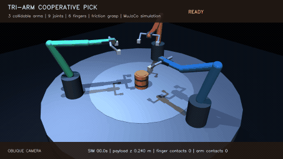](assets/demos/cooperative_pick_triarm.mp4) | [Watch the synchronized top-down view](assets/demos/cooperative_pick_triarm_top.mp4) |
| Wrist-to-pad attachment path | Recorded run metrics |
| [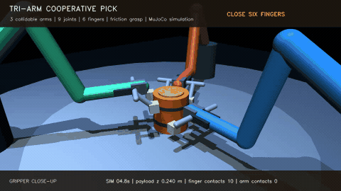](assets/demos/cooperative_pick_triarm_closeup.mp4) | [Read the measured lift and contact counts](assets/demos/cooperative_pick_triarm.json) |
| Collision geometry and grasp bands | Full experiment record |
| 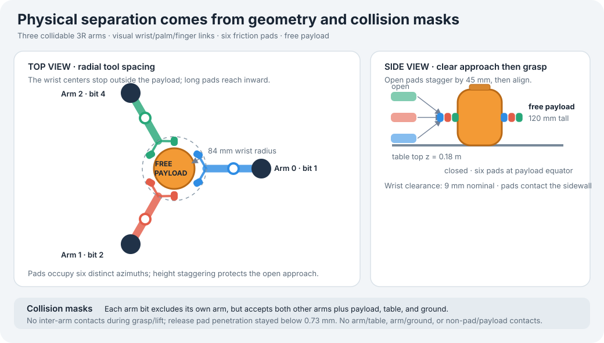 | [Read the method, source links, checks, and limitations](docs/experiments/cooperative-pick.md) |
| Camera-guided three-arm pick | Fresh visual check and evaluation paths |
| [](assets/demos/camera_guided_cooperative_pick.mp4) | 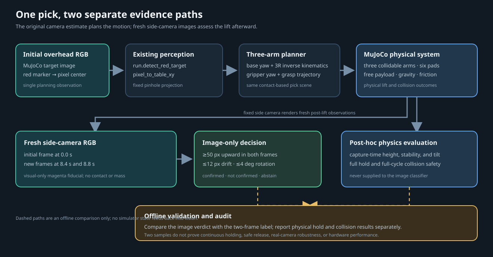 |
| Post-pick image-fault stress demos | Fixed V3 under exposure, occlusion, blur, and camera shift |
| [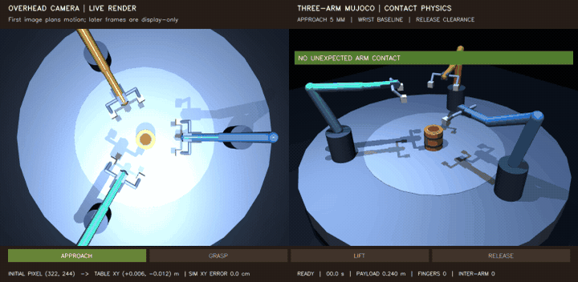](assets/demos/cooperative_pick_visual_fault_marker_occlusion_50pct.mp4) | [Open the six-condition scorecard](results/cooperative-pick-visual-fault-validation/cooperative-pick-visual-fault-scorecard.svg) · [all fault clips](docs/video-gallery.md#camera-guided-extension) |
| Opt-in occlusion-tolerant V4 | Same-pose V3 and V4 decisions after half-marker occlusion |
| [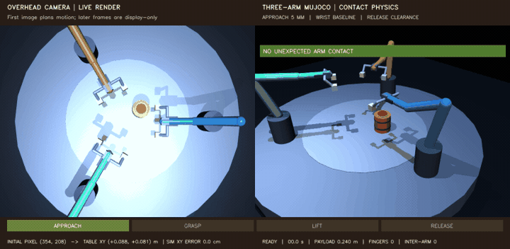](assets/demos/cooperative_pick_occlusion_v4_marker_occlusion_50pct.mp4) | [Open the held-out scorecard](results/cooperative-pick-occlusion-heldout/cooperative-pick-occlusion-scorecard.svg) · [method and data](docs/experiments/cooperative-pick-occlusion.md) |
| Frozen V4 occlusion-geometry challenge | One fixed 28 px option across mask shapes, positions, severities, and hard negatives |
| [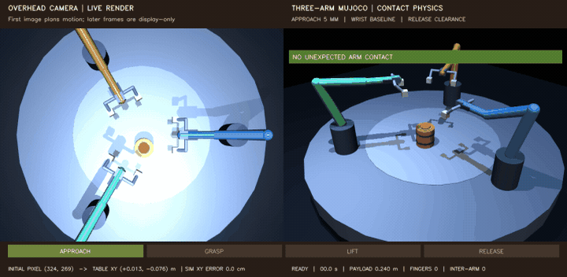](assets/demos/cooperative_pick_occlusion_shape_nominal_positive_mask.mp4) | [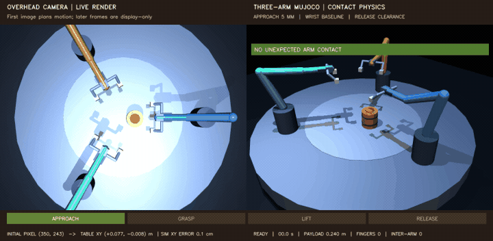](assets/demos/cooperative_pick_occlusion_shape_hard_negative_occlusion_false_confirm.mp4) |
| [Open the 200-pose scorecard](results/cooperative-pick-occlusion-shape-challenge/cooperative-pick-occlusion-shape-scorecard.svg) | [Protocol, exact 1,800-row table, and retained failures](docs/experiments/cooperative-pick-occlusion.md#frozen-geometry-and-negative-control-challenge) |
| Orthogonal-view verification under an in-scene MuJoCo rail | Two perpendicular fresh views: occlusion recovery, false-confirmation rejection, and a retained false non-confirmation |
| [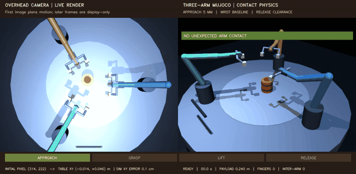](assets/demos/cooperative_pick_orthogonal_occlusion_recovery.mp4) | [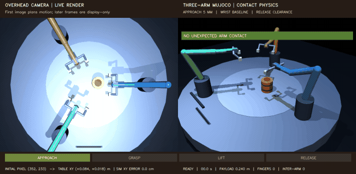](assets/demos/cooperative_pick_orthogonal_false_confirmation_rejected.mp4) |
| [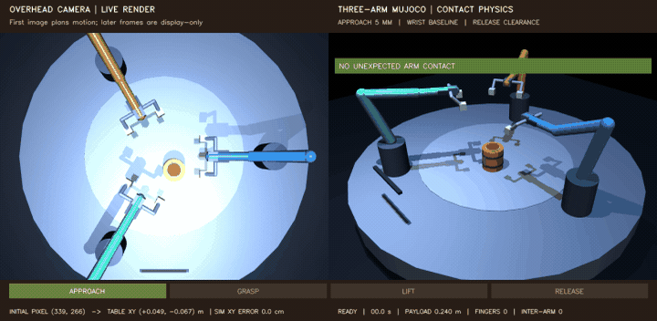](assets/demos/cooperative_pick_orthogonal_true_lift_not_confirmed.mp4) | [240-pose scorecard and full method](results/cooperative-pick-orthogonal-verification-heldout/cooperative-pick-orthogonal-verification-scorecard.svg) · [experiment record](docs/experiments/cooperative-pick-orthogonal-verification.md) |
| Same-pose pad-size comparison | Camera and oracle trial results |
| [Open paired comparison scorecard](results/cooperative-pick-pad-size-comparison.svg) | [Read the camera-guided experiment and failure analysis](docs/experiments/camera-guided-cooperative-pick.md) |
| Baseline release contact | Clearance release on the same held-out pose |
| [](assets/demos/cooperative_pick_release_baseline.mp4) | [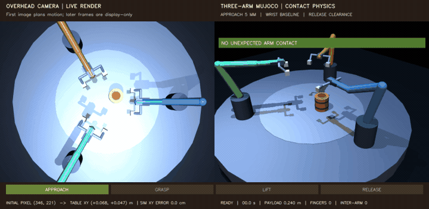](assets/demos/cooperative_pick_release_clearance.mp4) |
| Paired release-profile scorecard | Contact attribution and paired data |
| [Open the fresh-seed outcome chart](results/cooperative-pick-release-heldout-comparison.svg) | [Open exact paired outcomes](results/cooperative-pick-release-heldout-paired.csv) |
| Lowest-pad approach clearance | Matched held-out pose and geometry/result graphic |
| [Watch the paired 30-pose replay](assets/demos/cooperative_pick_approach_clearance_pair.mp4) | [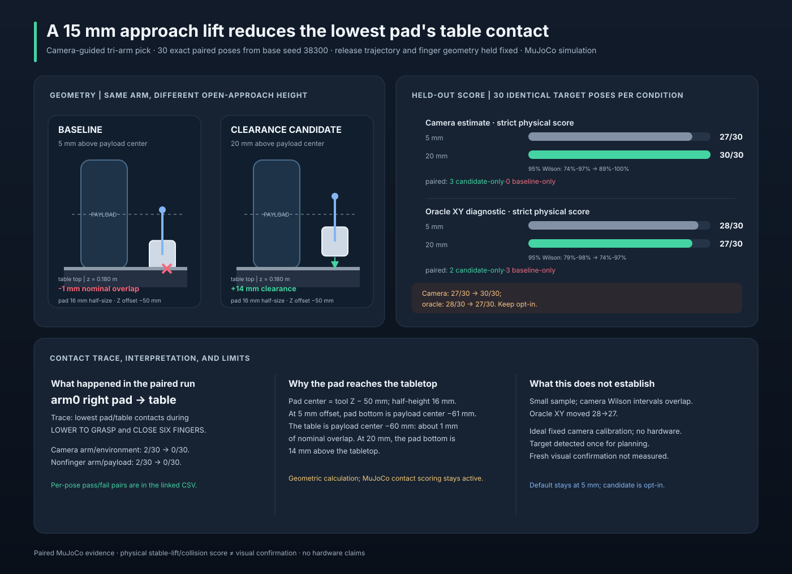](results/cooperative-pick-approach-clearance-comparison.svg) |
| Individual approach clips | Method and limitations |
| [Baseline 5 mm](assets/demos/cooperative_pick_approach_clearance_5mm.mp4) · [candidate 20 mm](assets/demos/cooperative_pick_approach_clearance_20mm.mp4) | [Read the approach-clearance study](docs/experiments/camera-guided-cooperative-pick.md#lowest-pad-approach-clearance) |
| Independent 60-pose confirmation | Exact paired outcomes |
| [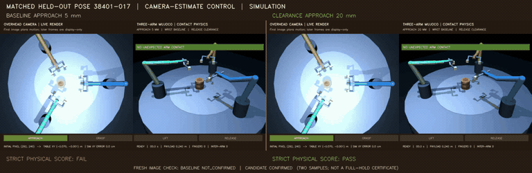](assets/demos/cooperative_pick_approach_clearance_extended_pair.mp4) | [Open the 60-pose geometry scorecard](results/cooperative-pick-approach-clearance-extended-comparison.svg) · [per-pose CSV](results/cooperative-pick-approach-clearance-extended-paired.csv) |
| Post-lift image verifier validation | Method and held-out false-confirmation analysis |
| [Open the fresh-frame verification scorecard](results/cooperative-pick-visual-confirmation/cooperative-pick-visual-confirmation-scorecard.svg) | [Read the new experiment and its limits](docs/experiments/cooperative-pick-visual-confirmation.md) |
| Same held-out pose under nominal and heavy/low-friction payload settings | Matched contact outcome and full sweep scorecard |
| [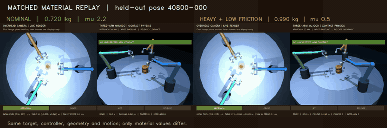](assets/demos/cooperative_pick_material_matched_comparison.mp4) | [Open the 3×3 mass/friction scorecard](results/cooperative-pick-material-validation/cooperative-pick-material-scorecard.svg) · [trial rows](results/cooperative-pick-material-validation/cooperative-pick-material-trials.csv) |
| Matched pad-size test at low and high friction | Four-way held-out replay and 96-trial scorecard |
| [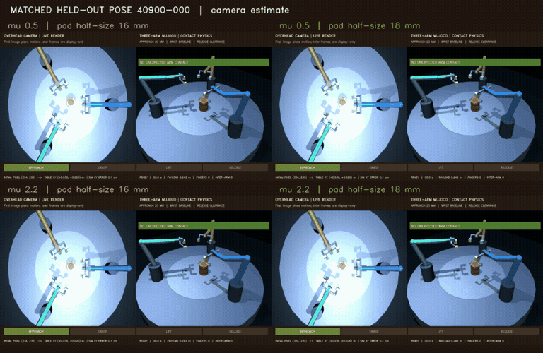](assets/demos/cooperative_pick_pad_friction_matched.mp4) | [Open pad/friction scorecard](results/cooperative-pick-pad-friction-validation/cooperative-pick-pad-friction-scorecard.svg) · [trial rows](results/cooperative-pick-pad-friction-validation/cooperative-pick-pad-friction-trials.csv) |
| Per-finger contact-retention diagnostic | Same held-out pose under low and high friction |
| [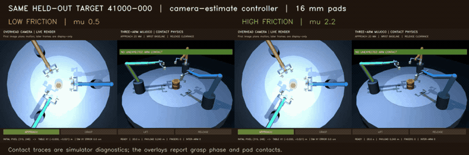](assets/demos/cooperative_pick_contact_friction_pair.mp4) | [Open phase-resolved contact scorecard](results/cooperative-pick-contact-diagnostics/cooperative-pick-contact-scorecard.svg) · [288 per-finger traces](results/cooperative-pick-contact-diagnostics/cooperative-pick-contact-by-finger.csv) |
| Why low-friction contact is lost | New held-out force, finger tracking, and payload-to-hand motion diagnostics |
| [](assets/demos/cooperative_pick_retention_diagnostic_pair.mp4) | [Open mechanism scorecard](results/cooperative-pick-retention-diagnostics/cooperative-pick-retention-scorecard.svg) · [Read the protocol and failure analysis](docs/experiments/cooperative-pick-retention-diagnostics.md) |

Browse the [complete video gallery](docs/video-gallery.md).

## Measured results

These results come from controlled MuJoCo and OpenCV experiments, not a physical robot. Physical reaching success, detector localization, and fresh visual confirmation are separate outcomes.

| Study | Evidence at a glance |
| --- | --- |
| Three-arm cooperative pick demo | One deterministic MuJoCo run lifted the free payload 9.48 cm; it stayed at least 8.98 cm above its starting height for a 1.6 s hold with at least five finger-payload contact points and at most 2.48° tilt. Cross-arm contacts were absent during grasp and lift; release pad contact stayed below 0.73 mm penetration. This is a demo, not a multi-trial benchmark. |
| Camera-guided cooperative pick | On the original 30-pose set, target detection was 30/30 (median pixel-to-table error 0.48 mm); the payload met the hold criteria in 29/30 camera trials, but only 12/30 were safe through release and withdrawal. A clearance release profile tuned on that set scored 25/30 strict successes on a separate 30-pose set, versus 13/30 for the paired baseline; oracle diagnostics were 23/30 versus 11/30. Hold rates did not change. Those original physical trials did not measure fresh visual confirmation. |
| Fresh visual verification after the cooperative pick | On a new 60-pose/120-trial seed block, V0–V3 made the same 112 true-positive and 8 true-negative decisions. That is no measured gain for V3; only eight negative labels limit the specificity evidence. The earlier [tilted no-grasp](assets/demos/cooperative_pick_verification_false_tilt.mp4) and [under-lift](assets/demos/cooperative_pick_verification_false_underlift.mp4) clips preserve the false-confirmation failures that motivated the gates. Image outcomes, full-hold physics, and full-cycle collision safety remain separate in the [scorecard and experiment record](docs/experiments/cooperative-pick-visual-confirmation.md). |
| Frozen V3 under side-camera image faults | On a new 60-pose matched split (360 condition replays), dimming to 25% caused abstention on all 60; 50% marker occlusion retained 26/58 positive confirmations and caused 32 false non-confirmations. A 9 px blur caused one miss; bright exposure and a 25 px image-plane shift changed no decisions. Only two negative labels and authored image transforms limit this evidence. See the [scorecard and protocol](docs/experiments/cooperative-pick-visual-faults.md). |
| Opt-in occlusion-tolerant post-pick V4 | On a separate 60-pose seed block, the frozen 28 px gap option raised half-occlusion positive recall from 23/56 to 55/56 with zero false confirmations for either rule, and exactly matched all 60 clean V3 decisions. Only four negatives and an authored marker band limit this result. V3 remains the default; see the [occlusion study](docs/experiments/cooperative-pick-occlusion.md). |
| Frozen V4 geometry challenge | Across 200 physical pose runs and 1,800 post-render image evaluations, the frozen candidate improved nominal-pad true positives for upper/lower 50% horizontal bands (15→43/94 and 27→62/94). It did not help vertical or diagonal masks and severely regressed on the centered 75% band (37→6/94). In the 14 mm hard-negative stratum, 82 poses were capture-time negatives; the centered 25% mask added a false confirmation (0→1), and the severe mask still caused five (V3: six). The mask and pad mix are authored challenges, not field prevalence. V4 stays opt-in; see the [full scorecard and limits](docs/experiments/cooperative-pick-occlusion.md#frozen-geometry-and-negative-control-challenge). |
| Orthogonal-view verification under a rendered MuJoCo rail | On 240 new poses (119 capture-time positives, 121 negatives), V3 made 3 false confirmations, side-only V4 made 4, and the two-view V4 candidate made 0; its Wilson 95% upper bound is 3.1%. The candidate abstained 26 times and had 100/119 true positives versus 101/119 for side-only V4. It trades coverage for fewer false confirmations and remains experimental. The rail is collisionless render geometry; see the [protocol, per-pose data, scorecard, and demos](docs/experiments/cooperative-pick-orthogonal-verification.md). |
| Lowest-pad approach clearance, experimental | On an independent 60-pose split, raising only the lowest open-pad approach from 5 mm to 20 mm changed the strict full-cycle score from 52/60 to 56/60 camera-guided and from 53/60 to 58/60 for the oracle diagnostic. There were four camera baseline-only wins, and both conditions have overlapping Wilson intervals. Keep the candidate opt-in; this is simulator evidence, not hardware validation or fresh visual confirmation. |
| Held-out payload mass and friction stress | Across the same 12 poses per setting (216 total controller runs), neither camera-estimate nor oracle had a strict success at friction 0.5. At friction 2.2, camera-estimate success was 11/12, 10/12, and 11/12 for 0.45, 0.720 kg nominal, and 0.99 kg respectively. At friction 1.1, only the light 0.45 kg setting had any strict successes (2/12 camera, 1/12 oracle). These synthetic contact stresses point to friction as a major gate for this fixed grasp; 12 poses do not establish reliability. Fresh visual confirmation was not measured. See the [full material study](docs/experiments/cooperative-pick-material-robustness.md). |
| Pad geometry under friction stress | On 12 new poses, the 18 mm candidate did not improve the 0/12 low-friction stable-lift result for either camera or oracle control. The legacy `no_grasp_contact` label scores zero contacts in the loaded hold window; it does not determine whether closure contact occurred. At friction 2.2, both 16 mm and 18 mm pads scored 12/12 for both controllers. The larger pad stays experimental. See the [paired pad/friction study](docs/experiments/cooperative-pick-pad-friction-validation.md). |
| Per-finger contact retention | On 12 further poses, all 24 low-friction camera/oracle trials recorded pad contact during closure and early lift, but none retained contact into the loaded hold (0/12 strict lifts per controller). At friction 2.2, stable lift was 12/12 camera and 11/12 oracle, with hold-window pad contact on 59/72 and 60/72 pad/pose pairs respectively. See the [phase-resolved diagnostic](docs/experiments/cooperative-pick-contact-diagnostics.md). |
| Hand-relative retention diagnosis | On 12 new matched poses, low-friction (`μ=0.5`) camera/oracle trials had 0/12 strict lifts, zero pad contact during hold, and 156/156 mm median maximum payload drift relative to the gripper hands, while median finger slide error during hold stayed near 0.02 mm. Contacting-sample tangential/normal ratios were 0.47, near the selected friction value. At `μ=2.2`, both controllers lifted 12/12; median hand-relative drift was 31/32 mm. Full-cycle collision safety was 6/12 and 7/12 at low friction versus 12/12 at high. This is a measured pattern consistent with payload slip in this scripted MuJoCo model, not hardware evidence or fresh visual confirmation. See the [diagnostic, paired data, and limits](docs/experiments/cooperative-pick-retention-diagnostics.md). |
| Image-feedback reaching | At 20 px target-measurement noise, 88/100 trials reached the 4.5 cm physical threshold; median error was 2.12 cm and P95 was 6.39 cm. Failures remain visible in the trial data. |
| Delayed camera inputs | Delayed target pixels with a current joint-state tip projection improved physical success over fully delayed RGB in all eight nonzero-delay profile/noise settings. Fresh visual confirmation was 0/100 at nonzero delay. The hybrid state source and fully delayed RGB remain distinct. |
| Post-stop visual completion | A two-frame, 1.0 s age guard confirmed 64.2% of outcomes; 335 false-positive delivery decisions occurred among 3,000 policy outcomes. A fixed image-age rule did not solve target motion during transport. |
| Reversal-aware prediction | It had lower physical success than the measured-target baseline in all eight paired path, delay, and noise settings. Predictors remain opt-in. |
| Appearance stress, new | Across 3,200 rendered frames, dim lighting produced 0/50 detections in the clear-target condition. A larger red distractor was selected in 50/50 paired trials (44.5 px median center error). A centered occlusion bar widened from 0% to 75% of target diameter increased median error from 0.08 px to 12.9 px. |
| Opt-in detector validation, disjoint held-out ranges | On 450 randomized rendered scenes, the circle prior localized within 4 px in 175/450 trials versus 8/450 for the default detector. Wrong-target selections fell from 136 to 6, while the candidate abstained in 266 trials. All six false selections involved red disks under occlusion. |

The appearance benchmark measures target-center localization only. It has no arm controller and does not claim physical reach success. Its target-only scene excludes robot self-occlusion; its lighting and clutter are authored simulator conditions, not measurements from a real camera. The full 64-condition design, per-trial results, and known limits are in [the appearance experiment record](docs/experiments/image-robustness.md).

The circle-prior detector remains experimental and is not the runtime default. Its held-out study uses light, distractor-size/distance, and occlusion-width ranges that were not used during development. It reports localization, wrong-target selection, and abstention separately; it does not measure reaching or fresh visual confirmation. See the [candidate validation record](docs/experiments/perception-candidate-validation.md) for the frozen split and archived development failures.

## System at a glance

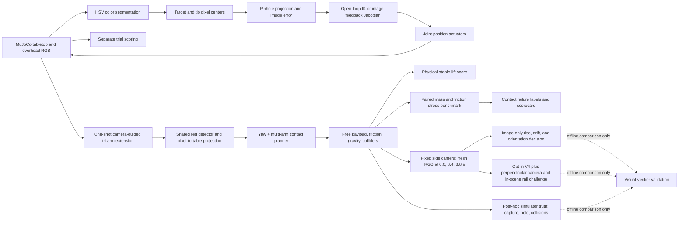

The planar controller uses image measurements for motion. The camera-guided multi-arm extension shares the default detector and pinhole mapping, then plans once around the detected object pose; the original scripted tri-arm clip remains its mechanical baseline. V3 uses one fresh side view and remains the default. The opt-in two-view candidate is evaluated separately under an actual MuJoCo-rendered rail; it still does not certify the full hold or safe release. Simulator ground truth is read afterward on a separate evaluation path. The [system overview](docs/system-overview.md) maps the main code and assumptions.

## Quick start

Requires Python 3.12, `uv`, and a working MuJoCo rendering backend.

```bash
uv sync --locked --extra dev --extra demo
uv run visual-servo-demo --controller image_feedback --episodes 20 --seed 7
uv run visual-servo-benchmark --seeds 5 --episodes-per-seed 20
uv run --locked visual-servo-cooperative-pick
uv run --locked visual-servo-cooperative-pick-orthogonal-validation
```

Reproduce the appearance stress study and its CSV, scorecard, MP4, and GIF preview with:

```bash
uv run --locked --extra demo visual-servo-perception-appearance-benchmark
uv run --locked visual-servo-perception-candidate-validation \
  --seeds 5 --samples-per-seed 10 --base-seed 9400 --split-name validation
```

Run the evidence consistency check and tests used by the configured GitHub Actions workflow:

```bash
uv run --locked python -m visual_servo_mujoco.evidence_audit
uv run --locked pytest -q
```

The [CI workflow](.github/workflows/ci.yml) runs the evidence audit and full test suite on pull requests and pushes to `main`. It passed on [PR #3](https://github.com/Lavalx100/visual-servo-mujoco/actions/runs/39376574453) with 132 tests; full benchmark replays remain separate reproduction steps because they take longer. The [independent review protocol](docs/independent-review-protocol.md) lists clean-clone commands and assumptions for another reviewer to challenge.

## Experiment records

Detailed protocols, results, trial-data links, videos, and limitations live outside this overview:

- [Reaching robustness, target dropout, motion, and sensor timing](docs/experiments/reaching-robustness.md)
- [Timestamped visual completion and held-out policies](docs/experiments/visual-completion.md)
- [Terminal verification and image-quality studies](docs/experiments/terminal-verification.md)
- [Camera calibration and distortion](docs/experiments/camera-calibration.md)
- [Rendered lighting, clutter, occlusion, and radial-distortion robustness](docs/experiments/image-robustness.md)
- [Held-out circle-prior target detector validation](docs/experiments/perception-candidate-validation.md)
- [Scripted three-arm cooperative pick baseline](docs/experiments/cooperative-pick.md)
- [Camera-guided cooperative pick and paired contact-geometry study](docs/experiments/camera-guided-cooperative-pick.md)
- [Fresh post-pick visual confirmation](docs/experiments/cooperative-pick-visual-confirmation.md)
- [Side-camera image-fault validation](docs/experiments/cooperative-pick-visual-faults.md)
- [Opt-in gap-tolerant marker validation](docs/experiments/cooperative-pick-occlusion.md)
- [Orthogonal-view fresh verification with an in-scene occluder](docs/experiments/cooperative-pick-orthogonal-verification.md)
- [Held-out payload mass and friction robustness](docs/experiments/cooperative-pick-material-robustness.md)
- [Target-motion prediction, including the negative reversal result](docs/experiments/motion-prediction.md)
- [Commands to reproduce experiments and regenerate demos](docs/reproduction.md)
- [Full video and preview gallery](docs/video-gallery.md)

The original three-arm clip is a scripted manipulation baseline. The camera-guided extension now connects the project's existing red-target detector and pixel-to-table mapping to the same free-payload MuJoCo contact scene. It estimates the target once, then plans the grasp; it is not closed-loop visual servoing during the lift. The new optional side-camera verifier makes a separate post-lift image decision, while randomized physical outcomes remain scored independently.

The project is a simulation study. It does not claim real-robot performance, production-ready completion logic, or a general-purpose detector. Experimental predictors, completion rules, and the clearance release profile remain opt-in; measured failures and baseline comparisons are retained.
