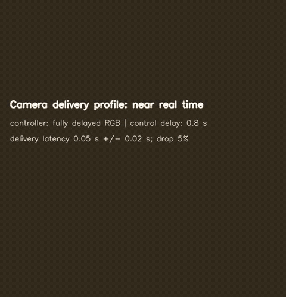
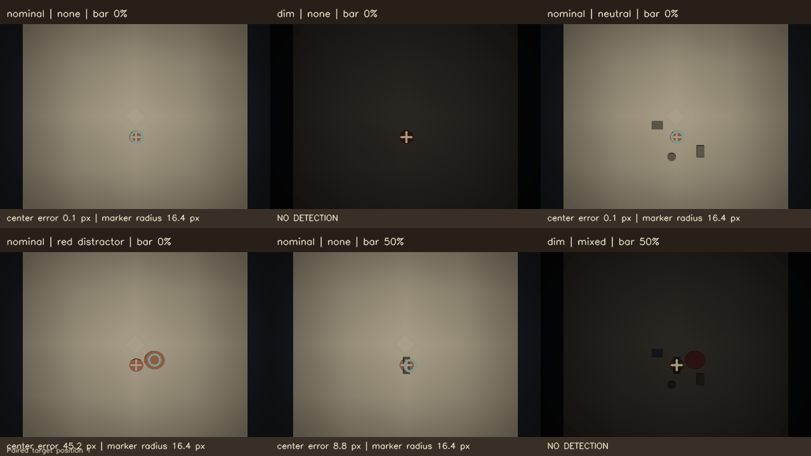
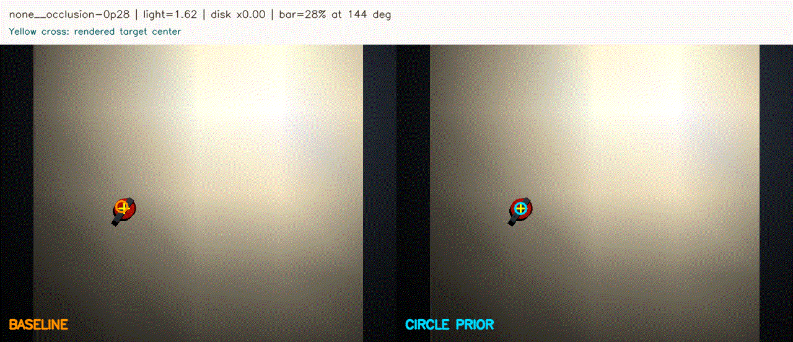
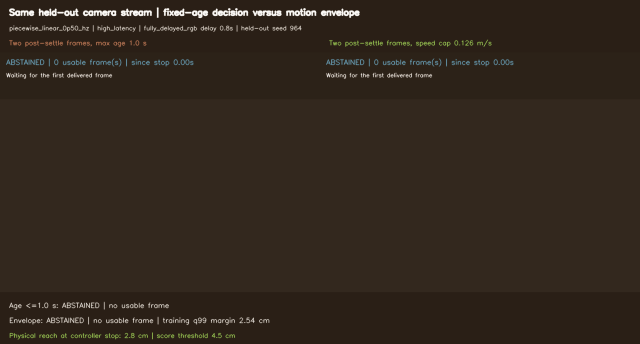
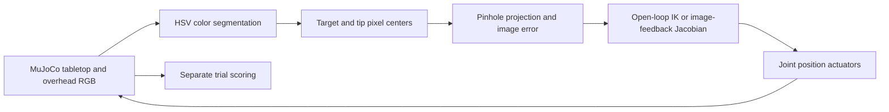

# Camera-based reaching in MuJoCo

A small, reproducible robotics project built around one inspectable perception-to-action loop. MuJoCo renders an overhead RGB view; OpenCV detects a red target and green end-effector marker; a pinhole model maps pixels to the tabletop; and a two-joint image-feedback controller moves the arm. Paired simulation trials measure where this simple system works and where its assumptions fail.


[Watch the clean reaching demo](assets/reaching_demo.mp4) · [Read the illustrated project explainer](output/pdf/visual-servo-mujoco-project-explainer.pdf)

## Demo previews

The clips below are selected examples. Their experiment pages link to the full videos, trial tables, and reproduction commands.

| Closed-loop reaching | Delayed vision and current arm state |
| --- | --- |
| [](assets/demos/feedback_clean.mp4) | [](assets/demos/sensor_timing_sinusoidal_noise-0px_delay-1.mp4) |
| Post-stop visual completion | Camera calibration |
| [](assets/demos/timestamped_post_stop_verification.mp4) | [](assets/demos/camera_calibration_planar.mp4) |
| Rendered lighting, clutter, and occlusion stress | Appearance localization scorecard |
| [](assets/demos/perception_appearance_comparison.mp4) | [](assets/demos/perception-appearance-scorecard.svg) |
| Opt-in circle-prior detector validation | Paired detector scorecard |
| [](assets/demos/perception_candidate_validation.mp4) | [](assets/demos/perception-candidate-validation.svg) |
| Held-out completion-rule validation | Reversal-aware prediction negative result |
| [](assets/demos/motion_envelope_comparison.mp4) | [Watch measured target, constant velocity, and reversal-aware estimates](assets/demos/feedback_prediction_sinusoidal_reversal.mp4) |

Browse the [complete video gallery](docs/video-gallery.md).

## Measured results

These results come from controlled MuJoCo and OpenCV experiments, not a physical robot. Physical reaching success, detector localization, and fresh visual confirmation are separate outcomes.

| Study | Evidence at a glance |
| --- | --- |
| Image-feedback reaching | At 20 px target-measurement noise, 88/100 trials reached the 4.5 cm physical threshold; median error was 2.12 cm and P95 was 6.39 cm. Failures remain visible in the trial data. |
| Delayed camera inputs | Delayed target pixels with a current joint-state tip projection improved physical success over fully delayed RGB in all eight nonzero-delay profile/noise settings. Fresh visual confirmation was 0/100 at nonzero delay. The hybrid state source and fully delayed RGB remain distinct. |
| Post-stop visual completion | A two-frame, 1.0 s age guard confirmed 64.2% of outcomes; 335 false-positive delivery decisions occurred among 3,000 policy outcomes. A fixed image-age rule did not solve target motion during transport. |
| Reversal-aware prediction | It had lower physical success than the measured-target baseline in all eight paired path, delay, and noise settings. Predictors remain opt-in. |
| Appearance stress, new | Across 3,200 rendered frames, dim lighting produced 0/50 detections in the clear-target condition. A larger red distractor was selected in 50/50 paired trials (44.5 px median center error). A centered occlusion bar widened from 0% to 75% of target diameter increased median error from 0.08 px to 12.9 px. |
| Opt-in detector validation, disjoint held-out ranges | On 450 randomized rendered scenes, the circle prior localized within 4 px in 175/450 trials versus 8/450 for the default detector. Wrong-target selections fell from 136 to 6, while the candidate abstained in 266 trials. All six false selections involved red disks under occlusion. |

The appearance benchmark measures target-center localization only. It has no arm controller and does not claim physical reach success. Its target-only scene excludes robot self-occlusion; its lighting and clutter are authored simulator conditions, not measurements from a real camera. The full 64-condition design, per-trial results, and known limits are in [the appearance experiment record](docs/experiments/image-robustness.md).

The circle-prior detector remains experimental and is not the runtime default. Its held-out study uses light, distractor-size/distance, and occlusion-width ranges that were not used during development. It reports localization, wrong-target selection, and abstention separately; it does not measure reaching or fresh visual confirmation. See the [candidate validation record](docs/experiments/perception-candidate-validation.md) for the frozen split and archived development failures.

## System at a glance



The controller uses image measurements for motion. Simulator ground truth is read after a trial to score physical position error. Post-stop camera confirmation is measured by a separate experiment and is never inferred from proximity alone. The [system overview](docs/system-overview.md) maps the main code and assumptions.

## Quick start

Requires Python 3.12, `uv`, and a working MuJoCo rendering backend.

```bash
uv sync --locked --extra dev --extra demo
uv run visual-servo-demo --controller image_feedback --episodes 20 --seed 7
uv run visual-servo-benchmark --seeds 5 --episodes-per-seed 20
```

Reproduce the appearance stress study and its CSV, scorecard, MP4, and GIF preview with:

```bash
uv run --locked --extra demo visual-servo-perception-appearance-benchmark
uv run --locked visual-servo-perception-candidate-validation \
  --seeds 5 --samples-per-seed 10 --base-seed 9400 --split-name validation
```

Run the evidence consistency check and tests used by the configured GitHub Actions workflow:

```bash
uv run --locked python -m visual_servo_mujoco.evidence_audit
uv run --locked pytest -q
```

The [CI workflow](.github/workflows/ci.yml) is configured to run the evidence audit and tests on pull requests and pushes to `main`. It has not run on GitHub yet, so there is no hosted CI result to report. Full benchmark replays remain separate reproduction steps because they take longer. The [independent review protocol](docs/independent-review-protocol.md) lists clean-clone commands and assumptions for another reviewer to challenge.

## Experiment records

Detailed protocols, results, trial-data links, videos, and limitations live outside this overview:

- [Reaching robustness, target dropout, motion, and sensor timing](docs/experiments/reaching-robustness.md)
- [Timestamped visual completion and held-out policies](docs/experiments/visual-completion.md)
- [Terminal verification and image-quality studies](docs/experiments/terminal-verification.md)
- [Camera calibration and distortion](docs/experiments/camera-calibration.md)
- [Rendered lighting, clutter, occlusion, and radial-distortion robustness](docs/experiments/image-robustness.md)
- [Held-out circle-prior target detector validation](docs/experiments/perception-candidate-validation.md)
- [Target-motion prediction, including the negative reversal result](docs/experiments/motion-prediction.md)
- [Commands to reproduce experiments and regenerate demos](docs/reproduction.md)
- [Full video and preview gallery](docs/video-gallery.md)

The project is a simulation study. It does not claim real-robot performance, production-ready completion logic, or a general-purpose detector. Experimental predictors and completion rules remain opt-in; measured failures and baseline comparisons are retained.
