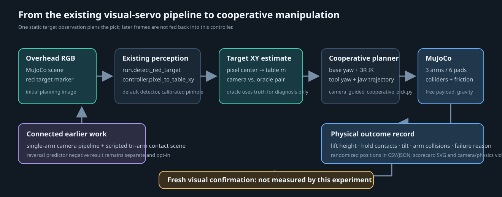

# Camera-guided cooperative pick

[Project overview](../../README.md) ·
[Original contact-based tri-arm demo](cooperative-pick.md) ·
[Complete video gallery](../video-gallery.md)

## Why this extension exists

The original tri-arm clip proved one scripted, centered lift with a free payload
and active inter-arm colliders. It did not use perception. This experiment
connects that physical scene to the visual-servo pipeline already in the
project: the same default red-marker detector finds the target in an overhead
MuJoCo RGB image, and the same pinhole pixel-to-table helper maps its center to
world XY. The resulting estimate drives the multi-arm grasp plan.



## Demonstration

The left panel is a live overhead render alongside the physical response on
the right. For control, the target is detected once from the initial overhead
frame and projected to table coordinates; later overhead frames are rendered
only for video display and do not feed back into the arms. The fixed pixel and
table estimate shown below the panels are from that initial frame.

- [Camera-guided three-arm pick video](../../assets/demos/camera_guided_cooperative_pick.mp4)
- [GIF preview](../../assets/demos/camera_guided_cooperative_pick.gif)
- [Illustrative run metrics](../../results/cooperative-pick-pose-validation-summary.json)
- [Selected demo run metadata](../../assets/demos/camera_guided_cooperative_pick_demo.json)
- [Randomized paired scorecard](../../results/cooperative-pick-pose-validation.svg)
- [All paired trial data](../../results/cooperative-pick-pose-validation-trials.csv)


The current video uses one successful development-selected target pose at
`(+0.03965 m, -0.08357 m)`. It is illustrative and excluded from the randomized
aggregate below. The paired oracle run at the same pose is included in the JSON
only as a diagnostic, not in the aggregate. The earlier v1 clip is retained
with its original scorecard and run data.

## How the pieces connect

| Existing project component | Reused behavior | New cooperative behavior |
| --- | --- | --- |
| `run.py:detect_red_target` | The unchanged default HSV red-contour detector returns the marker pixel center. | A non-colliding red disk is rendered on the payload; robot-link colors avoid the detector's red range. |
| `controller.py:pixel_to_table_xy` | The existing top-down pinhole mapping converts pixels to tabletop XY. | The estimate becomes the target input to base-yaw and elbow-up 3R arm planning. |
| `cooperative_pick_demo.py` | Existing free payload, arm collision masks, contact accounting, grasp-height trajectory, and friction-based lift. | Optional yaw joints support off-center targets. Arm, palm, fingertip, payload, table, and ground colliders stay active; visual wrist adapters, palm rails, and finger shanks close the visible gaps without adding contact surfaces. |
| `cooperative_pick_demo.py:desired_pick_state` | The same phase timing, approach, close, lift, hold, lower, release, and withdraw sequence. | The endpoint locations are re-centered on the estimated payload position. |

All trials start the robot from the same centered ready pose. Ground-truth
target XY places the payload and scores the run; only the `oracle_xy` diagnostic
uses that truth for control. `camera_estimate` uses the detector result.
Camera, oracle, and physical results remain separate fields. Physical
stable-lift success does not mean fresh visual confirmation.

## Randomized evaluation

The validation uses paired camera-estimate and oracle-XY trials at 30 target
positions drawn independently from the prespecified square
`x,y ∈ [-0.09, +0.09] m` using three deterministic seeds. Each pair has the
same payload pose and physics model. The standard detector and an ideal fixed
overhead pinhole calibration are used without noise or image distortion.

The physical success criterion requires the free payload to remain at least
7 cm above its starting height for a 1.6 s hold, with at least three
finger-to-payload contact points, no more than 5 degrees of tilt, no more than
1 mm of inter-arm penetration, and no arm-to-table, arm-to-ground, or non-finger
arm-to-payload contact. Each trial records target detection, the initial
pixel-to-world error, physical outcome, contact and collision diagnostics, and
a categorized failure reason. Fresh post-stop visual confirmation is not
measured in this experiment.

The oracle condition separates target-localization error from grasp-planning
and contact failures. If the oracle condition also fails at a pose, detector
accuracy alone cannot explain the failure. These are controlled simulator
results, not evidence of hardware performance or a general grasp success
rate.

### Results

#### Initial result and development change

The first 30-pose run used 14 mm finger-pad half-size, seed 28100, and the
rounded v1 trial export. The detector found all 30 targets; median projection
error was 0.052 cm (0.52 mm). Physical stable lift was 0/30 for camera estimates
and 5/30 for oracle XY. Paired outcomes were 0 successes for both, 5 oracle-only,
and 25 failures for both. The largest camera failure category was payload tilt
(19/30). This negative result is preserved in the [v1 summary](../../results/cooperative-pick-pose-validation-v1-summary.json),
[scorecard](../../results/cooperative-pick-pose-validation-v1.svg), [trial table](../../results/cooperative-pick-pose-validation-v1-trials.csv),
and [v1 video](../../assets/demos/camera_guided_cooperative_pick_v1.mp4).

After this failure, a 16 mm pad half-size was explored on the same 30 development
poses. It produced 18/30 camera and 13/30 oracle lifts on that development set;
those trials selected the candidate and are not treated as held-out evidence.
The v1 export rounded target coordinates to five decimal places, which is not
enough to exactly replay this contact-sensitive simulation. The newer exports
retain full round-trip floating-point target coordinates.

#### Fresh-seed validation and paired pad control

On 30 new poses from seed 38100, with the candidate 16 mm pad half-size, the
detector succeeded 30/30 and median projection error was 0.048 cm (0.48 mm).
Physical stable lift succeeded in 12/30 camera-estimate trials (40%) and 9/30
oracle-XY diagnostic trials (30%). The paired outcomes were 4 successes in both
conditions, 8 camera-only, 5 oracle-only, and 13 failures in both. Camera
failures were mostly arm-environment contact (11/30), followed by nonfinger
payload contact (6/30); there was one no-grasp-contact failure.

To isolate contact geometry, the 14 mm baseline was replayed on those exact same
30 target poses. Camera-estimate success changed from 4/30 to 12/30 with the
16 mm pads; paired outcomes were 11 candidate-only successes, 3 baseline-only,
1 success in both, and 15 failures in both. Oracle success changed from 4/30 to
9/30. Its paired outcomes were 7 candidate-only, 2 baseline-only, 2 successes
in both, and 19 failures in both. Median localization error was 0.048 cm for
both pad sizes and both control conditions, so this comparison changes the
contact geometry, not the detector. Wilson 95% intervals for camera success are
5.3-29.7% at 14 mm and 24.6-57.7% at 16 mm; for oracle success they are
5.3-29.7% and 16.7-47.9%. With only 30 poses and substantial interval overlap,
this is a promising same-simulator comparison, not a broad or statistically
settled claim.

The 16 mm candidate materially reduced tilt/no-grasp failures on these paired
poses, but arm-environment and nonfinger payload contacts remain common. The
selected video pose is a hand-selected development example and must not be
counted as another validation success. Physical stable-lift success is also
not a fresh visual confirmation: no post-pick image decision is measured.

The evidence is preserved in the held-out [summary](../../results/cooperative-pick-pose-validation-summary.json),
[scorecard](../../results/cooperative-pick-pose-validation.svg), and [full precision trial table](../../results/cooperative-pick-pose-validation-trials.csv),
the [paired pad-size scorecard](../../results/cooperative-pick-pad-size-comparison.svg)
and [comparison JSON](../../results/cooperative-pick-pad-size-comparison.json),
plus the [14 mm same-pose control trials](../../results/cooperative-pick-pad-014-heldout-control/cooperative-pick-pose-validation-trials.csv)
and [16 mm development trials](../../results/cooperative-pick-pad-016-development/cooperative-pick-pose-validation-trials.csv).

The detailed outcomes and failure categories are in the paired [CSV trial
table](../../results/cooperative-pick-pose-validation-trials.csv), with
condition summaries in [JSON](../../results/cooperative-pick-pose-validation-summary.json)
and the [scorecard](../../results/cooperative-pick-pose-validation.svg). The
same-seed 14 mm baseline and comparison can be regenerated with:

```bash
uv run --locked visual-servo-camera-guided-cooperative-pick \
  --base-seed 38100 --finger-pad-half-size-m 0.014 --no-media \
  --results-dir results/cooperative-pick-pad-014-heldout-control
uv run --locked python scripts/compare_cooperative_pick_pad_sensitivity.py \
  --baseline-dir results/cooperative-pick-pad-014-heldout-control \
  --candidate-dir results \
  --json-output results/cooperative-pick-pad-size-comparison.json \
  --svg-output results/cooperative-pick-pad-size-comparison.svg
```

### Release and withdrawal collision study

The first strict result merged payload stability with collision safety over the
entire motion. A deterministic contact-attribution replay of the same 30
seed-38100 poses separated those outcomes: camera-estimate trials met the
1.6-second physical hold criteria in 29/30 cases, while only 12/30 were safe
through release and withdrawal. Oracle-XY reached 23/30 holds and 9/30
full-sequence safe trials. The hold did not include a fresh camera decision.
See the [phase outcome chart](../../results/cooperative-pick-contact-attribution/cooperative-pick-phase-outcomes.svg),
[contact-by-geometry event table](../../results/cooperative-pick-contact-attribution/cooperative-pick-contact-events.csv),
and [replay summary](../../results/cooperative-pick-contact-attribution/cooperative-pick-pose-validation-summary.json).

Most unexpected contacts occurred as the open grippers released and withdrew.
The experimental `clearance` profile keeps the lowest tool-height offset at or
above 35 mm and the tool-center radius at or above 110 mm during those phases. At the
nominal table pose, the lowest pad then clears the tabletop by about 29 mm.
The profile changes actuator targets only: the free payload still moves under
gravity and contact friction, with the same collision geometry and success
rules. The historical `baseline` profile remains the CLI default so the
original behavior can still be reproduced.

The 35 mm and 110 mm settings were selected after reviewing seed 38100. On
those same tuning poses, strict success changed from 12/30 to 26/30 for camera
estimates and 9/30 to 22/30 for oracle XY. That is tuning evidence, not an
independent result. We then replayed a separate 30-pose seed-38200 split under
both profiles, using identical target coordinates for each pair:

| Control target | Measure | Baseline | Clearance |
| --- | --- | ---: | ---: |
| Camera estimate | Payload stable lift | 26/30 | 26/30 |
| Camera estimate | Full-sequence collision-safe / strict score | 13/30 | 25/30 |
| Oracle XY diagnostic | Payload stable lift | 23/30 | 23/30 |
| Oracle XY diagnostic | Full-sequence collision-safe | 11/30 | 24/30 |
| Oracle XY diagnostic | Strict combined score | 11/30 | 23/30 |

The candidate had 12 camera-only strict successes and no baseline-only strict
successes; for oracle XY the paired result was also 12 candidate-only and zero
baseline-only. Across the entire sequence, camera-estimate trials with any
arm-table/ground contact fell from 7 to 2 and those with any nonfinger
arm-payload contact fell from 14 to 4. Oracle-XY counts changed from 6 to 0
and 18 to 5 respectively. A trial can contribute to multiple phases or contact
categories. Wilson intervals and exact paired outcomes are in the
[comparison JSON](../../results/cooperative-pick-release-heldout-comparison.json);
the [SVG](../../results/cooperative-pick-release-heldout-comparison.svg) and
[paired CSV](../../results/cooperative-pick-release-heldout-paired.csv) provide
compact views. Thirty poses remain a small simulator sample and the intervals
remain uncertain.

Two clips replay one of the held-out camera-estimate poses, `38201-005`. In the
baseline clip, `arm0_wrist_link` contacts the payload for 246 physics steps
during release and withdrawal; the clearance replay has no unexpected arm
contact and meets the strict score. The replay is already counted among the
30 trials. These examples show physical simulation state; fresh visual
confirmation remains unmeasured.

| Matched held-out replay | Video | Preview |
| --- | --- | --- |
| Baseline release, wrist-payload contact | [MP4](../../assets/demos/cooperative_pick_release_baseline.mp4) |  |
| Clearance release, no unexpected arm contact | [MP4](../../assets/demos/cooperative_pick_release_clearance.mp4) |  |

Regenerate the seed-38200 comparison and matched clips with:

```bash
uv run --locked visual-servo-camera-guided-cooperative-pick \
  --base-seed 38100 --release-profile baseline --no-media \
  --results-dir results/cooperative-pick-contact-attribution
uv run --locked visual-servo-camera-guided-cooperative-pick \
  --base-seed 38200 --release-profile baseline --no-media \
  --results-dir results/cooperative-pick-release-heldout-baseline
uv run --locked visual-servo-camera-guided-cooperative-pick \
  --base-seed 38200 --release-profile clearance --no-media \
  --results-dir results/cooperative-pick-release-heldout-clearance
uv run --locked python scripts/compare_cooperative_pick_release_profiles.py \
  --baseline-dir results/cooperative-pick-release-heldout-baseline \
  --candidate-dir results/cooperative-pick-release-heldout-clearance \
  --json-output results/cooperative-pick-release-heldout-comparison.json \
  --svg-output results/cooperative-pick-release-heldout-comparison.svg \
  --paired-csv-output results/cooperative-pick-release-heldout-paired.csv
uv run --locked python scripts/generate_cooperative_pick_release_demos.py \
  --baseline-dir results/cooperative-pick-release-heldout-baseline \
  --candidate-dir results/cooperative-pick-release-heldout-clearance \
  --pair-id 38201-005 --output-dir assets/demos
```

The clearance profile reduces one measured failure mode but leaves earlier
approach, grasp, lift, and lower-to-table contacts in some trials. It also does
not add post-pick vision. Keep it opt-in pending broader confirmation; the next
useful extension is to address those remaining approach/lift contacts without
weakening the contact rules or conflating a physical hold with visual
confirmation.

### Lowest-pad approach clearance

Contact attribution identified a geometric cause at the start of the grasp:
arm 0's lowest open fingertip approaches with its pad bottom nominally 1 mm
below the tabletop. The tool center is only 5 mm above the payload center, but
the pad center is 50 mm below the tool and the collidable pad has a 16 mm
vertical half-size. Since the payload center is 60 mm above the table, the
nominal pad-bottom offset is `5 - 50 - 16 = -61 mm` from the payload center.
This motivates raising only the lowest arm's open approach target to 20 mm.
The fingertip geometry and closed-grasp target remain the same; the nominal pad
bottom then clears the table by 14 mm. The 20 mm setting remains opt-in, and
the default is still 5 mm.


The experiment changes only that approach offset. Both runs use the same
30-pose split generated from base seed 38300, the same camera/oracle
conditions, the same 16 mm pads, the same release-clearance profile, and the
same active contact scoring. The one-shot camera estimate still comes only
from the initial image.

| Control target | Strict physical score | Baseline 5 mm | Candidate 20 mm |
| --- | --- | ---: | ---: |
| Camera estimate | stable lift and full-cycle collision-safe | 27/30 | 30/30 |
| Oracle XY diagnostic | stable lift and full-cycle collision-safe | 28/30 | 27/30 |

For camera-estimate trials the paired result is three candidate-only successes
and no baseline-only successes. Any arm-table/ground contact fell from 2/30 to
0/30, and any nonfinger arm-payload contact fell from 2/30 to 0/30. The oracle
diagnostic instead had two candidate-only and three baseline-only strict
successes. The camera Wilson intervals overlap (74-97% and 89-100%), and the
sample is only 30 poses, so this is a targeted same-simulator improvement, not
a settled general gain. It is not promoted to the default.

To check that result on a larger independent block, the exact comparison was
repeated on 60 new poses generated from base seed 38400 (seeds 38400-38402, 20
poses each). The parameter, release-clearance profile, camera setup, finger
geometry, and physical score stayed fixed:

| Control target | Baseline 5 mm | Candidate 20 mm | Candidate-only / baseline-only |
| --- | ---: | ---: | ---: |
| Camera estimate | 52/60 | 56/60 | 8 / 4 |
| Oracle XY diagnostic | 53/60 | 58/60 | 5 / 0 |

The new split therefore adds four net camera-estimate successes and five net
oracle successes. Any camera-trial arm-table/ground contact fell from 4/60 to
2/60; nonfinger arm-payload contact fell from 6/60 to 3/60. Oracle contact
counts changed from 3/60 to 1/60 for arm-table/ground and 6/60 to 2/60 for
nonfinger arm-payload. The candidate still has camera baseline-only outcomes
in four poses, and the Wilson intervals overlap for both conditions (camera
76-93% vs. 84-97%; oracle 78-94% vs. 89-99%). This is stronger replicated
simulation evidence, but it remains a modest, paired simulator study rather
than a settled or hardware-validated improvement.

The [first 30-pose comparison](../../results/cooperative-pick-approach-clearance-comparison.svg)
and the [independent 60-pose comparison](../../results/cooperative-pick-approach-clearance-extended-comparison.svg)
each have a separate exact-pose CSV and JSON record. Do not fold the
illustrative videos into either aggregate.

The paired replay of pose `38301-003` records an `arm0_right_pad`-to-table
contact during both lowering to grasp and finger closure at 5 mm. The 20 mm
replay removes the unexpected arm contact and changes the recorded strict
outcome from failure to success. Both clips use the same camera-estimate
controller and release profile; they are a matched illustration already
counted in the held-out 30 poses. The displayed overhead camera remains live,
but only its initial frame is used for planning.

| Matched seed-38300 replay | Video | Preview |
| --- | --- | --- |
| Baseline 5 mm, pad/table contact | [MP4](../../assets/demos/cooperative_pick_approach_clearance_5mm.mp4) | Individual MP4 replay |
| Candidate 20 mm, clear approach | [MP4](../../assets/demos/cooperative_pick_approach_clearance_20mm.mp4) | Individual MP4 replay |
| Synchronized paired comparison | [MP4](../../assets/demos/cooperative_pick_approach_clearance_pair.mp4) |  |
| Independent seed-38400 paired comparison | [MP4](../../assets/demos/cooperative_pick_approach_clearance_extended_pair.mp4) |  |

The [pair metadata](../../assets/demos/cooperative_pick_approach_clearance_pair.json),
[exact per-pose outcomes](../../results/cooperative-pick-approach-clearance-paired.csv),
and [full comparison record](../../results/cooperative-pick-approach-clearance-comparison.json)
retain the replay settings, Wilson intervals, and contact attribution. The
original physical dataset does not include vision confirmation; updated demo
replays show a separate two-frame image verdict and post-hoc simulator audit.
See the [fresh verification study](cooperative-pick-visual-confirmation.md).

The second-seed pair and [its metadata](../../assets/demos/cooperative_pick_approach_clearance_extended_pair.json)
are another illustrative replay from the 60-pose run. Its exact pose is also
already counted in the [extended paired trial table](../../results/cooperative-pick-approach-clearance-extended-paired.csv).

Each rendered panel keeps the overhead RGB and oblique physics views synchronized.
The stage strip highlights approach, grasp, lift, and release; the bottom readout
labels initial pixel-to-table estimation separately from the current simulated
payload height and contact counts. The replay end card separates the fresh
image verdict from the full-cycle physical score.

Reproduce the held-out pair and videos with:

```bash
uv run --locked visual-servo-camera-guided-cooperative-pick \
  --base-seed 38300 --release-profile clearance \
  --lowest-approach-tool-height-offset-m 0.005 --no-media \
  --results-dir results/cooperative-pick-approach-clearance-heldout-baseline
uv run --locked visual-servo-camera-guided-cooperative-pick \
  --base-seed 38300 --release-profile clearance \
  --lowest-approach-tool-height-offset-m 0.020 --no-media \
  --results-dir results/cooperative-pick-approach-clearance-heldout-candidate
uv run --locked python scripts/compare_cooperative_pick_geometry.py \
  --baseline-dir results/cooperative-pick-approach-clearance-heldout-baseline \
  --candidate-dir results/cooperative-pick-approach-clearance-heldout-candidate \
  --parameter lowest_approach_tool_height_offset_m \
  --json-output results/cooperative-pick-approach-clearance-comparison.json \
  --svg-output results/cooperative-pick-approach-clearance-comparison.svg \
  --paired-csv-output results/cooperative-pick-approach-clearance-paired.csv
uv run --locked --extra demo python scripts/generate_cooperative_pick_approach_clearance_demos.py \
  --baseline-dir results/cooperative-pick-approach-clearance-heldout-baseline \
  --candidate-dir results/cooperative-pick-approach-clearance-heldout-candidate
uv run --locked visual-servo-camera-guided-cooperative-pick \
  --base-seed 38400 --seeds 3 --samples-per-seed 20 \
  --release-profile clearance --lowest-approach-tool-height-offset-m 0.005 \
  --no-media --results-dir results/cooperative-pick-approach-clearance-extended-baseline
uv run --locked visual-servo-camera-guided-cooperative-pick \
  --base-seed 38400 --seeds 3 --samples-per-seed 20 \
  --release-profile clearance --lowest-approach-tool-height-offset-m 0.020 \
  --no-media --results-dir results/cooperative-pick-approach-clearance-extended-candidate
uv run --locked python scripts/compare_cooperative_pick_geometry.py \
  --baseline-dir results/cooperative-pick-approach-clearance-extended-baseline \
  --candidate-dir results/cooperative-pick-approach-clearance-extended-candidate \
  --parameter lowest_approach_tool_height_offset_m \
  --json-output results/cooperative-pick-approach-clearance-extended-comparison.json \
  --svg-output results/cooperative-pick-approach-clearance-extended-comparison.svg \
  --paired-csv-output results/cooperative-pick-approach-clearance-extended-paired.csv
uv run --locked --extra demo python scripts/generate_cooperative_pick_approach_clearance_demos.py \
  --baseline-dir results/cooperative-pick-approach-clearance-extended-baseline \
  --candidate-dir results/cooperative-pick-approach-clearance-extended-candidate \
  --file-prefix cooperative_pick_approach_clearance_extended
```

### Related geometry probes and retained negative results

The approach-height result is part of a small geometry investigation, not a
single parameter sweep with a guaranteed winner. On the seed-38100 development
poses, matched-pad wrist setback moved the full hand outward while extending
the collidable fingers inward to preserve nominal pad-center positions. At
3 mm setback, camera strict score changed 26/30 to 25/30 while oracle changed
22/30 to 28/30. At 6 mm, camera changed 26/30 to 24/30 and oracle changed
22/30 to 29/30. Those mixed development outcomes are preserved in the
[3 mm comparison](../../results/cooperative-pick-wrist-standoff-development-003-comparison.svg)
and [6 mm comparison](../../results/cooperative-pick-wrist-standoff-development-006-comparison.svg),
with paired CSV and JSON alongside each figure. Neither wrist setting is the
default.

A separate whole-hand retreat attempt, which changed the hand path without
keeping the pad contact geometry aligned, scored 0/30 camera and 1/30 oracle
strict successes. Its [summary](../../results/cooperative-pick-whole-hand-retreat-development-failure/cooperative-pick-pose-validation-summary.json)
and [trial table](../../results/cooperative-pick-whole-hand-retreat-development-failure/cooperative-pick-pose-validation-trials.csv)
remain available as a negative result. These trials motivated comparing a
local open-approach clearance change with fixed finger and release geometry.

## Reproduce

```bash
uv sync --locked --extra dev --extra demo
uv run --locked visual-servo-camera-guided-cooperative-pick
uv run --locked visual-servo-cooperative-pick-visual-validation \
  --base-seed 39400 --seeds 3 --samples-per-seed 20
```

The command regenerates the paired CSV and JSON, scorecard SVG, camera-plus-
physics MP4, and GIF preview. The planner, camera projection, collision checks,
full-precision trial export, and physical success condition are covered by
[`test_camera_guided_cooperative_pick.py`](../../tests/test_camera_guided_cooperative_pick.py).

## Limits and next failure to address

- The target pose is detected once at planning time and treated as static. This
  is camera-guided planning, not closed-loop visual servoing during grasp or
  lift.
- Camera intrinsics are ideal and fixed. The experiment does not add the
  lighting, clutter, occlusion, delay, or calibration faults from the separate
  perception and sensor-timing studies.
- The circle-prior candidate detector remains opt-in; this experiment uses the
  unchanged project default and does not reinterpret its earlier held-out
  results.
- The randomized target range is a simulator-authored assumption. The initial
  sample is small and should not be presented as a broad generalization claim.
- Same-arm self-collision remains suppressed by the shared scene masks.
- The original randomized physical benchmark did not collect fresh images after
  the pick. The newer opt-in side-camera verifier is separate; its two samples
  do not certify continuous holding or collision-safe release.
- Accurate localization paired with low lift rates and repeated arm/payload
  contact failures points toward approach geometry, collision-aware planning,
  and grasp robustness as the next technical milestone. Improve those before
  adding a more complex perception model.
