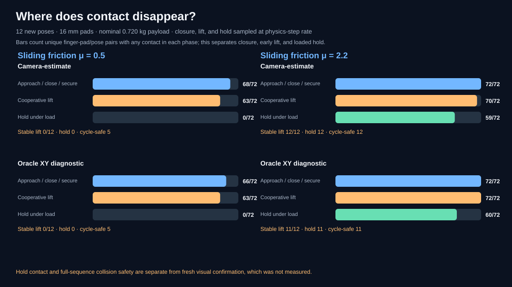

# Per-finger contact retention under friction stress

[Project overview](../../README.md) · [Pad-size validation](cooperative-pick-pad-friction-validation.md) · [Mass/friction stress map](cooperative-pick-material-robustness.md) · [Demo gallery](../video-gallery.md)

## Why this measurement

The earlier material sweep labeled every low-friction failure
`no_grasp_contact`. Its score uses the *minimum* pad-contact count during the
loaded hold window, so the label did not tell us whether the pads missed during
closure, touched briefly, or lost contact while lifting. The pad-size study
also measured only final outcomes. This follow-up records each named pad at
every MuJoCo timestep and compares contact through closing, early lift, and the
loaded hold.


This side-by-side replay uses camera-estimated control on held-out pose
`41000-000`. The left panel uses `μ=0.5`; the right uses `μ=2.2`. Replay clips
are not additional benchmark trials.

## Frozen protocol and instrumentation

- Twelve new target poses from seed `41000` in `[-0.09, 0.09] m` XY.
- Baseline 16 mm pad half-size, nominal 0.720116653454 kg payload, 20 mm open
  approach clearance, and the clearance release path.
- Friction `0.5` and `2.2`, each paired across the same poses with
  `camera_estimate` and `oracle_xy` control.
- Total: `12 × 2 × 2 = 48` physics trials and six named pad records per trial
  (288 pad/trial rows).
- Each pad record includes first/last contact time, the phase of first contact,
  physics steps and contact points by phase, contact-force solver output, and
  the commanded versus measured slide-joint position during `CLOSE SIX
  FINGERS`.

The contact force is calculated by MuJoCo's contact solver. It is a simulator
diagnostic, not a calibrated load-cell reading. The slide error compares a
position-actuator command with simulated joint position; it is not a motor
force measurement. Instrumentation reads the existing trajectory and does not
change its controller or contact settings.

## Results

The phase counts below are **finger-pad/pose pairs out of 72** per controller
condition, not unique target-pose counts.

| Friction | Controller | Contact during approach/close/secure | Contact during cooperative lift | Contact during loaded hold | Strict stable lift |
| ---: | --- | ---: | ---: | ---: | ---: |
| 0.5 | Camera estimate | 68/72 | 63/72 | 0/72 | 0/12 |
| 0.5 | Oracle XY diagnostic | 66/72 | 63/72 | 0/72 | 0/12 |
| 2.2 | Camera estimate | 72/72 | 70/72 | 59/72 | 12/12 |
| 2.2 | Oracle XY diagnostic | 72/72 | 72/72 | 60/72 | 11/12 |



All 24 low-friction trials had contact during closing/early lift but no pad
contact in the loaded hold window. The diagnostic categorizes those outcomes
as `contact_not_retained_to_hold`; it does not establish whether the payload
slid tangentially or the fingers separated as the arm motion continued. At
`μ=2.2`, the camera controller achieved 12/12 strict successes and the oracle
11/12. The one oracle failure reached the hold window with contact but did not
meet the stable-lift score.

This resolves the ambiguity in the old `no_grasp_contact` failure label: it
means no pad contacts survived into the scored hold window. It does not mean
there was never contact during grasp closure. The result points to retention
under load as the low-friction bottleneck for this fixed trajectory, while
leaving the precise slip/separation mechanism open.

The median, per-finger maximum slide tracking error during closure was about
6.0 mm under `μ=0.5` and 12.3–12.6 mm under `μ=2.2` across camera/oracle
conditions. These values describe the simulated position actuator's tracking
of its command; they should not be interpreted as force or hardware behavior.

## Artifacts and reproduction

- [48-row trial summary CSV](../../results/cooperative-pick-contact-diagnostics/cooperative-pick-contact-trials.csv)
- [288-row per-finger contact and slide telemetry CSV](../../results/cooperative-pick-contact-diagnostics/cooperative-pick-contact-by-finger.csv)
- [Condition summary, paired friction outcomes, and limits](../../results/cooperative-pick-contact-diagnostics/cooperative-pick-contact-summary.json)
- [Phase-resolved SVG scorecard](../../results/cooperative-pick-contact-diagnostics/cooperative-pick-contact-scorecard.svg)
- [Paired MP4](../../assets/demos/cooperative_pick_contact_friction_pair.mp4) · [GIF preview](../../assets/demos/cooperative_pick_contact_friction_pair.gif)
- [Low-friction replay](../../assets/demos/cooperative_pick_contact_low_friction.mp4) · [high-friction replay](../../assets/demos/cooperative_pick_contact_high_friction.mp4) · [replay metadata](../../assets/demos/cooperative_pick_contact_demos.json)
- Physics-step telemetry: [`camera_guided_cooperative_pick.py`](../../src/visual_servo_mujoco/camera_guided_cooperative_pick.py)
- Paired benchmark: [`cooperative_pick_contact_diagnostics.py`](../../src/visual_servo_mujoco/cooperative_pick_contact_diagnostics.py)
- Data reconciliation: [`evidence_audit.py`](../../src/visual_servo_mujoco/evidence_audit.py)

```bash
uv run --locked visual-servo-cooperative-pick-contact-diagnostics
uv run --locked python -m visual_servo_mujoco.evidence_audit
```

## Limits and next experiment

This is a simulator-only diagnostic on a fixed cylinder, rigid pads,
author-selected friction, and idealized position actuators. The measured
contact wrench and joint tracking errors are outputs of that model, not real
sensor measurements. Twelve poses per condition are enough to localize this
failure within the scripted trajectory, not to estimate field reliability.
The oracle controller shares all contact and motion behavior with the camera
condition.

The next experiment should record payload-to-pad relative displacement during
cooperative lift and compare one contact-retention change against the unchanged
16 mm baseline on new paired poses. A candidate should remain opt-in until it
improves hold success without reducing full-sequence collision safety. Physical
stable lift also remains separate from fresh visual confirmation, which this
study did not measure.
