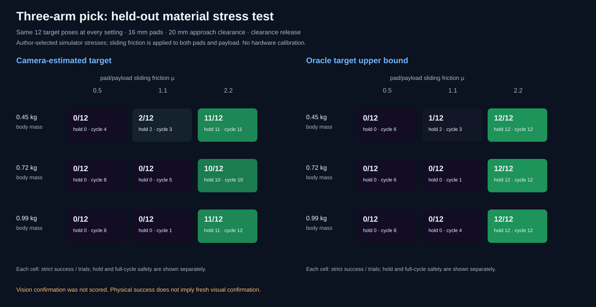

# Payload mass and grasp-friction stress

[Project overview](../../README.md) · [Camera-guided pick](camera-guided-cooperative-pick.md) · [Demo gallery](../video-gallery.md)

## Question

The camera-guided three-arm picker can detect and approach a target, but its
remaining physical failures often occur at grasp contact or during the lift.
This experiment asks whether those outcomes persist when payload mass and
pad/payload sliding friction are varied independently. The oracle controller
uses the true target XY as an upper-bound diagnostic; if it fails alongside
camera estimation, the result points toward contact mechanics or the shared
trajectory rather than only target localization.


The animation is one matched pose already counted in the trial table. The
camera-estimate run is shown at nominal mass with high friction and at 0.99 kg
with low friction. It illustrates the contrast, not the aggregate success
rate.

## Frozen protocol

- Twelve target poses were sampled uniformly within `[-0.09, 0.09] m` in XY
  using base seed `40800`. The same coordinates are replayed at every setting.
- Payload body masses: `0.45 kg`, the legacy nominal `0.720116653454 kg`, and
  `0.99 kg`.
- MuJoCo sliding-friction coefficient, applied to the finger pads and payload
  canister: `0.5`, `1.1`, and `2.2`.
- All other pickup settings are fixed: 16 mm pad half-size, 20 mm lowest-pad
  approach clearance, and the clearance release trajectory.
- Each pose/material combination runs both `camera_estimate` and `oracle_xy`.
  The oracle receives target ground truth and is not the camera system.
- Total: 9 material combinations × 12 poses × 2 controllers = 216 physical
  simulation trials.

`physical_stable_lift_success` is the strict score: the payload passes the
full-hold stability checks and the complete trajectory has no disallowed
inter-arm, arm-environment, or non-finger arm-payload collisions. The saved
data also reports the hold check and full-sequence collision safety
separately. Fresh visual confirmation is **not measured** in this experiment.

The nominal mass keeps the original geometry-derived inertial model because an
explicit inertial, despite compiling to the same mass, center of mass, and
principal moments, changed long contact outcomes in the scripted scene. For
off-nominal mass settings, the canister collider retains friction but has zero
density, as do the collision-disabled visual bands and cap; the requested
body mass and proportionally scaled principal moments are then explicit. This
keeps the established nominal trajectory while preventing trim mass from
changing the off-nominal body-mass settings.

## Results

Strict physical stable-lift successes out of 12 paired target poses:

| Payload body mass | Sliding friction | Camera-estimate | Oracle XY |
| ---: | ---: | ---: | ---: |
| 0.45 kg | 0.5 | 0/12 | 0/12 |
| 0.45 kg | 1.1 | 2/12 | 1/12 |
| 0.45 kg | 2.2 | 11/12 | 12/12 |
| 0.720 kg nominal | 0.5 | 0/12 | 0/12 |
| 0.720 kg nominal | 1.1 | 0/12 | 0/12 |
| 0.720 kg nominal | 2.2 | 10/12 | 12/12 |
| 0.99 kg | 0.5 | 0/12 | 0/12 |
| 0.99 kg | 1.1 | 0/12 | 0/12 |
| 0.99 kg | 2.2 | 11/12 | 12/12 |



At friction `0.5`, all trials in both controllers ended without a stable grasp;
the recorded failure label was `no_grasp_contact` for all 72 runs across the
three masses. At friction `2.2`, the camera-estimate controller passed 32/36
trials and oracle passed 36/36. At `1.1`, only the lightest payload had any
strict successes (2/12 camera-estimate and 1/12 oracle). The oracle's matching
failures under low friction and at nominal/heavy mass support a contact-physics
or shared-trajectory bottleneck in those settings; this does not prove the
camera planner has no additional failures.

The 95% Wilson interval for camera-estimate success is 0%-24.3% for every
zero-success cell, 4.7%-44.8% for 2/12 at 0.45 kg and friction 1.1, and
64.6%-98.5% for 11/12 at 0.45 kg and friction 2.2, and 55.2%-95.3% for 10/12
at nominal mass and friction 2.2. Even the high-friction
cells are small samples; they indicate a stress trend in this simulator, not
reliability for real objects.

## Artifacts and code

- [Exact 216-row CSV](../../results/cooperative-pick-material-validation/cooperative-pick-material-trials.csv)
- [Summary JSON with per-condition counts and Wilson intervals](../../results/cooperative-pick-material-validation/cooperative-pick-material-summary.json)
- [Camera/oracle scorecard SVG](../../results/cooperative-pick-material-validation/cooperative-pick-material-scorecard.svg)
- [Matched nominal/stress MP4](../../assets/demos/cooperative_pick_material_matched_comparison.mp4) · [GIF](../../assets/demos/cooperative_pick_material_matched_comparison.gif)
- [Nominal replay](../../assets/demos/cooperative_pick_material_nominal_material.mp4) · [heavy/low-friction replay](../../assets/demos/cooperative_pick_material_heavy_low_friction_stress.mp4)
- [Demo sidecar](../../assets/demos/cooperative_pick_material_demos.json) records the source pose and says the replays are not additional trials.
- Main experiment: [`cooperative_pick_material_validation.py`](../../src/visual_servo_mujoco/cooperative_pick_material_validation.py)
- Scene mass and inertia: [`cooperative_pick_demo.py`](../../src/visual_servo_mujoco/cooperative_pick_demo.py)
- Camera-estimate/oracle trial runner: [`camera_guided_cooperative_pick.py`](../../src/visual_servo_mujoco/camera_guided_cooperative_pick.py)
- Evidence reconciliation: [`evidence_audit.py`](../../src/visual_servo_mujoco/evidence_audit.py)
- [Historical density-prototype report and media](../../results/cooperative-pick-density-prototype-archive/README.md), kept separate from the explicit-mass result.

Reproduce with:

```bash
uv run --locked visual-servo-cooperative-pick-material-validation
uv run --locked python -m visual_servo_mujoco.evidence_audit
```

The evidence audit reconciles condition labels, full-precision model masses,
paired pose coordinates, outcome counts, failure labels, and Wilson intervals.

## Limits and next measurement

- Masses and friction levels are author-selected synthetic stresses, not
  measured material properties for a particular object or gripper.
- One seed and 12 poses per cell are enough to expose obvious failure regions,
  not enough for precise success-rate estimates or broad generalization.
- The payload remains a fixed cylinder; object shape, center of mass offset,
  rotational inertia changes independent of mass, and slip during transport
  were not independently swept.
- The oracle comparator shares the same grasp and actuator trajectory, so it
  cannot isolate all planner and controller limitations.
- The benchmark does not measure image-only task completion, fresh visual
  confirmation, or any real-hardware behavior.

The next useful manipulation study is a larger, independent pose block at a
small number of friction/mass settings chosen from this stress map, with
contact-onset and slip measurements recorded over time. Keep the present
trajectory and baseline intact until a candidate change improves the paired
held-out physical score without increasing collision failures.
