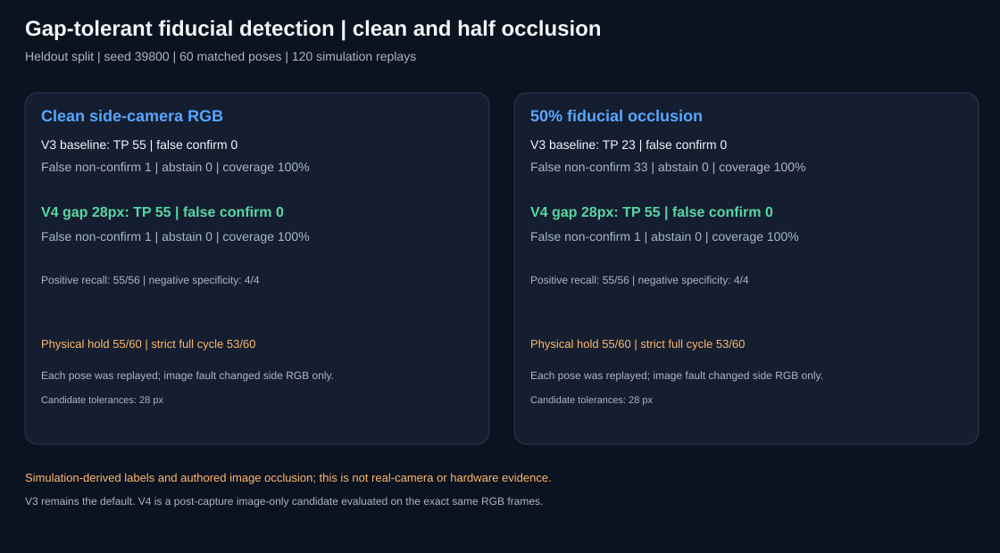
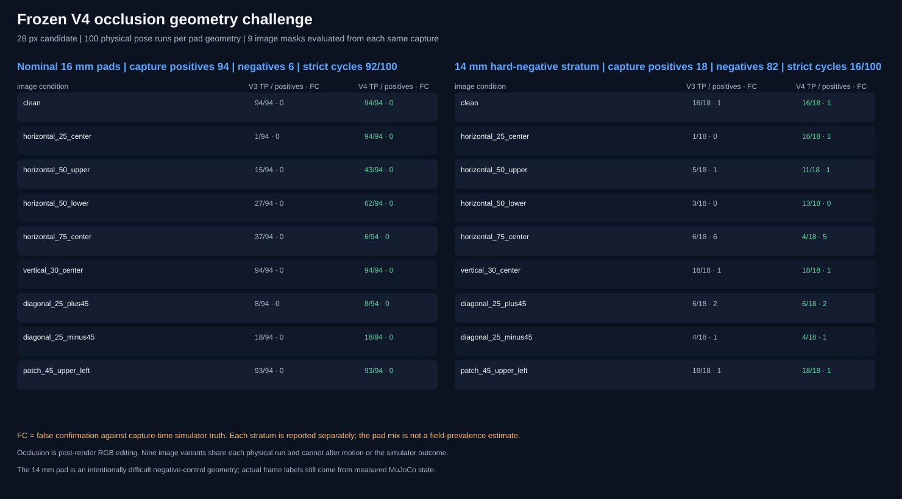

# Gap-tolerant post-pick marker measurement

[Project overview](../../README.md) · [Image-fault study](cooperative-pick-visual-faults.md) · [Video gallery](../video-gallery.md)

## Motivation and scope

The preceding V3 image-fault study found that a central 50% band across the
magenta payload fiducial caused 32 false non-confirmations among 58
capture-time-positive poses. The detector chose one largest connected
component, so the band split the marker and changed its measured center or
principal angle.

This experiment evaluates an opt-in V4 measurement that joins components only
when their horizontal extents overlap by at least half and their vertical gap
does not exceed a specified pixel tolerance. The measured center and PCA angle
use observed pixels only; the gap is not filled. V4 reuses V3's fixed 50 px
rise, 12 px inter-frame drift, and 4 degree rotation thresholds. The initial
overhead control image, motion, MuJoCo scene, and physical outcomes are
independent of the detector candidate. V3 remains the default.

The initial overhead RGB plans the pick. The image verifier receives the
initial side-camera RGB and two fresh side-camera frames only. Capture-time
payload height and tilt are recorded later as simulator labels. Physical hold
and full-cycle collision safety remain separate outcomes.

## Protocol and frozen selection

The development split uses base seed 39700, three seeds, and 10 target poses
per seed. Each target pose is replayed with clean RGB and with a central 50%
fiducial occlusion, for 30 matched poses and 60 simulation replays. The same
RGB frames are evaluated by V3 and candidate gap tolerances 12, 20, and 28 px.

The selection rule required exact V3 decision parity on every clean frame and
zero false confirmations on clean and occluded development observations. Among
eligible candidates, it maximized occluded true positives and used the
smallest gap tolerance to break ties. The 28 px candidate was selected: it
preserved 30/30 clean decisions, made 29/29 occlusion-positive confirmations,
and produced no false confirmations. The 12 px and 20 px options recovered
15/29 and 14/29 positive labels respectively.

The frozen validation uses a disjoint base seed 39800, three seeds, and 20
target poses per seed. It evaluates only the selected 28 px option, again on
clean and 50% occluded side-camera RGB, for 60 matched poses and 120
simulation replays. No threshold was adjusted after this split.

## Results

| Split / image condition | Rule | TP / positive | False confirmation | TN / negative | False non-confirmation | Abstain |
| --- | --- | ---: | ---: | ---: | ---: | ---: |
| Development clean | V3 | 28/29 | 0 | 1/1 | 1 | 0 |
| Development clean | V4, 28 px | 28/29 | 0 | 1/1 | 1 | 0 |
| Development 50% occlusion | V3 | 15/29 | 0 | 1/1 | 14 | 0 |
| Development 50% occlusion | V4, 28 px | 29/29 | 0 | 1/1 | 0 | 0 |
| Held-out clean | V3 | 55/56 | 0 | 4/4 | 1 | 0 |
| Held-out clean | V4, 28 px | 55/56 | 0 | 4/4 | 1 | 0 |
| Held-out 50% occlusion | V3 | 23/56 | 0 | 4/4 | 33 | 0 |
| Held-out 50% occlusion | V4, 28 px | 55/56 | 0 | 4/4 | 1 | 0 |

On the held-out occlusion set, positive recall rose from 41.1% for V3
(Wilson 95% interval 29.2%-54.1%) to 98.2% for V4 (90.6%-99.7%). Both rules
made zero false confirmations and labeled all four negatives as not confirmed.
The specificity interval remains wide at 51.0%-100% because there were only
four negative labels. V4 exactly matched V3 on all 60 clean validation poses.

The matched physical outcomes were identical between clean and occluded
replays for every target pose. In the held-out block, 55/60 runs met the
payload hold criteria and 53/60 were strict full-cycle successes under both
image conditions. These are 60 physical pose replays, not 120 independent
physical outcomes. V4 did not change the trajectory or improve physical
reaching; it changed only image measurements.



The [development scorecard](../../results/cooperative-pick-occlusion-development/cooperative-pick-occlusion-scorecard.svg), [frozen validation scorecard](../../results/cooperative-pick-occlusion-heldout/cooperative-pick-occlusion-scorecard.svg), [development CSV](../../results/cooperative-pick-occlusion-development/cooperative-pick-occlusion-trials.csv), [held-out CSV](../../results/cooperative-pick-occlusion-heldout/cooperative-pick-occlusion-trials.csv), and both JSON summaries preserve the exact per-pose records.

## Demonstrations

These two clips replay one development pose already included in the 39700
CSV. The side-camera frames overlay the V3 component box in yellow and V4's
bounded union in green. The end card places both fresh-frame image verdicts
beside the separate MuJoCo physical audit.

| Input | Replay |
| --- | --- |
| Clean RGB | [MP4](../../assets/demos/cooperative_pick_occlusion_v4_clean.mp4) · [GIF](../../assets/demos/cooperative_pick_occlusion_v4_clean.gif) |
| 50% marker occlusion | [MP4](../../assets/demos/cooperative_pick_occlusion_v4_marker_occlusion_50pct.mp4) · [GIF](../../assets/demos/cooperative_pick_occlusion_v4_marker_occlusion_50pct.gif) |
| Replay decisions and source pose | [Metadata](../../assets/demos/cooperative_pick_occlusion_v4_demos.json) |

## Reproduction

```bash
uv run --locked visual-servo-cooperative-pick-occlusion-validation \
  --stage development --base-seed 39700 --seeds 3 --samples-per-seed 10
uv run --locked visual-servo-cooperative-pick-occlusion-validation \
  --stage heldout --base-seed 39800 --seeds 3 --samples-per-seed 20 \
  --development-base-seed 39700 --selected-gap-tolerance 28
uv run --locked --extra demo python scripts/generate_cooperative_pick_occlusion_demos.py
```

The held-out run is intentionally a separate command. Its selected tolerance
must come from development, and it does not search other values. The saved
scorecard reports both conditions, while each CSV row retains capture-time
truth and physical outcomes separately.

## Limitations of the initial central-band validation

- Both splits use an ideal synthetic fiducial and an authored gray band. This
  does not establish robustness to real scene occluders, glare, lighting
  changes, lens distortion, blur, or camera movement.
- There are only one and four negative poses in development and validation,
  respectively. Zero observed false confirmations is weak evidence for
  specificity.
- A connected magenta distractor aligned above or below the marker could be
  joined if it falls within the tolerance and overlap limits. The detector does
  not identify fragment appearance or object identity.
- Two fresh images do not prove continuous payload holding or safe release.
- That first study supports only a bounded synthetic central-band case. The
  later geometry challenge below adds mask variants and more negatives, but
  still does not justify making V4 the runtime default.

## Frozen geometry and negative-control challenge

The follow-up challenge freezes the selected 28 px V4 tolerance and evaluates
it on disjoint seed blocks rather than searching for a new tolerance. It
includes 100 nominal 16 mm pad poses and 100 poses with the previously studied
14 mm pad geometry, which produced frequent physical lift failures. The second
group enriches the negative examples for checking false confirmation; it is an
intentional challenge stratum, not an estimate of how often failures occur in
practice. Every label still comes from MuJoCo's payload height, inter-frame
drift, and tilt at the two image capture times.

Each physical pose is simulated once. Its initial side-camera frame and two
fresh side-camera frames are reused to compare V3 and frozen V4 across nine
image conditions: clean; centered horizontal bands at 25% and 75% of marker
height; upper- and lower-offset horizontal bands at 50%; a centered vertical
band at 30% of marker width; diagonal bands at +45 and -45 degrees; and an
upper-left patch covering 45% of the marker bounding-box width and height.
Masks are applied after rendering to side-camera RGB only. They are not
physical occluders, and the candidate decisions cannot change the trajectory.

The resulting scorecard and trial table report each pad stratum separately.
The 28 px tolerance is not adjusted based on these outcomes. A demo generator
selects a counted positive example, a representative masked positive case, a
clean hard-negative false confirmation, and a masked hard-negative false
confirmation. It reruns those exact poses for video; these illustrative replays
are not extra benchmark trials.

### Measured outcomes

The nominal 16 mm group had 94 capture-time positive and six negative labels.
Its payload met the stable-hold criteria in 94/100 runs and the strict full
cycle in 92/100. The 14 mm negative-control group had 18 capture-time positive
and 82 negative labels; only 16/100 met the stable-hold and strict full-cycle
criteria. Thus the image label at two capture instants is not interchangeable
with full-hold or full-cycle physical success.

The table reports true positives and false confirmations. Abstentions remain
separate in the trial CSV and JSON summary.

| Side-camera image condition | Nominal positives V3 → V4 / 94 | 14 mm positives V3 → V4 / 18 | False confirmations V3 → V4 / 82 negatives |
| --- | ---: | ---: | ---: |
| Clean | 94 → 94 | 16 → 16 | 1 → 1 |
| Horizontal band, 25% centered | 1 → 94 | 1 → 16 | 0 → 1 |
| Horizontal band, 50% upper offset | 15 → 43 | 5 → 11 | 1 → 1 |
| Horizontal band, 50% lower offset | 27 → 62 | 3 → 13 | 0 → 0 |
| Horizontal band, 75% centered | 37 → 6 | 6 → 4 | 6 → 5 |
| Vertical band, 30% centered | 94 → 94 | 18 → 18 | 1 → 1 |
| Diagonal band, +45° | 8 → 8 | 6 → 6 | 2 → 2 |
| Diagonal band, −45° | 18 → 18 | 4 → 4 | 1 → 1 |
| Upper-left patch, 45% linear size | 93 → 93 | 18 → 18 | 1 → 1 |

The result is specific to fragments separated horizontally in the image:
moderate horizontal bands often let V4 recover positives V3 rejects. V4 did
not improve the vertical, diagonal, or corner-patch cases. At 75% band height,
nominal positive detections fell from 37/94 to 6/94, and the hard-negative
group still produced five V4 false confirmations among 82 negative labels.
The 25% band also added one false confirmation in that group (V3 had zero).
These failures rule out a general claim that the gap option makes verification
robust to occlusion. **V4 remains opt-in; V3 remains the default.**



The exact [1,800-row CSV](../../results/cooperative-pick-occlusion-shape-challenge/cooperative-pick-occlusion-shape-trials.csv), [summary JSON](../../results/cooperative-pick-occlusion-shape-challenge/cooperative-pick-occlusion-shape-summary.json), and [evidence audit](../../src/visual_servo_mujoco/evidence_audit.py) preserve the split, masks, decisions, abstentions, physical outcomes, and per-pose pairings.

| Case | Replay | Interpretation |
| --- | --- | --- |
| Nominal clean positive | [MP4](../../assets/demos/cooperative_pick_occlusion_shape_clean_nominal_positive.mp4) · [GIF](../../assets/demos/cooperative_pick_occlusion_shape_clean_nominal_positive.gif) | V3 and V4 both confirm the lifted, stable marker. |
| Horizontal-band recovery | [MP4](../../assets/demos/cooperative_pick_occlusion_shape_nominal_positive_mask.mp4) · [GIF](../../assets/demos/cooperative_pick_occlusion_shape_nominal_positive_mask.gif) | V3 rejects and V4 confirms the same positive fresh frames. |
| Clean hard-negative failure | [MP4](../../assets/demos/cooperative_pick_occlusion_shape_hard_negative_clean_false_confirm.mp4) · [GIF](../../assets/demos/cooperative_pick_occlusion_shape_hard_negative_clean_false_confirm.gif) | Both rules confirm while simulator truth reports a tilted payload that was not raised and stable at both captures. |
| Severe-band hard-negative failure | [MP4](../../assets/demos/cooperative_pick_occlusion_shape_hard_negative_occlusion_false_confirm.mp4) · [GIF](../../assets/demos/cooperative_pick_occlusion_shape_hard_negative_occlusion_false_confirm.gif) | Both rules confirm an unraised, tilted payload under a 75% band. |
| Replay IDs and outcomes | [Metadata](../../assets/demos/cooperative_pick_occlusion_shape_demos.json) | All four clips rerun challenge rows and add no trials. |

Reproduce the challenge and representative demos with:

```bash
uv run --locked visual-servo-cooperative-pick-occlusion-challenge
uv run --locked --extra demo python scripts/generate_cooperative_pick_occlusion_challenge_demos.py
uv run --locked python -m visual_servo_mujoco.evidence_audit
```
