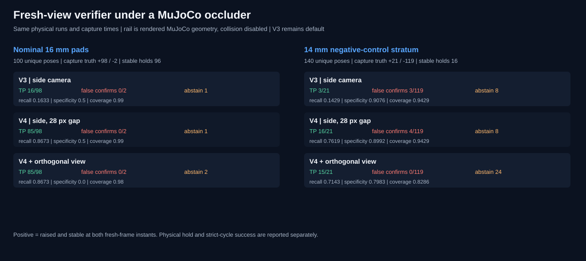

# Orthogonal-view verification under a rendered MuJoCo occluder

[Project overview](../../README.md) · [Video gallery](../video-gallery.md) · [Previous occlusion challenge](cooperative-pick-occlusion.md)

## Why this experiment

The frozen V4 mask-shape challenge retained a real false confirmation: one side
camera showed a magenta marker that appeared raised and stable even though the
payload was tilted. The V4 fragment rule also recovered some occluded positives
but produced four false confirmations in the later held-out rail challenge's
failure-prone 14 mm pad stratum. Those measured errors suggested adding an
independent orientation view, while keeping V3 and V4 available as baselines.

The opt-in candidate uses the same fresh marker observation from two
perpendicular side cameras. Each view must independently satisfy the frozen
50 px rise, 12 px inter-frame drift, and 4 degree marker-rotation gates. Both
views use V4's already-selected 28 px vertical fragment-gap tolerance. Missing
marker evidence in either view produces abstention. This candidate does not
feed motion planning and does not receive MuJoCo state.

## MuJoCo scene and protocol

`cooperative_pick_demo.py` adds a static opaque box called
`verification_occluder_rail` at `(0, -0.62, 0.347)` m, with half-sizes
`(0.12, 0.008, 0.006)` m. It crosses the original side camera's line of sight
to the payload marker; a new camera at right angles views a second visual-only
marker on the payload. The rail and both markers have collision disabled. This
lets the experiment test occlusion rendered by MuJoCo without changing the arm
contact dynamics. It does not test obstacle avoidance.

Each of 240 randomized target poses runs once. V3, side-only V4, and two-view
V4 process the same initial and two fresh images captured at 8.4 s and 8.8 s.
The seed blocks are disjoint from the preceding V4 challenge: 100 nominal
16 mm pad poses use seeds 40500-40504; 140 negative-control 14 mm pad poses use
seeds 40600-40606. The 14 mm group was intentionally selected because earlier
work found frequent grasp and tilt failures; its frequency is not a deployment
estimate. All thresholds and the rail geometry were fixed before this run. No
development tuning was performed on these held-out rows.

Capture-time truth is assigned afterward from MuJoCo height, stability between
the two captures, and tilt. The project separately records payload hold through
the full 1.6 s interval and strict full-cycle success through release and
withdrawal. A two-frame positive is not treated as a successful physical pick.

## Held-out results

Across the 240 unique pose runs there were 119 capture-time positives and 121
negatives. The table aggregates both pad strata. A false confirmation means a
visual `confirmed` decision on a capture-time negative. Abstentions are shown
separately; the reported negative specificity counts abstentions as unresolved,
so it is lower when a method abstains more often.

| Rule on the same rail-occluded frames | True positive / 119 | False confirmation / 121 | True negative / 121 | False non-confirmation | Abstain | Coverage |
| --- | ---: | ---: | ---: | ---: | ---: | ---: |
| V3, original side camera | 19 (16.0%) | 3 (2.5%) | 109 (90.1%) | 100 | 9 | 231/240 (96.3%) |
| V4, side camera, 28 px gap | 101 (84.9%) | 4 (3.3%) | 108 (89.3%) | 18 | 9 | 231/240 (96.3%) |
| V4 plus orthogonal view, opt-in | 100 (84.0%) | **0 (0.0%)** | 95 (78.5%) | 19 | 26 | 214/240 (89.2%) |

For the two-view candidate, zero false confirmations among 121 negative labels
has a Wilson 95% upper bound of 3.1%. This finite simulated sample is not a
risk guarantee. The candidate removed the four side-only V4 false
confirmations from the 14 mm stratum and did not introduce a false confirmation
among the two nominal-pad negatives. It also abstained on 24/119 negatives in
the enriched hard-negative stratum and missed 19 positive poses, one more
positive than side-only V4. Therefore it trades availability for fewer false
confirmations; it is not a universal improvement.

| Stratum | Poses | Capture positives / negatives | Stable hold | Strict full cycle | V3 TP / FC / abstain | V4 side TP / FC / abstain | V4 two-view TP / FC / abstain |
| --- | ---: | ---: | ---: | ---: | ---: | ---: | ---: |
| Nominal 16 mm pads | 100 | 98 / 2 | 96 | 96 | 16 / 0 / 1 | 85 / 0 / 1 | 85 / 0 / 2 |
| 14 mm negative control | 140 | 21 / 119 | 16 | 12 | 3 / 3 / 8 | 16 / 4 / 8 | 15 / 0 / 24 |

Overall, 112/240 trajectories passed the full-hold criterion and 108/240
passed strict full-cycle checks. These counts are independent of which
verifier is scored: the rail and markers do not collide, and the classifier
does not change the arm trajectory.



The exact [240-row trial CSV](../../results/cooperative-pick-orthogonal-verification-heldout/cooperative-pick-orthogonal-verification-trials.csv), [summary and Wilson intervals](../../results/cooperative-pick-orthogonal-verification-heldout/cooperative-pick-orthogonal-verification-summary.json), and [evidence auditor](../../src/visual_servo_mujoco/evidence_audit.py) preserve the per-pose decisions, capture-time labels, hold and full-cycle outcomes, and collision counts.

## Videos

Each clip replays one pose already counted in the held-out CSV. The end card
shows initial and fresh frames from both cameras, the two-view image result,
and the simulator labels separately. Replays add no benchmark trials.

| Case | Demo | What it demonstrates |
| --- | --- | --- |
| Positive recovered under the in-scene rail | [MP4](../../assets/demos/cooperative_pick_orthogonal_occlusion_recovery.mp4) · [GIF](../../assets/demos/cooperative_pick_orthogonal_occlusion_recovery.gif) | V3 rejects the partially occluded side marker; V4 plus the orthogonal view confirms the same true positive. |
| Side-view false confirmation rejected | [MP4](../../assets/demos/cooperative_pick_orthogonal_false_confirmation_rejected.mp4) · [GIF](../../assets/demos/cooperative_pick_orthogonal_false_confirmation_rejected.gif) | V3 and side-only V4 confirm a tilted payload; the orthogonal marker angle causes a rejection. |
| True lift rejected | [MP4](../../assets/demos/cooperative_pick_orthogonal_true_lift_not_confirmed.mp4) · [GIF](../../assets/demos/cooperative_pick_orthogonal_true_lift_not_confirmed.gif) | A real raised, stable lift is not confirmed, illustrating the candidate's conservative false non-confirmation. |
| Source pose IDs and decisions | [Metadata](../../assets/demos/cooperative_pick_orthogonal_verification_demos.json) | All three videos are deterministic replays of counted rows. |

## Reproduction

```bash
uv run --locked visual-servo-cooperative-pick-orthogonal-validation
uv run --locked --extra demo python scripts/generate_cooperative_pick_orthogonal_demos.py
uv run --locked python -m visual_servo_mujoco.evidence_audit
uv run --locked pytest -q
```

The full run uses seeds 40500-40504 and 40600-40606 with 20 target poses per
seed. `--allow-small` is available for a smoke run; it skips the required
80-negative minimum and writes to a caller-selected output directory.

## Limits and next experiment

- The test uses ideal MuJoCo cameras and synthetic visual markers, not a real
  camera, image sensor, lighting change, or physical robot.
- The rail is rendered geometry with collision disabled. Occlusion is physical
  in the camera model but it does not obstruct the robot.
- The failure-prone 14 mm pad mix is an enriched challenge distribution. The
  two nominal negatives and 119 hard negatives must not be pooled as a natural
  deployment prior without an explicit weighting model.
- The two-view candidate's zero observed false confirmations still has a 3.1%
  Wilson upper bound. It also abstains more than V3/V4 and misses valid lifts.
- The image decision means raised and stable at two capture instants. It does
  not prove continuous holding, safe release, or physical success.
- **V3 remains the runtime default. V4 and V4 plus orthogonal view remain
  experimental and opt-in.**

The next useful work is to inspect the 19 false non-confirmations and the 24
hard-negative abstentions pose by pose, then freeze a new candidate only if
their image-level causes are fixable without reusing the held-out labels. Any
new claim should be checked on another disjoint seed block and under a second
rail position or occlusion shape.
