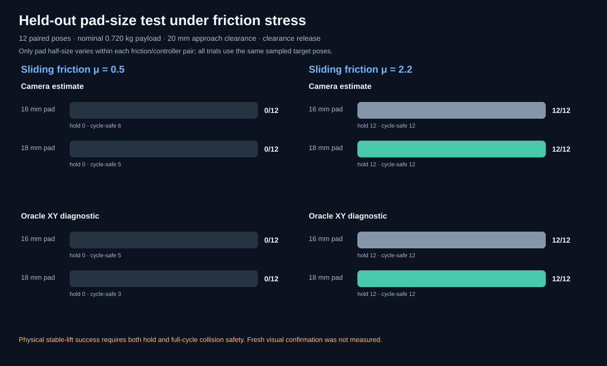

# Pad geometry under low-friction grasp stress

[Project overview](../../README.md) · [Mass/friction stress map](cooperative-pick-material-robustness.md) · [Demo gallery](../video-gallery.md)

## Question

The 216-trial material study found that every friction-0.5 run ended with
`no_grasp_contact`, including oracle-target trials. A larger 18 mm pad appeared
promising in an earlier pose run, but that run also changed the release
trajectory. This fresh-seed test isolates pad half-size while keeping payload,
friction, target, approach, release, and controller paired.


The GIF is a replay of held-out pose `40900-000`; the four rendered clips are
not extra benchmark trials. It shows the same camera-estimate pose with 16 mm
and 18 mm pad half-sizes at friction `0.5` and `2.2`.

## Frozen protocol

- Twelve new target poses sampled uniformly within `[-0.09, 0.09] m` in XY,
  using base seed `40900`.
- Baseline pad half-size: `0.016 m`; candidate: `0.018 m`.
- Nominal payload body mass: `0.720116653454 kg`.
- Pad/payload sliding friction: `0.5` and `2.2`, retained from the earlier
  stress map as a failure condition and a high-friction reference.
- The lowest open-pad approach remains `0.020 m`, and the clearance release
  profile is fixed for every trial.
- Both camera-estimate and oracle-XY diagnostic controllers run on each
  target, pad size, and friction condition.
- Total: `12 × 2 × 2 × 2 = 96` physics trials.

`physical_stable_lift_success` requires both a stable payload hold and a
collision-safe complete sequence. The CSV and summary also retain those two
components separately. Fresh visual confirmation is **not measured**.

## Results

Strict physical stable-lift successes out of 12 paired target poses:

| Sliding friction | Controller | 16 mm pad half-size | 18 mm pad half-size |
| ---: | --- | ---: | ---: |
| 0.5 | Camera estimate | 0/12 | 0/12 |
| 0.5 | Oracle XY diagnostic | 0/12 | 0/12 |
| 2.2 | Camera estimate | 12/12 | 12/12 |
| 2.2 | Oracle XY diagnostic | 12/12 | 12/12 |



At friction `0.5`, all 48 trials across both pad sizes and controllers were
labeled `no_grasp_contact`, meaning the trial recorded zero pad contacts in
the required loaded hold window. That label does not establish whether the
pads touched the canister during closing or early lift; the follow-up
[phase-resolved contact diagnostics](cooperative-pick-contact-diagnostics.md)
measured those phases directly. The stable-hold score was 0/12 in every
low-friction cell. Full-cycle collision safety was
6/12 versus 5/12 for camera-estimate with 16 mm versus 18 mm pads, and 5/12
versus 3/12 for the oracle diagnostic. Those safety counts are descriptive
with only twelve poses and do not establish a pad-size effect.

At friction `2.2`, both pad sizes produced 12/12 strict successes for both
controllers. The paired outcomes contain no candidate-only or baseline-only
successes: all 12 poses succeeded at both sizes in both controller conditions.
The 95% Wilson intervals are 0%-24.3% for each 0/12 cell and 75.7%-100% for
each 12/12 cell.

The result does not support increasing the pad half-size to 18 mm as a remedy
for the low-friction hold-contact failure. Both sizes had zero stable lifts at
friction `0.5`, while both scored 12/12 at `2.2`. The candidate also had fewer
full-cycle safe trials under low friction, though the small sample cannot
establish a regression. Keep the existing 16 mm runtime geometry and treat
18 mm as an unselected experiment.

## Artifacts and reproduction

- [96-row paired trial CSV](../../results/cooperative-pick-pad-friction-validation/cooperative-pick-pad-friction-trials.csv)
- [Summary JSON and paired outcome counts](../../results/cooperative-pick-pad-friction-validation/cooperative-pick-pad-friction-summary.json)
- [SVG scorecard](../../results/cooperative-pick-pad-friction-validation/cooperative-pick-pad-friction-scorecard.svg)
- [Four-way MP4 replay](../../assets/demos/cooperative_pick_pad_friction_matched.mp4) · [GIF preview](../../assets/demos/cooperative_pick_pad_friction_matched.gif)
- [Replay metadata](../../assets/demos/cooperative_pick_pad_friction_demo.json) · [four individual clips](../../assets/demos/cooperative_pick_pad_friction_mu_0.5_pad_16mm.mp4), [18 mm at low friction](../../assets/demos/cooperative_pick_pad_friction_mu_0.5_pad_18mm.mp4), [16 mm at high friction](../../assets/demos/cooperative_pick_pad_friction_mu_2.2_pad_16mm.mp4), and [18 mm at high friction](../../assets/demos/cooperative_pick_pad_friction_mu_2.2_pad_18mm.mp4)
- Runner: [`cooperative_pick_pad_friction_validation.py`](../../src/visual_servo_mujoco/cooperative_pick_pad_friction_validation.py)
- Evidence consistency checks: [`evidence_audit.py`](../../src/visual_servo_mujoco/evidence_audit.py)

```bash
uv run --locked visual-servo-cooperative-pick-pad-friction-validation
uv run --locked python -m visual_servo_mujoco.evidence_audit
```

## Limits and next experiment

The two friction settings are synthetic simulator stresses, not measured
properties of a physical gripper or object. The payload is a fixed cylinder;
this test does not vary object shape, pad material compliance, contact
stiffness, or joint torque limits. Twelve target poses are enough to reject
this pad-size change as a clear fix for the observed zero-contact failure, but
not to estimate real-world reliability. Oracle XY shares the same grasp path
and only removes target-position estimation error.

The follow-up diagnostic found that, at friction `0.5`, pad contact often
continues through closing and the early lift but is absent during the loaded
hold. It did not distinguish tangential slip from the fingers separating as
the arms move. The next experiment should record relative payload/finger motion
through lift, then test one retention change on a fresh pose block. Do not
promote a geometry or controller change unless paired stable-lift success
improves without reducing full-cycle collision safety. Physical success still
needs a separate fresh-image confirmation study.
