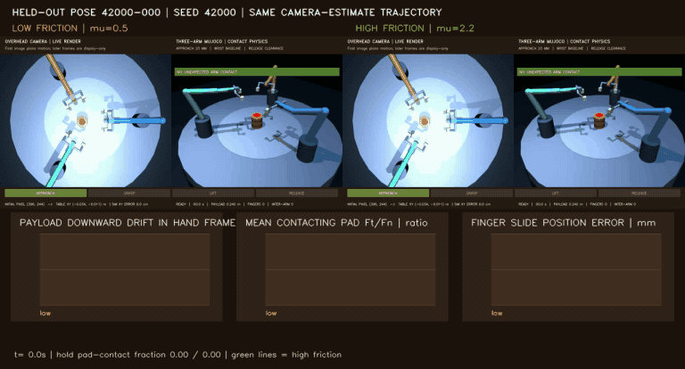

# What causes low-friction contact loss?

[Project overview](../../README.md) · [Per-finger contact diagnostic](cooperative-pick-contact-diagnostics.md) · [Demo gallery](../video-gallery.md)

## Question

The earlier phase-resolved study showed that the low-friction pads touched the
payload during closure and early lift but none remained in contact during the
loaded hold. It could not distinguish payload slip from fingers opening under
load. This follow-up measures both the payload's motion relative to each hand
and the finger slide joints while recording each pad's simulated contact
wrench.

## Frozen protocol

- Twelve new target poses sampled from seed `42000` in `[-0.09, 0.09] m` XY.
- Paired friction settings `0.5` and `2.2`, each run with
  `camera_estimate` and the diagnostic `oracle_xy` controller.
- The payload mass, 16 mm pad half-size, 20 mm approach clearance, and
  clearance release profile are held constant.
- Total: 48 physics trials and 576 pad/phase records.
- Telemetry is sampled every tenth 2 ms physics step (20 ms): summed normal
  force, summed tangential force, their ratio while contacting, position
  command error for each finger slide, and payload-center displacement in each
  arm-hand frame from the first cooperative-lift sample.

The telemetry is evaluation-only. It reads the existing trajectory and does
not change control or contact parameters. Contact forces and joint positions
are MuJoCo simulated states, not calibrated hardware sensor measurements.
The contact-force components are expressed in the contact frame; the first
three entries are force components, with the first as normal and the next two
as tangential components ([MuJoCo API reference](https://mujoco.readthedocs.io/en/stable/APIreference/APIfunctions.html#mj-contactforce), [contact-frame explanation](https://mujoco.readthedocs.io/en/latest/programming/simulation.html#contacts)).

## Results

<!-- The generated summary and table are the source of truth. -->

| Friction | Controller | Strict stable lift | Full-cycle collision safe | Hold contact sample fraction | Median max downward payload drift relative to hand | Median max finger-slide command error during hold |
| ---: | --- | ---: | ---: | ---: | ---: | ---: |
| 0.5 | Camera estimate | 0/12 | 6/12 | 0.000 | 156.3 mm | 0.019 mm |
| 0.5 | Oracle XY diagnostic | 0/12 | 7/12 | 0.000 | 155.9 mm | 0.020 mm |
| 2.2 | Camera estimate | 12/12 | 12/12 | 0.702 | 30.6 mm | 1.916 mm |
| 2.2 | Oracle XY diagnostic | 12/12 | 12/12 | 0.714 | 32.2 mm | 2.204 mm |

The paired replay plots the three-arm motion beside the force ratio, payload
drift, and slide-position error. It is an illustrative replay of one scored
pose and does not add benchmark trials.



On every low-friction trial, sampled pad contact disappeared during the loaded
hold, and none met the strict physical stable-lift score. The payload moved a
median 156 mm down relative to its grippers, while the median maximum finger
slide-command error during the hold was only 0.019–0.020 mm. During the
contacting lift samples, the median tangential-to-normal force ratio was 0.468
for camera control and 0.470 for oracle control, close to the model's
`μ=0.5` setting. Together, these measurements are consistent with the payload
sliding out of fingers that remain at their closed position, rather than the
gripper opening under load.

At `μ=2.2`, both controllers lifted successfully on all 12 matched poses;
median maximum downward drift in the hand frame fell to 31–32 mm, and sampled
hold contact occupied about 70% of pad/time samples. Those measures improve,
but do not imply zero relative movement. Full-cycle collision safety also
differs from stable lift: only 6/12 camera and 7/12 oracle low-friction trials
passed the collision checks. The oracle result is a diagnostic comparison, not
a camera-vision outcome. This mechanism interpretation applies to this scripted
MuJoCo contact model and does not establish real-world friction or hardware
reliability.

The next useful experiment is a single opt-in grip-preload candidate at
`μ=0.5`, compared with the unchanged baseline on a new matched pose split. It
should report stable lift, full-sequence collision safety, hand-relative drift,
and fresh visual confirmation separately. Keep the candidate experimental
unless it improves lift and safety without hiding visual-verification misses.

## Artifacts and reproduction

- [48 trial rows](../../results/cooperative-pick-retention-diagnostics/cooperative-pick-retention-trials.csv)
- [576 finger-pad/phase rows](../../results/cooperative-pick-retention-diagnostics/cooperative-pick-retention-by-pad-phase.csv)
- [Condition summary and matched-pose deltas](../../results/cooperative-pick-retention-diagnostics/cooperative-pick-retention-summary.json)
- [Visual scorecard](../../results/cooperative-pick-retention-diagnostics/cooperative-pick-retention-scorecard.svg)
- [Instrumented MP4](../../assets/demos/cooperative_pick_retention_diagnostic_pair.mp4) · [GIF preview](../../assets/demos/cooperative_pick_retention_diagnostic_pair.gif) · [replay metadata](../../assets/demos/cooperative_pick_retention_diagnostic_demos.json)
- [Telemetry implementation](../../src/visual_servo_mujoco/camera_guided_cooperative_pick.py)
- [Paired experiment](../../src/visual_servo_mujoco/cooperative_pick_retention_diagnostics.py)
- Contact-wrench component definitions: [MuJoCo API reference](https://mujoco.readthedocs.io/en/stable/APIreference/APIfunctions.html#mj-contactforce) and [contact-frame explanation](https://mujoco.readthedocs.io/en/latest/programming/simulation.html#contacts).

```bash
uv run --locked visual-servo-cooperative-pick-retention-diagnostics
uv run --locked python -m visual_servo_mujoco.evidence_audit
```

## Limits

The benchmark uses an idealized cylinder, rigid pads, author-selected friction
values, position actuators, and one scripted grasp trajectory. A dozen target
poses per condition can help localize the model's observed failure but cannot
estimate reliability on hardware. The oracle-XY controller is a diagnostic
comparison that shares the contact mechanics and motion. No fresh visual
confirmation is measured by this experiment; physical lift success and image
confirmation remain separate outcomes.
