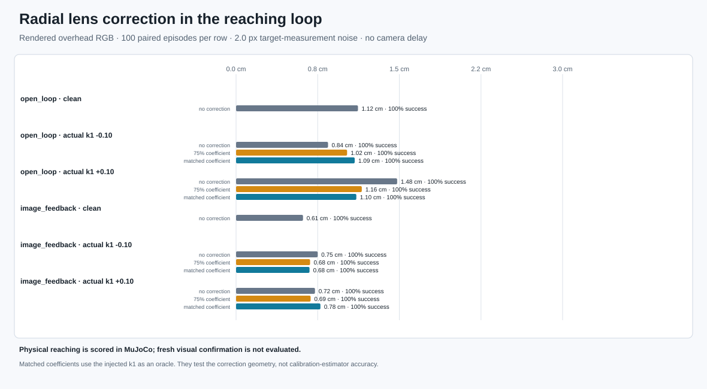
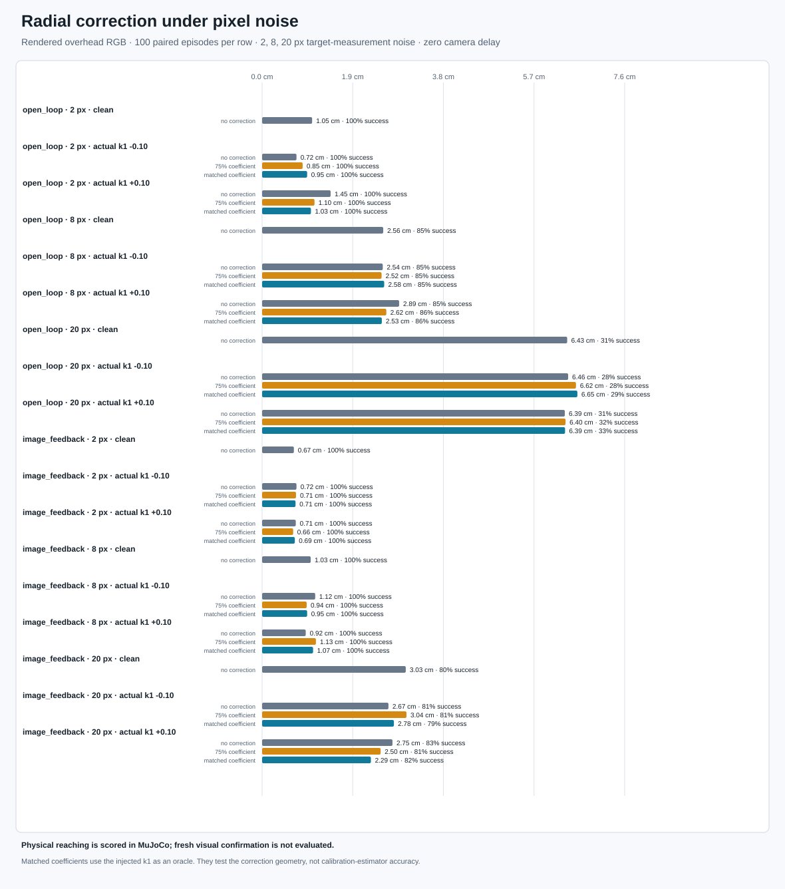
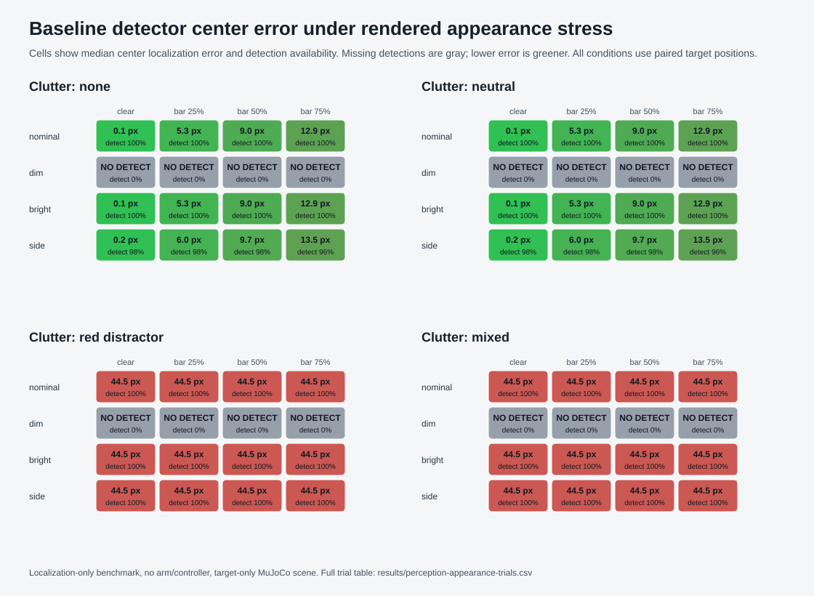

# Rendered image robustness

[Project overview](../../README.md)

## End-to-end radial-distortion stress test

The preceding recorded-camera check asks whether a radial model fits checkerboard
image points. This separate MuJoCo experiment asks whether applying that kind of
pixel correction improves reaching. It applies Brown–Conrady radial `k1` distortion
to every rendered overhead RGB frame, then optionally corrects the detected target
and camera-observed arm-tip pixels before control. It compares open-loop projection
and image feedback under the same targets and 2 px measurement-noise seeds.

| Controller | Actual camera `k1` | Pixel correction | Physical success | Median / P95 reach error | Paired median error change vs. no correction |
| --- | ---: | --- | ---: | ---: | ---: |
| Open loop | +0.10 | none | 100/100 | 1.48 / 2.59 cm | — |
| Open loop | +0.10 | exact injected coefficient | 100/100 | 1.10 / 2.27 cm | −0.35 cm; lower error in 96/100 pairs |
| Open loop | −0.10 | none | 100/100 | 0.84 / 2.31 cm | — |
| Open loop | −0.10 | exact injected coefficient | 100/100 | 1.09 / 2.29 cm | +0.16 cm; lower error in 28/100 pairs |
| Image feedback | +0.10 | none | 100/100 | 0.73 / 1.69 cm | — |
| Image feedback | +0.10 | exact injected coefficient | 100/100 | 0.78 / 1.39 cm | +0.05 cm; lower error in 44/100 pairs |
| Image feedback | −0.10 | none | 100/100 | 0.75 / 1.47 cm | — |
| Image feedback | −0.10 | exact injected coefficient | 100/100 | 0.68 / 1.26 cm | −0.09 cm; lower error in 62/100 pairs |



[Watch the paired image-feedback demo](../../assets/demos/radial_distortion_correction.mp4) ·
[See all 1,400 trial rows](../../results/radial-distortion-trials.csv)

All conditions achieved the 4.5 cm **physical MuJoCo reaching** threshold, so
success rate does not separate them; the error distribution does. Exact correction
helps open-loop reaching under positive `k1` but hurts under negative `k1` with
this injected pixel noise. In image feedback, the shared target/tip distortion
largely cancels in the relative-pixel loop, and correction has small, mixed effects.
The result supports keeping correction opt-in rather than enabling it by default.
The `±0.10` coefficients are simulation stress values, not measured lens
parameters. Exact matching is an oracle geometry check, not evidence that a
calibration estimator could recover the coefficient. Targets are stationary;
camera delay is zero; no predictor or current-joint-state tip projection is used.
Fresh visual confirmation is not evaluated by this benchmark.

Reproduce the paired benchmark and demo with:

```bash
uv run visual-servo-distortion-benchmark --output artifacts/radial-distortion-benchmark.json
uv run python scripts/generate_radial_distortion_demo.py
ffmpeg -i assets/demos/radial_distortion_correction.mp4 -vf "fps=8,scale=640:-1:flags=lanczos" \
  assets/demos/previews/radial_distortion_correction.gif
```

The benchmark writes its full per-observation report to the ignored `artifacts/`
directory, plus the compact CSV and SVG shown above. The MP4/GIF are illustrative
paired episodes; the 1,400-row CSV is the aggregate evidence.

## Noise-interaction follow-up

The 2 px run is a mild-noise geometry check and has no physical misses. This
follow-up uses a separate seed block (700–704) and repeats all seven distortion
and correction settings at 2, 8, and 20 px noise: 4,200 trials total, paired by
target and noise seeds.
The 20 px level targets the controller's measured high-noise weakness. At zero
distortion, this seed block reached 31/100 with open loop and 80/100 with image
feedback; the earlier 88/100 result used a different seed block.

| Controller | Actual `k1` | No correction: success, median / P95 | Exact correction: success, median / P95 | Paired successes recovered / lost |
| --- | ---: | --- | --- | ---: |
| Open loop | −0.10 | 28/100, 6.46 / 13.98 cm | 29/100, 6.65 / 13.94 cm | 3 / 2 |
| Open loop | +0.10 | 31/100, 6.39 / 13.81 cm | 33/100, 6.39 / 13.86 cm | 2 / 0 |
| Image feedback | −0.10 | 81/100, 2.67 / 6.18 cm | 79/100, 2.78 / 6.26 cm | 6 / 8 |
| Image feedback | +0.10 | 83/100, 2.75 / 6.35 cm | 82/100, 2.29 / 6.86 cm | 7 / 8 |



The high-noise changes are small and mixed. Exact correction netted one or two
more successes in open loop (3 recovered / 2 lost at negative `k1`, 2 / 0 at
positive `k1`), while feedback lost one or two net successes. At positive
`k1`, feedback's median improved but its P95 worsened by 0.51 cm. These results
do not support making correction a default or claiming it fixes the 20 px
failure mode. The independent 2 px run and all 4,200 noise-sweep outcomes are
available in [the original CSV](../../results/radial-distortion-trials.csv) and
[the noise-sweep CSV](../../results/radial-distortion-noise-trials.csv).
The random generators restart from matching seeds, but feedback conditions can
take different numbers of observations, so matching seed/episode IDs do not
guarantee identical noise draws at the same simulated times.

Targets remain stationary, camera delay is zero, and no predictor or
current-joint-state tip projection is used. Success is physical MuJoCo distance
within 4.5 cm. Fresh visual confirmation is not measured. The exact coefficient
is an oracle correction, and the injected `±0.10` values are stress settings,
not estimates of this project's camera.

For the noise sweep and a paired 20 px example video:

```bash
uv run visual-servo-distortion-benchmark --base-seed 700 --noise-levels 2 8 20 \
  --output artifacts/radial-distortion-noise-benchmark.json \
  --csv results/radial-distortion-noise-trials.csv \
  --figure assets/demos/radial_distortion_noise_benchmark.svg
uv run python scripts/generate_radial_distortion_demo.py \
  --pixel-noise-std-px 20 \
  --output assets/demos/radial_distortion_correction_20px.mp4
ffmpeg -i assets/demos/radial_distortion_correction_20px.mp4 \
  -vf "fps=8,scale=640:-1:flags=lanczos" \
  assets/demos/previews/radial_distortion_correction_20px.gif
```

The [paired 20 px clip](../../assets/demos/radial_distortion_correction_20px.mp4) is
one illustrative seed/episode, not aggregate evidence.

The full condition tables, failure definitions, limitations, and commands to
reproduce each run appear in the sections below. The checked-in
[1,800-row trial CSV](../../results/robustness-baseline-trials.csv) contains one
compact outcome row per controller, condition, seed, and episode, including
the ground-truth target and final arm coordinates used for physical scoring.
At about 351 KiB, it is small enough for GitHub's searchable interactive CSV
view. It omits verbose per-observation traces; those remain in the local
`artifacts/benchmark.json` output.

Regenerate the benchmark and CSV with:

```bash
uv run visual-servo-benchmark --seeds 5 --episodes-per-seed 20
uv run python scripts/export_public_trial_data.py
```

The CSV reports physical reaching outcomes and visibility diagnostics. It does
not claim fresh visual confirmation; the camera-timing reports below measure
that outcome separately.

The MuJoCo scene and target positions are generated locally. The robotics
benchmarks require no external simulator assets, robot datasets, or pretrained
models. The optional recorded-camera check downloads checksum-pinned OpenCV
sample images into the ignored `artifacts/` directory; source photos are not
copied into this repository.

## Rendered lighting, clutter, and target-occlusion study

The radial-distortion studies apply an image warp after MuJoCo rendering. This
separate diagnostic changes the rendered scene itself and measures the current
largest-red-contour detector from `run.detect_red_target`. It does not move the
arm or change the controller. The experiment is aimed at perception failure:
can the baseline detector return the target center under altered illumination,
nearby distractors, and a partially covered marker?



[Watch the paired appearance demo](../../assets/demos/perception_appearance_comparison.mp4) ·
[View the GIF preview](../../assets/demos/previews/perception_appearance_comparison.gif) ·
[Inspect all 3,200 trial rows](../../results/perception-appearance-trials.csv)

### Protocol

The benchmark crosses four rendered-light conditions (overhead nominal,
dimmed, brighter, and off-axis), four clutter conditions (none, neutral
objects, a larger red distractor, and the neutral objects plus red distractor),
and four widths of a gray occlusion bar (0%, 25%, 50%, and 75% of the target
diameter). The light source, prop geometry, and bar are MuJoCo scene elements;
lighting and occlusion are not added as pixel post-processing.

Each condition uses the same 50 target positions: ten paired positions from
each seed 9100–9104. The full factorial design has 64 conditions and 3,200
rendered views. At each view, the unchanged detector returns the minimum
circle enclosing its largest red HSV contour. The benchmark records
availability, red-component count, detected and true image centers, center
error in pixels and projected millimeters, and a diagnostic rate for estimates
within the projected 4.5 cm target disk. That disk metric is a localization
summary only; it is not physical reaching success.

| Appearance condition | Detection | Median center error | P95 center error |
| --- | ---: | ---: | ---: |
| Nominal light, clear target | 50/50 | 0.08 px (0.22 mm) | 0.15 px (0.42 mm) |
| Dim light, clear target | 0/50 | unavailable | unavailable |
| Bright light, clear target | 50/50 | 0.12 px (0.33 mm) | 0.18 px (0.48 mm) |
| Side light, clear target | 49/50 | 0.19 px (0.51 mm) | 0.38 px (1.04 mm) |
| Nominal light, larger red distractor | 50/50 | 44.51 px (122.18 mm) | 46.35 px (127.22 mm) |
| Nominal light, 25% occlusion bar | 50/50 | 5.27 px (14.47 mm) | 6.00 px (16.46 mm) |
| Nominal light, 50% occlusion bar | 50/50 | 9.02 px (24.75 mm) | 9.57 px (26.26 mm) |
| Nominal light, 75% occlusion bar | 50/50 | 12.85 px (35.27 mm) | 13.31 px (36.55 mm) |

The existing detector has a minimum brightness threshold of 70 in HSV. Under
the dim rendered condition it found no red component in any of 50 clear-target
views. A plausible appearance adjustment could improve this case, but it would
need to be checked against distractors and held-out lighting before adoption.

With the red distractor, the detector still returns a center on every frame,
but chooses the larger red component instead of the target in all 50 trials.
The median localization error is 44.51 px. Detection availability alone would
misrepresent this outcome as success; center error and component count reveal
that the returned point is wrong.

The centered occlusion bar splits the target contour. The current
minimum-enclosing-circle estimate drifts increasingly toward one visible
fragment: median error rises from 0.08 px with no bar to 12.85 px at 75% of the
target diameter. These errors remain inside the broad projected target-disk
radius in this sample, which is why the report retains the actual center-error
distribution rather than treating the disk rate as a robotics success metric.

This is still a bounded simulator diagnostic. The target-only scene excludes
arm self-occlusion and real sensor effects such as exposure response, lens
flare, motion blur, sensor noise, and camera-specific color processing. The
lighting powers, object colors, placements, and occluder shape are authored
conditions. Results show a measured weakness of the existing baseline under
these rendered inputs; they do not establish field-camera performance or
justify changing the default detector.

Reproduce the data and all three visuals with:

```bash
uv sync --locked --extra dev --extra demo
uv run --locked --extra demo visual-servo-perception-appearance-benchmark \
  --seeds 5 --samples-per-seed 10 --base-seed 9100
```

The command writes `results/perception-appearance-trials.csv`, the 64-row
summary CSV and JSON, the scorecard SVG, the paired MP4, and the GIF preview.
The demo shows the same target positions under clear nominal light, dim light,
neutral clutter, a red distractor, 50% occlusion, and combined dim/mixed/50%
conditions. Yellow crosses mark rendered target centers; cyan circles mark the
detector outputs.

The follow-up [candidate-detector validation](perception-candidate-validation.md)
compares an experimental projected-size circle prior with this unchanged
baseline on new seeds and disjoint lighting, distractor, and occlusion ranges.
It preserves both the first false-selection result and the remaining held-out
failures.
