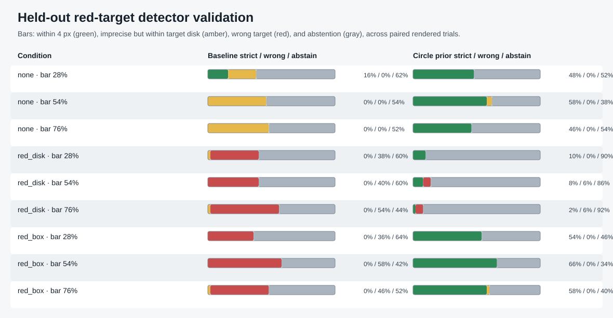

# Held-out target-detector validation

[Project overview](../../README.md) · [Rendered appearance baseline](image-robustness.md)

## Question

Can the current largest-red-contour detector be improved with the fixed
camera's projected target size, while making the detector abstain when the
image is ambiguous?

The preceding appearance benchmark found that the default detector missed all
50 dim, clear-target samples and selected a larger red distractor in all 50
nominal-light distractor samples. It also localized poorly when a bar covered
the target. That benchmark remains the baseline record; this experiment does
not rewrite or replace its results.

## Experimental detector

The default `run.detect_red_target` remains unchanged and remains the runtime
default. The opt-in `perception_candidate.detect_red_target_circle` lowers the
HSV value floor, searches red pixels for Hough circles near the target's known
projected radius (16.39 px for the current camera and target), and can abstain
when another spatially separate circle has similar size support. Its reported
confidence is a radius-fit score, not a probability.

The complete HSV, Hough, radius, and ambiguity settings are recorded in each
JSON report. The detector assumes this fixed camera and the known 9 cm target;
it is not a general-purpose red-object detector.

## Development and held-out split

The first pilot used seeds 9200–9204 and the development factor ranges. Its
initial ambiguity rule missed partial target arcs and accepted four distractor
centers as the target. That negative result is preserved in the pilot-v1 raw
trial file. A revised rule considered those partial arcs; the second
development run had no wrong-target selections in its 450 trials, but this was
used for development and is not the final score.

A same-distribution adversarial review on seeds 9300–9304 then exposed two
confident selections of nearly target-sized red disks under occlusion. The
detector was not changed after that review. Both development stages and their
videos are retained so the progression is visible.

The final evaluation uses seeds 9400–9404, with 10 paired target positions per
seed in each of nine rendered conditions. Its lighting intensity ranges,
red-distractor size and distance ranges, and occlusion widths are disjoint
from the development ranges. Light position, occluder angle, and bar offset
are randomized within the ranges recorded in the trial report. The default and
experimental detectors receive the exact same RGB frame on each trial.

The test covers three clutter scenes (none, a red disk, and a red box) crossed
with occlusion bars covering 28%, 54%, and 76% of the target diameter. The
validation intensities are either 0.04–0.07 or 1.31–1.65; the development
range was 0.08–1.30. The red disk radius is 0.80–0.94 times the target radius
in validation, compared with 0.95–1.55 in development. Distractor distance
and occlusion-width ranges also differ. These remain authored simulator
conditions, not a survey of real camera environments.

## Held-out results

The strict localization criterion is a center error of at most 4 px. A
wrong-target selection is an emitted center more than one projected target
radius (16.39 px) from the rendered target center. Abstentions are counted
separately from wrong selections.

| Detector | Strictly localized | Wrong target | Abstained | Other emitted estimates |
| --- | ---: | ---: | ---: | ---: |
| Default largest-red contour | 8/450 (1.8%) | 136/450 (30.2%) | 245/450 (54.4%) | 61/450 (13.6%) |
| Opt-in circle prior | 175/450 (38.9%) | 6/450 (1.3%) | 266/450 (59.1%) | 3/450 (0.7%) |

Among emitted estimates, the wrong-target rate was 136/205 (66.3%) for the
default and 6/184 (3.3%) for the candidate. The candidate improves strict
localization overall, but coverage is low: it abstained on 59.1% of all
validation frames.

| Clutter | Detector | Strict | Wrong target | Abstained |
| --- | --- | ---: | ---: | ---: |
| None | Default | 8/150 | 0/150 | 84/150 |
| None | Circle prior | 76/150 | 0/150 | 72/150 |
| Red disk | Default | 0/150 | 66/150 | 82/150 |
| Red disk | Circle prior | 10/150 | 6/150 | 134/150 |
| Red box | Default | 0/150 | 70/150 | 79/150 |
| Red box | Circle prior | 89/150 | 0/150 | 60/150 |

All six candidate false selections occurred in the red-disk conditions. They
had 34–96 px center errors despite fitting the target-size prior. A red disk
with similar color and apparent size can be indistinguishable from the target
in a single image, especially when the real target is partially covered. The
circle prior reduces the default detector's false selections sharply, but the
held-out result shows it does not solve target identity.



[Watch the paired detector comparison](../../assets/demos/perception_candidate_validation.mp4) ·
[View the GIF preview](../../assets/demos/previews/perception_candidate_validation.gif)

The MP4/GIF includes one selected frame from each condition and all six
false-accept examples, so the remaining target-identity failures can be seen
directly.

The raw 450-row held-out table is [available as CSV](../../results/perception-candidate-validation-trials.csv),
with the [grouped CSV summary](../../results/perception-candidate-validation-summary.csv)
and [full JSON protocol and metrics](../../results/perception-candidate-validation-summary.json).

## Preserved development evidence

The first rule revision produced four wrong selections and was not retained as
the final candidate. Its raw data and demo remain available:

- [Pilot-v1 trials](../../results/perception-candidate-pilot-v1-trials.csv) ·
  [summary](../../results/perception-candidate-pilot-v1-summary.json) ·
  [video](../../assets/demos/perception_candidate_pilot_v1.mp4)
- [Development-v2 trials](../../results/perception-candidate-development-v2-trials.csv) ·
  [summary](../../results/perception-candidate-development-v2-summary.json) ·
  [video](../../assets/demos/perception_candidate_development_v2.mp4)
- [Same-distribution adversarial review trials](../../results/perception-candidate-adversarial-review-trials.csv) ·
  [summary](../../results/perception-candidate-adversarial-review-summary.json) ·
  [video](../../assets/demos/perception_candidate_adversarial_review.mp4)

The pilot-v1 summary adds an “imprecise but within one target radius” category
by deterministic recomputation from the unchanged raw rows. Its report records
the original 1.35 px ambiguity setting and confirms the raw trials reproduce
byte-for-byte with the archived command below.

## Scope and limits

This experiment evaluates target-center localization only. It does not run the
arm controller, score physical reaching, or measure fresh visual confirmation.
Those outcomes remain separate in their respective benchmarks. The scene is
MuJoCo-rendered and omits robot self-occlusion, sensor noise, motion blur,
exposure adaptation, and real-camera image processing. A single-view detector
cannot reliably distinguish visually identical red objects; the remaining
false selections show that an additional cue such as a fiducial, shape,
temporal tracking, or depth would be needed before this candidate could be
considered for control.

## Reproduce

Run the frozen held-out validation and regenerate the trial tables, scorecard,
MP4, and GIF:

```bash
uv sync --locked --extra dev --extra demo
uv run --locked visual-servo-perception-candidate-validation \
  --split-name validation --seeds 5 --samples-per-seed 10 --base-seed 9400
```

Recreate the archived development stages without overwriting the checked-in
validation results:

```bash
uv run --locked visual-servo-perception-candidate-validation \
  --split-name development --base-seed 9200 \
  --ambiguity-radius-error-px 1.35 --no-partial-arc-competitor-check \
  --output-dir artifacts/perception-candidate-pilot-v1/results \
  --media-dir artifacts/perception-candidate-pilot-v1/media
uv run --locked visual-servo-perception-candidate-validation \
  --split-name development --base-seed 9200 \
  --output-dir artifacts/perception-candidate-development-v2/results \
  --media-dir artifacts/perception-candidate-development-v2/media
uv run --locked visual-servo-perception-candidate-validation \
  --split-name development --base-seed 9300 \
  --output-dir artifacts/perception-candidate-adversarial-review/results \
  --media-dir artifacts/perception-candidate-adversarial-review/media
```

Reconcile the checked-in datasets and run the suite with:

```bash
uv run --locked python -m visual_servo_mujoco.evidence_audit
uv run --locked pytest -q
```
