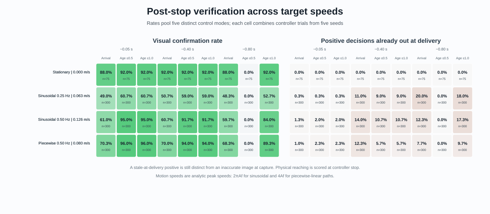
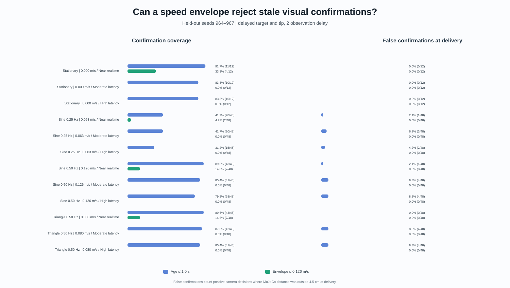
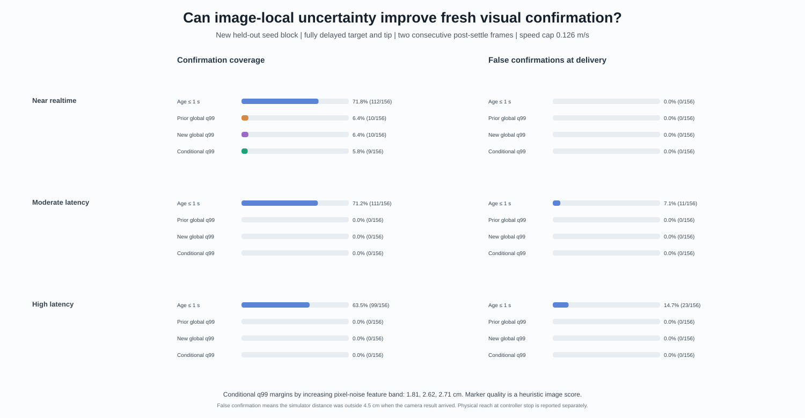

# Visual completion experiments

[Project overview](../../README.md)

## Timestamped post-stop visual verification

The sensor-timing benchmark found that the delayed-target/current-joint-state
hybrid can reach moving targets, while it still produces no current-time visual
confirmation under nonzero camera delay. This benchmark investigates the next
question after control stops: when does a later camera frame provide valid
evidence that the task is complete?

Reproduce the aggregate report, detailed trial table, and SVG chart with:

```bash
uv run visual-servo-timestamped-verification-benchmark \
  --output artifacts/timestamped-verification.json \
  --csv results/timestamped-verification-trials.csv \
  --summary-csv results/timestamped-verification-summary.csv \
  --figure assets/demos/timestamped_verification_benchmark.svg
uv run python scripts/generate_timestamped_verification_demo.py
```

The 1,000 controller trials use seeds 900–904, sinusoidal and piecewise-linear
targets, four starting phases per path, 2 px control-measurement noise, and
five control modes: fresh RGB; fully delayed RGB at 0.4/0.8 s; and delayed
target pixels paired with a current-joint-state tip projection at 0.4/0.8 s.
Those modes remain distinct: the hybrid is not fully delayed vision. Motion
prediction and stale-target arrival confirmation stay disabled. At controller
stop the benchmark stores the measured arm pose and velocity, then replays it
with the pose held while the target keeps moving.

The independent east-view camera captures at 5 Hz with 2 px target/tip centroid
noise. It models three seeded transport profiles: 0.05 s nominal latency with
±0.02 s jitter and 5% frame loss; 0.40 s with ±0.10 s jitter and 10% loss; and
0.80 s with ±0.10 s jitter and 10% loss. The arm is considered settled after
both joint speeds stay below 0.02 rad/s for 0.1 s, with a maximum 0.8 s settle
window. The guarded policy then requires two consecutive post-settle frames
within the selected receive-age limit and a 2 s decision deadline. The
arrival-only comparison accepts the first visible positive estimate without
checking settling or age.

Each entry below aggregates 1,000 outcomes across all target paths and control
modes for that transport profile. It shows camera confirmations and, after the
slash, cases where the image decision was positive but MuJoCo distance had
exceeded 4.5 cm by frame delivery.

| Camera delivery profile | Arrival-only | Two frames, age ≤0.5 s | Two frames, age ≤1.0 s |
| --- | ---: | ---: | ---: |
| 0.05 s nominal | 62.1%; 15/1,000 | 70.1%; 12/1,000 | 70.1%; 12/1,000 |
| 0.40 s nominal | 62.1%; 87/1,000 | 65.6%; 108/1,000 | 65.6%; 108/1,000 |
| 0.80 s nominal | 61.4%; 231/1,000 | 0%; 0/1,000 | 56.9%; 215/1,000 |

Across the three transport profiles, arrival-only confirmed 61.9% of outcomes
and had 333/3,000 decisions outside the physical radius at delivery. The 0.5 s
guard reduced this to 120/3,000 but confirmed only 45.2%; it abstained on every
high-latency outcome. The 1.0 s guard restored coverage to 64.2%, while
335/3,000 decisions arrived after the target had left the radius. The 0.5 s
guard also had more delivery mismatches than arrival-only in the moderate
latency profile, so a tighter age cap is not a universal fix.

Most delivery-time mismatches were physically within the success radius when
the image was captured, then moved outside before delivery: 108/120 for the
0.5 s guard and 318/335 for the 1.0 s guard. The other 12 and 17 cases were
already outside at capture despite a positive camera estimate. These are
different failure sources: transport-age drift and image-estimation error.
Across the 1,000 controller trials, 682 reached the physical radius at control
stop; that score is independent of camera confirmation. Ground-truth distances
at capture and delivery are evaluation-only and never enter detection or the
confirmation policy. These percentages are descriptive across five seed groups
and one target-motion amplitude/frequency; they do not establish a general
network model or a statistically validated age threshold.

The [compact aggregate CSV](../../results/timestamped-verification-summary.csv)
contains 90 protocol groups for GitHub's table view. The
[per-outcome CSV](../../results/timestamped-verification-trials.csv) retains all
9,000 policy outcomes, timestamps, status reasons, age/drop counters, and
separate physical reach and confirmation fields. The aggregate
[SVG scorecard](../../assets/demos/timestamped_verification_benchmark.svg) and
[annotated 17.5-second demo](../../assets/demos/timestamped_post_stop_verification.mp4)
show the same distinction. The video is one illustrative benchmark episode,
not aggregate evidence.

This is a post-control benchmark; it does not change the default controller or
promote an age threshold. The follow-on speed sweep below keeps these two
questions separate: whether the captured image showed a close arm-target pair,
and whether that pair was still close when the receiver used the frame.

## Timestamped completion across target speeds

The first post-stop benchmark used one target amplitude and frequency. This
follow-on holds the existing controller, arm-settling rule, camera estimator,
delivery profiles, and completion policies fixed while changing the target
motion. It adds a stationary target, a 0.04 m sinusoid at 0.25 Hz, a faster
0.04 m sinusoid at 0.50 Hz, and a 0.04 m piecewise-linear path at 0.50 Hz.
Their analytic peak speeds are 0, 0.063, 0.126, and 0.080 m/s respectively.
The non-monotonic ordering between the two fast paths helps separate speed from
path shape.

The suite uses new seeds 950–954, three episodes per seed, four motion phases
for each moving condition, and all five controller modes from the previous
benchmark. That gives 975 controller trials and 8,775 policy outcomes. Fresh
RGB, fully delayed RGB, and delayed target with a current-joint-state tip
projection remain separately identified in the detailed CSV; only the
scorecard heatmap pools those modes within each motion and delivery cell.
Camera latency, jitter, loss, settling, two-frame confirmation, and the 0.5 s
and 1.0 s age guards retain their previous definitions. Controller-stop
physical reach remains a separate field from fresh camera confirmation.



The table pools the three camera-delivery profiles and all five control modes
within each motion condition. “Out at delivery” counts image-positive
confirmations where MuJoCo distance exceeded 4.5 cm by arrival. The stationary
denominator is smaller because it has one phase; moving conditions use four.

| Target motion | Peak speed | Arrival-only confirmation / out at delivery | Two frames, age ≤0.5 s | Two frames, age ≤1.0 s |
| --- | ---: | ---: | ---: | ---: |
| Stationary | 0.000 m/s | 89.3%; 0/225 | 61.3%; 0/225 | 92.0%; 0/225 |
| Sinusoidal, 0.25 Hz | 0.063 m/s | 49.3%; 94/900 | 39.9%; 28/900 | 57.4%; 82/900 |
| Piecewise linear, 0.50 Hz | 0.080 m/s | 69.6%; 63/900 | 63.3%; 24/900 | 93.1%; 53/900 |
| Sinusoidal, 0.50 Hz | 0.126 m/s | 60.4%; 83/900 | 62.2%; 38/900 | 90.2%; 90/900 |

Controller-stop reaching success was 74/75 stationary trials, 176/300 for the
0.25 Hz sinusoid, 228/300 for the piecewise-linear path, and 200/300 for the
0.50 Hz sinusoid. Those physical reach rates do not equal the fresh visual
confirmation rates in the preceding table.

The failure rate is not monotonic in analytic peak speed: the slower sinusoid
had more stale-at-delivery positives than either fast path under each guarded
policy. The path shape and phase matter. For the 0.5 s guard, moderate-latency
delivery still produced 17–32 stale positives per 300 moving outcomes, while
high-latency delivery had zero confirmations because all frames exceeded the
age limit. A tighter age cap can improve delivery-time precision while
abstaining entirely in a latency regime; it does not create an all-purpose
completion rule. Among guarded false confirmations, 84/90 at 0.5 s and 219/225
at 1.0 s were physically within the radius at capture, then crossed it during
transport. That points to motion during camera delivery as the dominant
measured failure in this sweep.

The detailed trial table records capture-time and delivery-time ground truth
separately. It can show whether a delivery mismatch began during camera
transport or was already present at image capture. As before, those ground
truth fields are evaluation-only. The study has five seed groups, one motion
amplitude, and simulated cameras; it is a measured comparison for this model,
not a validated real-camera latency rule.

The [180-row compact summary](../../results/timestamped-completion-speed-summary.csv)
and [8,775-outcome trial table](../../results/timestamped-completion-speed-trials.csv)
are suitable for browsing in GitHub. The [paired stationary-versus-fast
video](../../assets/demos/timestamped_completion_speed_comparison.mp4) shows one
illustrative seed. The GIF preview appears in the demo gallery above.

Reproduce the benchmark and demo with:

```bash
uv run visual-servo-completion-speed-benchmark \
  --output artifacts/timestamped-completion-speed.json \
  --csv results/timestamped-completion-speed-trials.csv \
  --summary-csv results/timestamped-completion-speed-summary.csv \
  --figure assets/demos/timestamped_completion_speed_benchmark.svg
uv run --extra demo python scripts/generate_timestamped_speed_demo.py
```

The next milestone is a bounded reachability check, not target-position
extrapolation. The benchmark below evaluates an empirical image-error margin
and a configured target-speed cap against new held-out speeds and path phases.
Earlier target-position predictors remain negative results and opt-in.

## Held-out motion-envelope visual completion

The speed sweep showed that camera age alone ignores how much distance the
target can cover before a frame reaches the receiver. This experiment adds a
simple bound to the measured image distance:

```text
image distance + training-calibrated image margin + speed cap * camera age <= 4.5 cm
```

The receiver must see two consecutive post-settle frame indices satisfying
that test. It does not predict a future target position. The tested speed caps
are 0, 0.063, 0.080, 0.126, and 0.150 m/s. The 0.126 m/s cap covers every
analytic target peak speed in the four motion conditions. It was a benchmark
setting, not a measured real-robot speed limit.

The image margin is calibrated only on post-settle training frames. For each
frame, its one-sided residual is
`max(MuJoCo capture-time distance - estimated image distance, 0)`; the
99th-percentile empirical residual is the fixed margin. Seeds 960–963 supplied
780 calibration controller trials and 10,916 usable image frames. The margin
was 2.54 cm (median residual 0 cm, P95 1.48 cm, maximum 3.85 cm). Because the
frames are correlated and the image-noise distribution is not bounded, this
quantile is a calibration statistic, not a guarantee.

Seeds 964–967 were held out. They supplied another 780 controller trials and
18,720 policy outcomes, pairing the arrival-only baseline, both fixed age
guards, and all five speed caps across three delivery profiles. The table
pools those three delivery profiles within each control input mode; each cell
has 468 policy outcomes. Physical reaches at controller stop remain separately
reported below.

| Control input mode | Two post-settle frames, age ≤1.0 s: confirmed; false at delivery | Motion envelope, cap 0.126 m/s: confirmed; false at delivery | Controller-stop physical reach |
| --- | ---: | ---: | ---: |
| Fresh RGB target and tip | 412/468 (88.0%); 33 | 49/468 (10.5%); 0 | 137/156 |
| Fully delayed RGB, 1 observation | 387/468 (82.7%); 52 | 25/468 (5.3%); 0 | 91/156 |
| Fully delayed RGB, 2 observations | 334/468 (71.4%); 23 | 20/468 (4.3%); 0 | 90/156 |
| Delayed target with current joint-state tip, 1 observation | 413/468 (88.2%); 38 | 40/468 (8.5%); 0 | 117/156 |
| Delayed target with current joint-state tip, 2 observations | 403/468 (86.1%); 39 | 58/468 (12.4%); 0 | 125/156 |

The fully delayed RGB modes keep target and tip delayed together. They remain
separate from the hybrid mode, which uses delayed target pixels and a current
joint-state tip projection. The scorecard below shows only the fully delayed
RGB, two-observation condition; the complete summary and trial CSVs retain all
five modes separately.



Across all five input modes and three delivery profiles, the 1.0 s guard
confirmed 1,949/2,340 outcomes (83.3%). There were 185 false confirmations at
delivery, for 90.5% precision among its 1,949 positive decisions. The
0.126 m/s envelope confirmed 192/2,340 outcomes (8.2%), with no false
confirmations in this held-out policy sample. All 192 confirmations used the
near-realtime delivery profile; it made none under moderate or high latency.
It trades away too much coverage to serve as a general completion rule.

The frame-level validation is also not a proof of safety: across the three
profile-specific delivery streams, the 0.126 m/s cap applied to 16,168
post-settle frame-delivery events and 23 had MuJoCo delivery distance above
the proposed envelope. These streams replay the same captures with different
transport loss and age, so the records are correlated. All 23 envelope misses
were in near-realtime delivery (23/6,689 events). The q99 image margin
underestimated capture distance on 202/16,168 profile events (1.25%), including
80/6,689 near-realtime events. The two-frame policy happened not to confirm
those cases, but neither zero false policy confirmations nor an empirical q99
quantile establishes a hard bound.

The speed-cap sweep makes the assumption visible. A zero-speed cap confirmed
47.6% but produced 81 delivery-time false confirmations because it did not
cover the moving conditions. Caps of 0.063, 0.080, 0.126, and 0.150 m/s
confirmed 14.1%, 12.4%, 8.2%, and 6.4%, respectively, with zero false policy
confirmations in this sample. The 0.063 and 0.080 m/s settings understate at
least one tested path's peak speed, so their outcomes are not valid evidence
for those out-of-bound conditions.

The [18,720-outcome held-out table](../../results/motion-envelope-validation-trials.csv),
[480-row mode-specific summary](../../results/motion-envelope-validation-summary.csv),
[training calibration frames](../../results/motion-envelope-calibration-frames.csv),
and [frame-level envelope diagnostics](../../results/motion-envelope-validation-diagnostics.csv)
are tracked for direct review. The [paired video](../../assets/demos/motion_envelope_comparison.mp4)
uses fully delayed RGB with two-observation control delay and shows one held-out
high-latency episode. It reports controller-stop reaching separately from the
later camera decision; its MuJoCo distance overlays are evaluation labels only.

Reproduce the study and the selected held-out demo with:

```bash
uv run visual-servo-motion-envelope-benchmark
uv run --extra demo python scripts/generate_motion_envelope_demo.py
```

This is a negative result for the global q99 margin as a useful general rule:
it reduced stale confirmation but drove coverage down to 8.2%, and frame-level
bound violations remained. The conditional follow-up below tests whether pixel
location and marker-localization quality can recover useful coverage while
retaining that bound.

## Conditional image-distance uncertainty validation

The global margin may be unnecessarily conservative for some views and too
small for others. This follow-up uses each detected noisy pixel center, the
local sensitivity of the calibrated image-to-world projection, the configured
2 px observation noise, and the minimum heuristic quality score of the two
markers. The feature is an image-only uncertainty proxy; capture and delivery
distances from MuJoCo are used only to score the fitted margins.

Seeds 970–973 supplied 780 training controller trials and 10,914 usable,
post-settle camera frames. Three equal-count feature bands produced empirical
q99 margins of 1.81 cm, 2.62 cm, and 2.71 cm as the predicted image-noise scale
increased. The pooled training q99 was 2.5940 cm. The prior experiment's
2.5413 cm q99 remains locked as a comparison; the new validation seeds did not
select or tune any margin.

Seeds 974–977 supplied 780 held-out controller trials and 9,360 policy
outcomes, with the same test conditions, control modes, and three simulated
camera delivery profiles. The table below isolates fully delayed RGB with a
two-observation control delay and pools the delivery profiles (468 outcomes).
The conditional model confirmed 9 outcomes, below both global margins. The
paired demo uses an example where the prior global rule confirms and the
conditional rule abstains even though the delivery-time physical distance is
inside the 4.5 cm threshold; it illustrates conditional coverage loss, not a
new success.

| Offline completion rule | Fresh visual confirmations | False at delivery |
| --- | ---: | ---: |
| Two post-settle frames, age ≤ 1.0 s | 322/468 (68.8%) | 34 |
| Prior fixed global q99, 2.5413 cm | 10/468 (2.1%) | 0 |
| New global q99, 2.5940 cm | 10/468 (2.1%) | 0 |
| Conditional q99 by image-feature band | 9/468 (1.9%) | 0 |

Across all five control-input modes and all three delivery profiles, the
conditional rule confirmed 97/2,340 outcomes (4.1%) with no false confirmations.
The new global q99 confirmed 109/2,340 (4.7%); the prior global q99 confirmed
129/2,340 (5.5%), also with none false. The one-second age guard confirmed
1,914/2,340 (81.8%) with 179 false confirmations at delivery (90.6% precision).
Physical reaching remains a separate metric: fully delayed RGB with two
observations reached the 4.5 cm radius in 93/156 controller trials at stop.

On held-out frames, the conditional image margin underbounded capture distance
on 50/15,727 profile-specific delivered post-settle events, and the full
0.126 m/s delivery envelope exceeded delivery distance on 5/15,727. The three
delivery profiles replay the same captures with different simulated age and
loss, so these event records are correlated. The binned feature did not improve
the policy trade-off: its q99 margin was generally at least as conservative as
the global q99, and its held-out confirmation count was lower. Runtime behavior
is unchanged; the conditional estimator and all completion policies remain
offline experiments.



The [9,360-outcome held-out policy table](../../results/conditional-uncertainty-validation-trials.csv),
[mode and delivery summary](../../results/conditional-uncertainty-validation-summary.csv),
[10,914 training frames](../../results/conditional-uncertainty-calibration-frames.csv),
and [frame-level conditional envelope diagnostics](../../results/conditional-uncertainty-validation-diagnostics.csv)
retain the complete evidence. The [paired video](../../assets/demos/conditional_uncertainty_comparison.mp4)
shows both policies on the same captured images, delivery times, and simulator
evaluation labels. The GIF preview appears in the demo gallery above.

Reproduce the calibration, held-out study, and paired demo with:

```bash
uv run visual-servo-conditional-uncertainty-benchmark
uv run --extra demo python scripts/generate_conditional_uncertainty_demo.py
```

The next useful study should isolate detector localization error from
projection geometry. The heuristic target-quality score varied widely and
had a modest negative correlation with optimistic distance error (r = -0.22),
while the combined pixel-noise feature correlated only weakly (r = 0.10) in
the training frames. A held-out photometric stress test can vary lighting,
blur, and partial marker occlusion while comparing detected centers with
known rendered marker centers. That would establish whether the quality score
tracks actual pixel-center error before another distance-margin model is
proposed.
