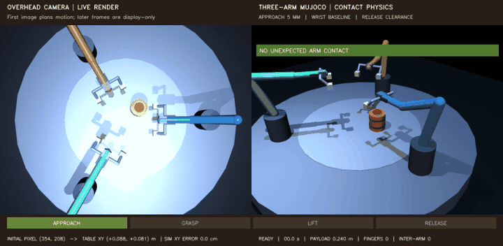
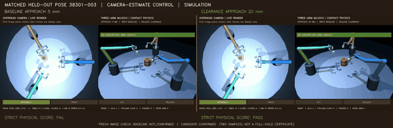

# Demo gallery

[Project overview](../README.md)

## Multi-arm manipulation

The original three-view demo is a deterministic scripted centered pick. Three
3-joint arms close six sliding fingers around a free payload, lift it using
contact and friction, hold it, then lower and release it. The separate
camera-guided extension uses the project's default target detector and
pixel-to-table projection to plan the same contact task at randomized object
positions. Its left video panel shows a live overhead render beside the
physical response. Control uses the initial overhead image only. A fixed side
camera also captures the initial view and two fresh post-lift images; its
image-only decision is shown separately from the later simulator-truth audit.
The fixed pixel-to-table estimate comes from the initial overhead image. The
close-up views show wrist adapters meeting the palm boxes, plus
palm-mounted rails and moving shanks that join the sliding pads. Those
connectors are visual-only; the pads remain the modeled grasp surfaces.

The camera-guided clips label the four motion stages, keep the initial
pixel-to-table estimate separate from current MuJoCo state, and show finger and
inter-arm contact counts. Their final card shows the fresh image verdict and a
separate physical audit. Two image samples do not certify a continuous hold or
safe release.

| Demo | View |
| --- | --- |
| [Oblique hero video](../assets/demos/cooperative_pick_triarm.mp4) | [Top-down synchronized video](../assets/demos/cooperative_pick_triarm_top.mp4) |
| [Wrist-to-pad connection close-up](../assets/demos/cooperative_pick_triarm_closeup.mp4) | [Looping close-up GIF](../assets/demos/cooperative_pick_triarm_closeup.gif) |
| [Run metrics](../assets/demos/cooperative_pick_triarm.json) | [Experiment record](experiments/cooperative-pick.md) |


### Camera-guided extension

| Demo | Evidence |
| --- | --- |
| [](../assets/demos/camera_guided_cooperative_pick.mp4) | [Camera/perception/planning/physics pipeline](../assets/demos/camera_guided_cooperative_pick_pipeline.svg) |
| [Selected demo run metadata](../assets/demos/camera_guided_cooperative_pick_demo.json) | Control image policy, score, pose, and metrics for the illustrative clip. |
| [Post-lift fresh side-camera demo](../assets/demos/camera_guided_cooperative_pick.mp4) | Initial and fresh image captures, image-only V3 result, then separate physical audit. |
| [Fresh verification scorecard](../results/cooperative-pick-visual-confirmation/cooperative-pick-visual-confirmation-scorecard.svg) | [Held-out per-trial image verdicts and separate physical labels](../results/cooperative-pick-visual-confirmation/cooperative-pick-visual-confirmation-trials.csv) |
| [Verifier method and limitations](experiments/cooperative-pick-visual-confirmation.md) | [Validation summary and Wilson intervals](../results/cooperative-pick-visual-confirmation/cooperative-pick-visual-confirmation-summary.json) |
| [Tilted no-grasp false-confirmation replay](../assets/demos/cooperative_pick_verification_false_tilt.mp4) | [Under-lift false-confirmation replay](../assets/demos/cooperative_pick_verification_false_underlift.mp4) |
| [Replay decisions and archived source IDs](../assets/demos/cooperative_pick_visual_verification_failure_demos.json) | Both clips replay prior classifier failures; neither adds benchmark trials. |
| [Fault robustness protocol and limits](experiments/cooperative-pick-visual-faults.md) | [Exact 360-trial CSV](../results/cooperative-pick-visual-fault-validation/cooperative-pick-visual-fault-trials.csv) |
| [Frozen V3 image-fault scorecard](../results/cooperative-pick-visual-fault-validation/cooperative-pick-visual-fault-scorecard.svg) | [Exact 360-trial results](../results/cooperative-pick-visual-fault-validation/cooperative-pick-visual-fault-summary.json) |
| [Dim exposure x0.25](../assets/demos/cooperative_pick_visual_fault_dim_exposure_x0_25.mp4) | [Bright exposure x1.5](../assets/demos/cooperative_pick_visual_fault_bright_exposure_x1_5.mp4) |
| [50% fiducial occlusion](../assets/demos/cooperative_pick_visual_fault_marker_occlusion_50pct.mp4) | [Horizontal blur, 9 px](../assets/demos/cooperative_pick_visual_fault_horizontal_blur_9px.mp4) |
| [Fresh-frame camera shift up 25 px](../assets/demos/cooperative_pick_visual_fault_camera_shift_up_25px.mp4) | [Clean same-pose reference](../assets/demos/cooperative_pick_visual_fault_clean.mp4) |
| [Fault replay metadata](../assets/demos/cooperative_pick_visual_fault_demos.json) | The same held-out pose is shown with each image transform; physics is kept separate. |
| [](../assets/demos/cooperative_pick_occlusion_v4_clean.mp4) | [](../assets/demos/cooperative_pick_occlusion_v4_marker_occlusion_50pct.mp4) |
| [Development/held-out scorecard](../results/cooperative-pick-occlusion-heldout/cooperative-pick-occlusion-scorecard.svg) | [Paired decisions, frozen protocol, and known limits](experiments/cooperative-pick-occlusion.md) |
| [Replay metadata](../assets/demos/cooperative_pick_occlusion_v4_demos.json) | Both clips replay an already-counted development pose; V4 stays opt-in. |
| [](../assets/demos/cooperative_pick_occlusion_shape_nominal_positive_mask.mp4) | [](../assets/demos/cooperative_pick_occlusion_shape_hard_negative_occlusion_false_confirm.mp4) |
| [Clean positive reference](../assets/demos/cooperative_pick_occlusion_shape_clean_nominal_positive.mp4) | [Clean hard-negative false confirmation](../assets/demos/cooperative_pick_occlusion_shape_hard_negative_clean_false_confirm.mp4) |
| [Frozen 200-pose scorecard](../results/cooperative-pick-occlusion-shape-challenge/cooperative-pick-occlusion-shape-scorecard.svg) | [Exact 1,800-row CSV and protocol](experiments/cooperative-pick-occlusion.md#frozen-geometry-and-negative-control-challenge) · [replay metadata](../assets/demos/cooperative_pick_occlusion_shape_demos.json) |
| [](../assets/demos/cooperative_pick_orthogonal_occlusion_recovery.mp4) | [](../assets/demos/cooperative_pick_orthogonal_false_confirmation_rejected.mp4) |
| [](../assets/demos/cooperative_pick_orthogonal_true_lift_not_confirmed.mp4) | [Held-out scorecard](../results/cooperative-pick-orthogonal-verification-heldout/cooperative-pick-orthogonal-verification-scorecard.svg) · [protocol and 240-row table](experiments/cooperative-pick-orthogonal-verification.md) |
| [Selected replay IDs and separate physics outcomes](../assets/demos/cooperative_pick_orthogonal_verification_demos.json) | The videos replay held-out poses; they do not add trials. V3 remains the runtime default. |
| [Randomized paired success scorecard](../results/cooperative-pick-pose-validation.svg) | [Paired trial table](../results/cooperative-pick-pose-validation-trials.csv) |
| [Condition summary and selected demo metrics](../results/cooperative-pick-pose-validation-summary.json) | [Experiment method and limits](experiments/camera-guided-cooperative-pick.md) |
| [14 mm baseline vs. 16 mm pads on the same 30 poses](../results/cooperative-pick-pad-size-comparison.svg) | [Exact paired outcomes and Wilson intervals](../results/cooperative-pick-pad-size-comparison.json) |
| [](../assets/demos/cooperative_pick_release_baseline.mp4) | [](../assets/demos/cooperative_pick_release_clearance.mp4) |
| [Seed-38200 paired outcome chart](../results/cooperative-pick-release-heldout-comparison.svg) | [Exact paired results and contact attribution](../results/cooperative-pick-release-heldout-comparison.json) |
| [Paired per-pose outcome table](../results/cooperative-pick-release-heldout-paired.csv) | [Selected replay metrics and pose](../assets/demos/cooperative_pick_release_pair.json) |
| [](../assets/demos/cooperative_pick_approach_clearance_pair.mp4) | [Geometry and held-out scorecard](../results/cooperative-pick-approach-clearance-comparison.svg) |
| [Baseline 5 mm individual clip](../assets/demos/cooperative_pick_approach_clearance_5mm.mp4) | [Candidate 20 mm individual clip](../assets/demos/cooperative_pick_approach_clearance_20mm.mp4) |
| [Pair replay metadata](../assets/demos/cooperative_pick_approach_clearance_pair.json) | [Exact 30-pose paired outcomes](../results/cooperative-pick-approach-clearance-paired.csv) |
| [](../assets/demos/cooperative_pick_approach_clearance_extended_pair.mp4) | [Independent 60-pose scorecard](../results/cooperative-pick-approach-clearance-extended-comparison.svg) |
| [](../assets/demos/cooperative_pick_material_matched_comparison.mp4) | [3×3 mass/friction scorecard](../results/cooperative-pick-material-validation/cooperative-pick-material-scorecard.svg) · [216 paired trial rows](../results/cooperative-pick-material-validation/cooperative-pick-material-trials.csv) |
| [Nominal payload clip](../assets/demos/cooperative_pick_material_nominal_material.mp4) | [Heavy, low-friction failure clip](../assets/demos/cooperative_pick_material_heavy_low_friction_stress.mp4) · [replay metadata](../assets/demos/cooperative_pick_material_demos.json) |
| [Exact condition counts and limitations](experiments/cooperative-pick-material-robustness.md) | The experiment record describes the explicit-mass model, paired protocol, and why visual confirmation is not implied. |
| [](../assets/demos/cooperative_pick_pad_friction_matched.mp4) | [Pad/friction scorecard](../results/cooperative-pick-pad-friction-validation/cooperative-pick-pad-friction-scorecard.svg) · [96 paired rows](../results/cooperative-pick-pad-friction-validation/cooperative-pick-pad-friction-trials.csv) |
| [Four individually labeled replays and sidecar](../assets/demos/cooperative_pick_pad_friction_demo.json) | The 18 mm pad produced no low-friction stable lifts; the clips replay one scored pose and add no trial rows. See the [experiment record](experiments/cooperative-pick-pad-friction-validation.md). |
| [](../assets/demos/cooperative_pick_contact_friction_pair.mp4) | [Phase-resolved contact scorecard](../results/cooperative-pick-contact-diagnostics/cooperative-pick-contact-scorecard.svg) · [48 trial rows](../results/cooperative-pick-contact-diagnostics/cooperative-pick-contact-trials.csv) |
| [288 individual finger traces](../results/cooperative-pick-contact-diagnostics/cooperative-pick-contact-by-finger.csv) | Low friction contacts the object during closure and early lift, then has 0/72 pad-pose contacts in the loaded hold. The [experiment record](experiments/cooperative-pick-contact-diagnostics.md) explains how this refines the old failure label. |
| [](../assets/demos/cooperative_pick_retention_diagnostic_pair.mp4) | [Hand-relative retention scorecard](../results/cooperative-pick-retention-diagnostics/cooperative-pick-retention-scorecard.svg) · [48 trials and 576 pad-phase records](../results/cooperative-pick-retention-diagnostics/cooperative-pick-retention-trials.csv) |
| [Exact per-pad phase data](../results/cooperative-pick-retention-diagnostics/cooperative-pick-retention-by-pad-phase.csv) | The new held-out study measures motion relative to each gripper, contact force ratio, and slide tracking through lift and hold. Replay details and limits are in the [experiment record](experiments/cooperative-pick-retention-diagnostics.md). |
| [Extended baseline 5 mm](../assets/demos/cooperative_pick_approach_clearance_extended_5mm.mp4) | [Extended candidate 20 mm](../assets/demos/cooperative_pick_approach_clearance_extended_20mm.mp4) |
| [Extended pair replay metadata](../assets/demos/cooperative_pick_approach_clearance_extended_pair.json) | [Exact 60-pose paired outcomes](../results/cooperative-pick-approach-clearance-extended-paired.csv) |
| [Mixed 3 mm wrist-standoff scorecard](../results/cooperative-pick-wrist-standoff-development-003-comparison.svg) | [Mixed 6 mm wrist-standoff scorecard](../results/cooperative-pick-wrist-standoff-development-006-comparison.svg) |
| [Whole-hand retreat negative summary](../results/cooperative-pick-whole-hand-retreat-development-failure/cooperative-pick-pose-validation-summary.json) | [Related geometry probes and limits](experiments/camera-guided-cooperative-pick.md#related-geometry-probes-and-retained-negative-results) |
| [Retained v1 failure clip](../assets/demos/camera_guided_cooperative_pick_v1.mp4) | [v1 trial table and scorecard](../results/cooperative-pick-pose-validation-v1-trials.csv) |

The candidate 16 mm pads were selected on a separate development sample. The
linked pad-size scorecard uses a fresh 30-pose seed set for a same-pose 14 mm
control; it does not make the selected demonstration clip part of the aggregate.
These are physical stable-lift results, and none measures fresh visual
confirmation.

The release clips replay held-out pose `38201-005`, which is already included
in the paired 30-pose table. The baseline records wrist-to-payload contact for
246 physics steps; the clearance trajectory has no unexpected arm contact and
meets the same strict physical score. Read the experiment record for the tuning
split, separate evaluation split, paired counts, and remaining contact failures.

The approach-clearance pair replays held-out pose `38301-003`. It changes only
the lowest open gripper's approach height from the 5 mm default to the 20 mm
experimental setting. The baseline logs pad/table contact and fails the strict
physical score; the candidate completes the pick. Across paired camera-estimate
trials, scores move from 27/30 to 30/30. The oracle diagnostic moves from 28/30
to 27/30, so this parameter remains opt-in. The replay is already counted in
the aggregate. Its end card shows the separate two-frame fresh-image V3 check;
the image result is not a replacement for the physical score.

The second video is an independent base-seed-38400 replay of `38401-017`, also
already counted in its 60-pose dataset. Its baseline has no grasp contact; the
raised-approach candidate passes. Across that larger split, camera strict
success changes from 52/60 to 56/60 and oracle diagnostic success from 53/60
to 58/60. Both paired comparison charts preserve the baseline-only cases and
the contact counts. The updated replay end card adds a separately computed
image-only confirmation for each side.

The mass/friction pair replays held-out pose `40800-000` at nominal mass with
the highest tested friction and at 0.99 kg with the lowest friction. It
illustrates one matched physical outcome, not the aggregate. Across all 12
poses per condition, both controllers had 0/12 strict successes at friction
0.5, while friction 2.2 produced 10-11/12 camera-estimate successes across
the three masses. The study uses author-selected MuJoCo values, preserves
separate stable-hold and full-cycle collision checks, and does not measure
fresh visual confirmation. The earlier density-prototype sweep is retained in
`results/cooperative-pick-density-prototype-archive/` and is not pooled with
the direct-mass result.

## Video demos

The gallery includes paired controller examples, noisy and miscalibrated
runs, a transparent failure case, filter-window and stale-target comparisons,
two target-dropout cases, and moving-target camera-latency comparisons.
Single-view clips are rendered at 640×480 and 30 fps; side-by-side videos label
each condition, outcome, and error. The eight sensor-timing videos cover every
profile/noise/delay row, and the two verification videos show current-time
overhead and oblique views. The terminal-verification clips demonstrate the
new opt-in east-view check after the controller has stopped.

| Demo | What it shows |
| --- | --- |
| [Clean open loop](../assets/demos/open_loop_clean.mp4) | One target projection followed by one IK motion command. |
| [Clean image feedback](../assets/demos/feedback_clean.mp4) | Repeated pixel-error corrections with no injected sensor error. |
| [20 px target noise](../assets/demos/feedback_noise_20px.mp4) | Image feedback reaching under strong Gaussian pixel noise. |
| [Noise and +5° FOV error](../assets/demos/feedback_noise_and_fov_error.mp4) | Feedback with both sensor noise and a camera-model calibration error. |
| [High-noise failure](../assets/demos/feedback_high_noise_failure.mp4) | A recorded benchmark failure that reaches the motion-update limit. |
| [3 vs. 5 observation filter](../assets/demos/feedback_filter_window_comparison.mp4) | Same seed and noise: three samples miss by 4.8 cm; five samples reach 0.1 cm. One illustrative trial, not an aggregate result. |
| [Target dropout and recovery](../assets/demos/feedback_target_dropout_recovery.mp4) | Target detection is suppressed for three feedback observations; the arm reuses its last target estimate, then reacquires vision. |
| [Target dropout timeout](../assets/demos/feedback_target_dropout_timeout.mp4) | A six-observation blackout exceeds the five-observation grace period, so visual confirmation stops safely. |
| [Strict vs. stale-target stop](../assets/demos/feedback_stale_confirmation_comparison.mp4) | Same target and camera sequence; strict mode stops on target loss, while the experimental rule confirms arrival from recent target history. |
| [Moving target and camera delay](../assets/demos/feedback_moving_target_latency.mp4) | Same seed and sinusoidal target: live feedback reaches within 1.4 cm, while a one-observation (0.4 s) delay misses by 4.95 cm. One illustrative trial. |
| [Delayed-target prediction](../assets/demos/feedback_target_prediction.mp4) | Same delayed target stream and arm state with measured, constant-velocity, and constant-acceleration estimates. One illustrative trial. |
| [Sinusoidal reversal comparison](../assets/demos/feedback_prediction_sinusoidal_reversal.mp4) | Measured target, constant velocity, and reversal-aware estimates with 0.4 s delay and 2 px noise. One illustrative trial. |
| [Piecewise-linear reversal comparison](../assets/demos/feedback_prediction_piecewise_linear_reversal.mp4) | The same comparison on a piecewise-linear path. One illustrative trial. |
| [Clean terminal verification view](../assets/demos/verification_view_clean.mp4) | Synchronized fresh renders show the target hidden in the overhead control view and visible with the end-effector from an east oblique view. |
| [20 px-noise terminal verification view](../assets/demos/verification_view_20px-noise.mp4) | The same two current-time views after a noisy control run. The oblique view is observational and does not alter the controller. |
| [Opt-in terminal estimate, clean](../assets/demos/terminal_verification_clean.mp4) | A fresh east-view render after control stops; reports its pixel-based distance beside the separate MuJoCo physical reach score. |
| [Opt-in terminal estimate, 20 px control noise](../assets/demos/terminal_verification_20px-noise.mp4) | The controller sees 20 px target-measurement noise; the terminal verifier uses a fresh clean simulator render and remains outside the control loop. |

The perception-candidate clips compare both detectors on the same rendered
frame. Yellow crosses mark the ground-truth target center, orange rings mark
the default detector, and cyan rings mark the opt-in circle prior. The final
validation examples use disjoint lighting, distractor size/distance, and
occlusion-width ranges from development. They are illustrative examples; use
the linked trial table for aggregate results.
The final validation video also includes all six candidate false-accept examples.

| Demo | What it shows |
| --- | --- |
| [Held-out target detector validation](../assets/demos/perception_candidate_validation.mp4) | Paired baseline and candidate detections across the nine held-out scene groups. |
| [Pilot-v1 false selections](../assets/demos/perception_candidate_pilot_v1.mp4) | The initial candidate ambiguity rule selecting four red distractors in its 450-trial development run. |
| [Development-v2 comparison](../assets/demos/perception_candidate_development_v2.mp4) | The revised rule's same-seed development examples, with aggregate trial data kept separate. |
| [Same-distribution adversarial review](../assets/demos/perception_candidate_adversarial_review.mp4) | A subsequent near-size red-disk check that exposed two confident wrong selections before the disjoint-range validation. |

The held-out verifier stress suite has one illustrative clip per injected
condition. Calibration offsets affect only the verifier's back-projection;
exposure and marker occlusion affect only its terminal image. Each clip uses
seed 7 and is an example, not an aggregate benchmark result.

| Verifier condition | Demo |
| --- | --- |
| FOV estimate +5° | [Watch](../assets/demos/terminal_verification_stress_fovy_plus_5deg.mp4) |
| FOV estimate −5° | [Watch](../assets/demos/terminal_verification_stress_fovy_minus_5deg.mp4) |
| Estimated camera world X +2 cm | [Watch](../assets/demos/terminal_verification_stress_camera_x_plus_2cm.mp4) |
| Estimated camera yaw +3° | [Watch](../assets/demos/terminal_verification_stress_camera_yaw_plus_3deg.mp4) |
| Uniform image exposure ×0.25 | [Watch](../assets/demos/terminal_verification_stress_dim_exposure_x0_25.mp4) |
| Uniform image exposure ×1.5 | [Watch](../assets/demos/terminal_verification_stress_bright_exposure_x1_5.mp4) |
| Target marker occluded | [Watch](../assets/demos/terminal_verification_stress_target_occluded.mp4) |
| End-effector marker occluded | [Watch](../assets/demos/terminal_verification_stress_end_effector_occluded.mp4) |

The quality-gate pair shows a held-out false-success case at a −5° FOV
estimate. A 0.50 gate withholds the image result while preserving the same
physical reach outcome. It is one selected example, not an aggregate result.

| Demo | What it shows |
| --- | --- |
| [False visual success, quality 0.47](../assets/demos/terminal_verification_quality_false_positive.mp4) | The camera estimate is within 4.5 cm while MuJoCo says the arm missed. |
| [Quality gate abstains](../assets/demos/terminal_verification_quality_abstention.mp4) | The same seed, target, and arm pose with a 0.50 gate; the visual result is unavailable. |

The seed-separated run selected a 0.60 gate on seeds 200–204, then evaluated
that unchanged threshold on seeds 300–304. These clips show seed 302, episode
17, from the independent validation split. The image estimate is 4.494 cm, but
the physical reaching error is 4.6 cm:

| Held-out validation demo | What it shows |
| --- | --- |
| [Ungated false visual success](../assets/demos/terminal_verification_quality_heldout_false_success.mp4) | The verifier reports within 4.5 cm without a quality gate. |
| [Frozen gate abstains](../assets/demos/terminal_verification_quality_heldout_abstention.mp4) | The same target and physical result; the 0.60 gate withholds the estimate. |

The fixed-landmark demo compares nominal camera calibration with a combined
renderer-side FOV, position, and yaw shift. White crosses show nominal
projections, green rings show detected landmark centers, and connecting lines
show image residuals:

| Demo | What it shows |
| --- | --- |
| [Fixed-landmark calibration health](../assets/demos/camera_calibration_health.mp4) | Four independent tabletop landmarks remain within 0.51 px RMS nominally and move to 32.02 px RMS under the combined rendered camera shift. |
| [Frozen threshold validation](../assets/demos/camera_calibration_validation.mp4) | Same held-out nominal image under two frozen thresholds, then examples of subtle/severe drift and unavailable dim imagery. |
| [Pose and lens transfer](../assets/demos/camera_calibration_transfer.mp4) | Applies the frozen East-view threshold to changed camera poses, image-edge clipping, positive/negative radial warps, and held-out shifts. |
| [Planar feature-radius diagnostic](../assets/demos/camera_calibration_planar.mp4) | A 49-corner tabletop target across five views and radial warps; overlays show reprojection vectors and error by feature radius beside the paired legacy four-marker result. |
| [Planar target-size design probe](../assets/demos/camera_calibration_planar_target_design.mp4) | Side-by-side 0.15 m and 0.17 m checker squares under the same noisy image settings, showing the edge-coverage versus detector-availability tradeoff. |

The eight delayed-feedback conditions each have a three-panel demo (fresh RGB,
fully delayed RGB, and delayed target with current joint-state tip projection):

| Target path | Noise | Delay | Video |
| --- | ---: | ---: | --- |
| Sinusoidal | 0 px | 0.4 s | [Watch](../assets/demos/sensor_timing_sinusoidal_noise-0px_delay-1.mp4) |
| Sinusoidal | 0 px | 0.8 s | [Watch](../assets/demos/sensor_timing_sinusoidal_noise-0px_delay-2.mp4) |
| Sinusoidal | 2 px | 0.4 s | [Watch](../assets/demos/sensor_timing_sinusoidal_noise-2px_delay-1.mp4) |
| Sinusoidal | 2 px | 0.8 s | [Watch](../assets/demos/sensor_timing_sinusoidal_noise-2px_delay-2.mp4) |
| Piecewise linear | 0 px | 0.4 s | [Watch](../assets/demos/sensor_timing_piecewise_linear_noise-0px_delay-1.mp4) |
| Piecewise linear | 0 px | 0.8 s | [Watch](../assets/demos/sensor_timing_piecewise_linear_noise-0px_delay-2.mp4) |
| Piecewise linear | 2 px | 0.4 s | [Watch](../assets/demos/sensor_timing_piecewise_linear_noise-2px_delay-1.mp4) |
| Piecewise linear | 2 px | 0.8 s | [Watch](../assets/demos/sensor_timing_piecewise_linear_noise-2px_delay-2.mp4) |

Regenerate the gallery with:

```bash
uv run python scripts/generate_demo_gallery.py
uv run python scripts/generate_filter_comparison.py
uv run python scripts/generate_stale_confirmation_comparison.py
uv run python scripts/generate_latency_comparison.py
uv run python scripts/generate_prediction_comparison.py
uv run python scripts/generate_reversal_prediction_comparison.py
uv run python scripts/generate_sensor_timing_comparisons.py
uv run python scripts/generate_verification_view_demos.py
uv run python scripts/generate_terminal_verification_demos.py
uv run python scripts/generate_verification_stress_demos.py
uv run python scripts/generate_verification_quality_demos.py
uv run visual-servo-camera-calibration-health --output artifacts/camera-calibration-health.json
uv run python scripts/generate_camera_calibration_health_demo.py
uv run visual-servo-camera-calibration-validation --output artifacts/camera-calibration-health-validation.json
uv run python scripts/generate_camera_calibration_validation_demo.py
uv run visual-servo-camera-calibration-transfer --output artifacts/camera-calibration-transfer-validation.json
uv run python scripts/generate_camera_calibration_transfer_demo.py
uv run visual-servo-camera-calibration-planar --output artifacts/camera-calibration-planar-profile.json
uv run python scripts/generate_camera_calibration_planar_demo.py
uv run python scripts/generate_camera_calibration_planar_design_demo.py
uv run --locked visual-servo-perception-candidate-validation --split-name validation \
  --seeds 5 --samples-per-seed 10 --base-seed 9400
uv run --locked visual-servo-perception-candidate-validation --split-name development \
  --base-seed 9200 --ambiguity-radius-error-px 1.35 --no-partial-arc-competitor-check \
  --output-dir artifacts/perception-candidate-pilot-v1/results \
  --media-dir artifacts/perception-candidate-pilot-v1/media
uv run --extra pdf python scripts/generate_project_explainer.py
```

To record a specific episode from a seeded batch, select it with
`--video-episode-index`. For example, this saves seed 3, episode 5 from the
20 px-noise condition:

```bash
uv run visual-servo-demo --controller image_feedback --pixel-noise-std-px 20 \
  --episodes 20 --seed 3 --video-episode-index 5 \
  --output-dir artifacts/high-noise-case
```

The benchmark compares two controllers on identical seeded target sequences:
`open_loop` projects one target detection into table coordinates and solves
inverse kinematics; `image_feedback` repeatedly compares the red target and
green end-effector marker in the image and applies a bounded damped-Jacobian
joint update. It requires three consecutive image-space checks inside an 8 px
tolerance before stopping, or stops after 20 motion updates. If the target
detector temporarily loses the target, feedback can reuse its last measured
position for up to five observations. By default, a stale estimate may guide
motion but cannot confirm arrival; the controller requires fresh vision for
its consecutive-tolerance stop. The opt-in stale-target experiment tests a
different policy for this stationary-target scene. The controller estimates
the target center from up to three recent detections using a coordinate-wise
median, which suppresses isolated pixel outliers. Both controllers start from
the same joint pose.

Seven paired conditions test clean sensing, Gaussian target-pixel noise, and
camera field-of-view calibration errors. Four additional feedback-only
conditions suppress target detection for 1, 3, 5, or 6 observations. Pixel
noise is injected after target detection at each observation; the calibration
perturbation changes the controller's camera model, not the simulated camera.
Each standard controller/condition pair and each dropout condition has 100
trials across five seeds, for 1,800 trials total. The report
includes success rate, error percentiles, failure reasons, update counts,
simulated motion time, and per-seed/per-trial details in
`artifacts/benchmark.json`. Simulated motion time is robot-task time, not wall
clock runtime. Benchmark trials do not save videos. These controlled tests
isolate specific errors; they do not claim to reproduce real camera noise or
lighting.

Target dropout is software fault injection: the simulated scene and physics
continue normally, but selected camera observations are withheld from the red
target detector. During the gap, the arm reuses the last target location to
keep moving. The default policy suspends arrival confirmation until the
detector sees the target again; the separate stale-target option tests
confirmation from recent target history. The benchmark tests gaps up to the
five-observation grace limit and one longer gap that stops with
`target_not_visible`. Run a recovery example locally with:

```bash
uv run visual-servo-demo --controller image_feedback --seed 7 --episodes 1 \
  --target-dropout-start-observation 1 \
  --target-dropout-duration-observations 3 \
  --output-dir artifacts/dropout-recovery
```

Every image-feedback trial now records a visibility trace: whether the target
was detectable in the rendered image, whether the test deliberately suppressed
that observation, whether the controller used a target measurement, the pixel
error, and the number of completed motion updates. This distinguishes an
injected detector fault from a target that the arm itself hides.

On the included deterministic setup (`--episodes 20 --seed 7`), the current run
reached all 20 targets within 4.5 cm. Median end-effector error was 0.9 cm; the
largest was 3.04 cm. These are simulation results, not real-robot performance.
